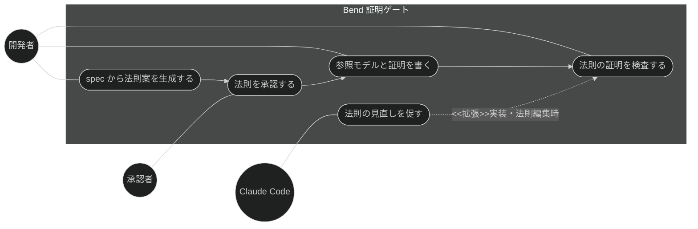

# Bend 証明ゲート 要求仕様書

**準拠する原則:** [CONSTITUTION.md](../../CONSTITUTION.md)（参照した版: `v2.0.0`）の B-001（承認ゲートで AI の自己採点による仕様の暗黙化を防ぐ）, B-002（proof の項目・結果・レポートは `SDD_LANG` で EN/JA 同等）, A-002（検査器の呼び出しは検証スクリプトへ委譲する。DC_003）, D-001（spec・design-draft を実装に先行させる）, D-002（法則ファイルは固定名、識別子はディレクトリ名）, D-003（`laws/` は永続ドキュメントとして扱う）

## 概要

本ドキュメントは、タスク・実装機能群（親 PRD: [index.md](index.md)）のうち、抽象仕様書（spec）の制約・不変条件・
事後条件を Bend の法則（law）として表現し、参照モデルがそれを満たすことを証明検査器で検証する
「Bend 証明ゲート」機能に対する要求仕様書である。

チェックリスト自動検証（[run-checklist.md](run-checklist.md)）の検証カテゴリに `proof` を追加する形で提供し、
spec（`.md`）を真実の源に残したまま、`${SDD_ROOT}/laws/{feature}/` 配下の法則ファイルを spec から
**一方向に派生**させる（ハイブリッド方式）。Bend は必須依存にせず、**opt-in** の品質ゲートとして位置づける。

本 PRD は GitHub issue #149（設計）の成果物であり、調査 issue #148（`.sdd` ドキュメントの Bend ファイル対応）と
issue #5 の調査コメント（`.sdd` の MCP 化・外部配置は採らない）の結論を前提とする。

SysML 要求図の記法（要求タイプ・リスクレベル・検証方法・関係タイプ）の凡例は
[PRD_TEMPLATE.md](../../PRD_TEMPLATE.md) のセクション 1 を参照。

---

# 1. 要求一覧

## 1.1. ユースケース図

## 1.2. 機能一覧（テキスト形式）

- Bend 証明ゲート
    - 法則ファイルの証明検査（`run-checklist` の `proof` カテゴリ）
        - 判定（PASS / FAIL / SKIPPED / TOOL_NOT_FOUND / TIMEOUT）と検証結果の記録
        - テレメトリ停止・外部 import 禁止・タイムアウト
        - Lean 形式化カーネルによる再検査（`--verdict`）の opt-in
    - 法則ファイルの配置と識別
        - `${SDD_ROOT}/laws/{feature}/` 配下の固定ファイル名（`LAWS.bend` / `PROOF.bend` / `main.bend`）
        - 先頭コメント規約（`# spec:` / `# model-of:` / `# approved:`）
    - spec からの一方向参照（front matter `laws:` / `laws-status:`）
    - 人による承認ゲート（未承認の法則は PASS にしない）
    - 法則の見直し促し（法則ファイル編集時・参照モデル対象の実装編集時のリマインド）
    - spec から法則案を生成する承認フロー（第 2 弾。本 PRD では境界のみ定義）

---

# 2. 要求図（SysML Requirements Diagram）

要求 ID は本ファイル内スコープで採番する。本ファイルの FR_001 は、
[index.md](index.md) の UR_003（体系的な品質検証）から派生し、
[run-checklist.md](run-checklist.md) の FR_001（チェックリスト自動検証）にトレースされる
（親 PRD の全体要求図では FR_006 として定義。本図には自ファイル内のノードのみを定義する）。

関係の読み方: `contains` は FR_001（ゲート本体）がその一部として FR_004（承認判定）を含むことを示す。他の FR・NFR・IR・DC は
本プロジェクトの記法規約どおり `制約・関連要求 - traces -> 対象要求` の向きで記載する。

```mermaid
%%{init: {'theme': 'dark'}}%%
requirementDiagram
    functionalRequirement ProofGate {
        id: FR_001
        text: "法則ファイルを証明検査器で検査し判定を記録する"
        risk: medium
        verifymethod: test
    }

    functionalRequirement LawsLayout {
        id: FR_002
        text: "法則ファイルを固定名で配置し先頭コメントで識別する"
        risk: low
        verifymethod: inspection
    }

    functionalRequirement SpecToLawsLink {
        id: FR_003
        text: "specのfront matterから法則を一方向に参照する"
        risk: low
        verifymethod: test
    }

    functionalRequirement ApprovalGate {
        id: FR_004
        text: "有効な承認行のない法則をPASSにしない"
        risk: medium
        verifymethod: test
    }

    functionalRequirement LawReviewReminder {
        id: FR_005
        text: "法則ファイルと参照モデル対象の実装の編集時に見直しを促す"
        risk: low
        verifymethod: test
    }

    functionalRequirement LawsDrafting {
        id: FR_006
        text: "specから法則案を生成し人が承認してからモデルと証明を書く"
        risk: medium
        verifymethod: demonstration
    }

    requirement OptionalDependency {
        id: NFR_001
        text: "証明検査器が無い環境でも検証全体が失敗しない"
        risk: medium
        verifymethod: test
    }

    requirement NoNetwork {
        id: NFR_002
        text: "検査はテレメトリを停止しネットワークに依存せず完結する"
        risk: medium
        verifymethod: test
    }

    requirement PassSemantics {
        id: NFR_003
        text: "PASSは参照モデルが法則を満たす保証であり実装の正しさではないと明記する"
        risk: medium
        verifymethod: inspection
    }

    interfaceRequirement VerificationContract {
        id: IR_001
        text: "判定は検証スクリプトのJSON契約とチェックリストIDに従って記録する"
        risk: low
        verifymethod: inspection
    }

    interfaceRequirement LawsConfig {
        id: IR_002
        text: "法則ディレクトリは設定ファイルのdirectories.lawsと環境変数で解決する"
        risk: low
        verifymethod: inspection
    }

    designConstraint NotRequired {
        id: DC_001
        text: "Bendを必須依存にせずCIにも導入しない"
        risk: medium
        verifymethod: inspection
    }

    designConstraint OneWayDerivation {
        id: DC_002
        text: "法則からPRDやspecを書き換えない"
        risk: high
        verifymethod: inspection
    }

    designConstraint ScopedInvocation {
        id: DC_003
        text: "証明検査器は検証スクリプト経由でのみ呼び出す"
        risk: medium
        verifymethod: inspection
    }

    designConstraint PlatformLimit {
        id: DC_004
        text: "WindowsはWSL経由のみ対応とし未対応環境では素通りする"
        risk: low
        verifymethod: inspection
    }

    ProofGate - contains -> ApprovalGate
    LawsLayout - traces -> ProofGate
    SpecToLawsLink - traces -> ProofGate
    LawReviewReminder - traces -> ProofGate
    LawsDrafting - traces -> SpecToLawsLink
    LawsDrafting - traces -> ApprovalGate
    OptionalDependency - traces -> ProofGate
    NoNetwork - traces -> ProofGate
    PassSemantics - traces -> ProofGate
    VerificationContract - traces -> ProofGate
    LawsConfig - traces -> LawsLayout
    NotRequired - traces -> OptionalDependency
    OneWayDerivation - traces -> SpecToLawsLink
    OneWayDerivation - traces -> LawsDrafting
    ScopedInvocation - traces -> ProofGate
    PlatformLimit - traces -> OptionalDependency
```

---

# 3. 要求の詳細説明

## 3.1. 機能要求

機能要求の優先度（MoSCoW）と実装段階は次のとおり。FR_001〜FR_005 は第 1 弾（本設計チケットの対象）、
FR_006 は第 2 弾（境界のみ定義し、実装は別チケット）である。

| 要求       | 優先度 | 段階   |
|:---------|:----|:-----|
| FR_001〜FR_004 | Must   | 第 1 弾 |
| FR_005   | Should | 第 1 弾 |
| FR_006   | Could  | 第 2 弾 |

### FR_001: 法則ファイルの証明検査（proof ゲート）

チェックリスト自動検証の検証カテゴリとして `proof` を提供し、対象 spec が参照する法則ディレクトリの
証明ファイルを Bend の証明検査器にかけ、結果を次の 5 状態で判定・記録する。

| 判定             | 意味                                                                          |
|:---------------|:----------------------------------------------------------------------------|
| PASS           | 承認済みの法則すべてについて証明が検査に合格した（参照モデルが法則を満たす）                           |
| FAIL           | 証明が検査に失敗した、証明ファイルが無い、または hub import（用語集参照）がある                        |
| SKIPPED        | 法則宣言ファイル（`LAWS.bend`）が無い、法則が未承認、または承認後に法則が変更され承認が失効している（失敗ではない）   |
| TOOL_NOT_FOUND | 証明検査器が導入されていない（失敗ではない）                                                   |
| TIMEOUT        | 検査が制限時間を超えた（手動確認が必要）                                                 |

判定は次の順で最初に該当したものを採用する: (1) 検査器不在 → TOOL_NOT_FOUND、(2) 法則ファイル無し → SKIPPED、
(3) 有効な承認行無し → SKIPPED（未承認・承認失効。FR_004）、(4) 証明ファイル無し、または hub import あり → FAIL、
(5) 検査器の結果により PASS / FAIL / TIMEOUT。未承認の法則は規約違反の有無を問わず検査対象にしない（承認前の
下書きに FAIL を出さない）。

検査器の呼び出しにはテレメトリ停止の環境変数を常に付与し、制限時間（既定 300 秒。設定で変更可）を設け、
Lean 形式化カーネルによる再検査は opt-in とする。再検査を要求したが再検査基盤（Lean）が無い場合は、通常検査の判定を返し、
再検査が未実施であることを結果に併記する（検査器自体の不在とは区別する）。[index.md](index.md) の UR_003 から派生し、[run-checklist.md](run-checklist.md) の FR_001 に
トレースされる（`proof` は同機能の検証カテゴリの 1 つとして動作する）。

**トリガー方式:** 手動（`/run-checklist` の実行、または `--category proof` 指定）

**検証方法:** テストによる検証

### FR_002: 法則ファイルの配置と識別

法則ファイルは `${SDD_ROOT}/laws/{feature}/` 配下に、固定ファイル名で配置する。

| ファイル          | 役割                                               | 作成者        |
|:--------------|:-------------------------------------------------|:-----------|
| `LAWS.bend`   | spec の制約・不変条件・事後条件を法則（law）として宣言する                 | AI が起草、人が承認 |
| `PROOF.bend`  | `LAWS.bend` を import し、各法則の証明を与える                  | AI         |
| `main.bend`   | 法則が述べる対象となる参照モデル（型・関数）。法則がモデル関数を参照しない自己完結の場合は省略できる | AI         |

Bend にはメタデータ構文が無いため、機能の識別子は**ディレクトリ名**（`{feature}`。階層 spec の場合は spec と同じ階層）に置き、
先頭コメント行で `LAWS.bend` に spec（`# spec:`）と承認（`# approved:`）を、`main.bend` に参照モデルが写す実装（`# model-of:`）を
記録する。法則ファイルに front matter は持たせない。

**検証方法:** インスペクションによる検証

### FR_003: spec からの一方向参照

spec の front matter に `laws:`（参照する法則ディレクトリのリスト。`${SDD_ROOT}` 相対）と
`laws-status:`（`none` → `drafted` → `approved` → `proven`）を持たせ、spec から法則ファイルへの参照を表現する。
法則は spec の派生物（下流）であり、`depends-on` の対象にはしない。`laws:` は依存関係ではなく、opt-in の判定と
法則ディレクトリの解決に使う**探索用ポインタ**であり、spec の上流依存を変えない。「front matter は下位ドキュメントへの
参照を持たない」という規約に対する意図的な例外として、この 1 フィールドに限って認める。
`laws-status` のうち `approved` / `proven` への遷移は人が行う（`drafted` は法則案生成スキルが付与してよい）。proof ゲートは PASS 時に `proven` への
遷移を**推奨として報告する**のみで、spec の front matter を含め spec / PRD を自動更新しない（DC_002）。
法則ファイル側から spec への参照は `# spec:` コメントのみとし、spec 本文を法則から再構成することはしない。

**検証方法:** テストによる検証（front matter 検証のルールとして
[front-matter-validation.md](../quality-guardrails/front-matter-validation.md) の機能で検証する）

### FR_004: 人による承認ゲート

`LAWS.bend` に有効な承認行（`# approved:` に承認日・承認者・承認時点の法則本文に対する内容ハッシュを含む行）が無い場合、
証明検査の結果にかかわらず PASS とせず SKIPPED（未承認）として記録する。承認後に `LAWS.bend` の法則本文が変更され
内容ハッシュが一致しなくなった場合、承認は失効したものとして同じく SKIPPED（承認失効）とする。
AI が生成した法則を AI 自身が証明して PASS を得る「自己採点」と、承認後に法則を弱めて PASS を得る抜け道を防ぐための
要求であり、承認行は人がレビューのうえ追記する（ゲートが検証できるのは承認行の有無と内容一致までであり、
承認者が人であることはレビュー運用で担保する）。ハッシュの算出方法は spec に委ねる。

**検証方法:** テストによる検証

### FR_005: 法則の見直し促し

法則ファイル（`.bend`）が編集されたときは proof ゲートの再実行を、`# model-of:` に記録された実装ファイルが
編集されたときは参照モデルと法則の見直しを、それぞれ非ブロッキングで促す。参照モデルと実装の乖離は証明では
検知できないため、編集直後のリマインドで緩和する。

**トリガー方式:** 自動（ファイル編集後のフック。促しの提供機能は
[stale-doc-detection.md](../quality-guardrails/stale-doc-detection.md)）

**検証方法:** テストによる検証

### FR_006: spec から法則案を生成する承認フロー（第 2 弾）

AI が spec の制約事項・機能要件表から `LAWS.bend` の案を生成し（`laws-status: drafted`）、人が内容を承認して
`# approved:` 行を追記し（`approved`）、そのうえで AI が参照モデル（`main.bend`）と証明（`PROOF.bend`）を書く
（検査合格後、人が `proven` に更新する）。生成は spec → 法則の一方向のみで、法則から spec・PRD を書き換えない（DC_002）。

本 PRD では境界（入力・出力・状態遷移）のみ定義し、生成スキルの実装は別チケットで扱う。

**検証方法:** デモンストレーションによる検証

## 3.2. 非機能要求

### NFR_001: 任意依存

証明検査器（`bend`）が導入されていない環境では `proof` カテゴリを TOOL_NOT_FOUND または SKIPPED として
記録し、チェックリスト検証全体を失敗させない。検査器の不在は品質ゲートの不合格ではない。

**検証方法:** テストによる検証

### NFR_002: ネットワーク非依存

検査器の呼び出しには常にテレメトリ停止の環境変数を付与し、法則ファイルが hub import（法則ディレクトリ外を指す import。
Bend Hub 名前空間・URL を含む）を含む場合は検査器を実行せず規約違反として扱う。許可する import は、同じ法則ディレクトリ内に
実在するファイルへの相対 import と、Bend に同梱される標準ライブラリ（`Base`）に限る。検査結果は
オフラインで再現できること。

**検証方法:** テストによる検証

### NFR_003: PASS の意味の明示

検証結果・レポート・スキル説明・利用者向けドキュメントにおいて、「PASS は参照モデルが法則を満たすことの保証であり、
対象プロジェクトの実装（TypeScript / Python / Go 等）の正しさの保証ではない」ことを明記する。

**検証方法:** インスペクションによる検証

## 3.3. インターフェース要求

### IR_001: 検証契約とチェックリスト ID

`proof` の判定は、チェックリスト自動検証の検証スクリプトが返す結果契約（判定・理由・出力要約）に従って表現し、チェックリストでは仕様レビューカテゴリ（`CHK-2xx`）の項目として記録する。
対応する項目は、spec が `laws:` を持つ場合にのみ生成し、優先度は P2 以降とする（P1 にはしない）。

**検証方法:** インスペクションによる検証

### IR_002: 法則ディレクトリの解決

法則ディレクトリ名は `.sdd-config.json` の `directories.laws`（既定 `laws`）で設定でき、
他のディレクトリと同様に `SDD_LAWS_DIR` / `SDD_LAWS_PATH` 環境変数として解決できること。

**検証方法:** インスペクションによる検証

## 3.4. 設計制約

### DC_001: Bend を必須依存にしない

Bend は opt-in の品質ゲートであり、プラグインの必須依存にしない。本リポジトリの CI にも bend 本体を
導入しない（npm / node 非依存の方針を維持する）。

**検証方法:** インスペクションによる検証

### DC_002: 一方向派生（PRD / spec 非自動化）

法則ファイルは spec から一方向に派生させる。法則や証明結果から PRD・spec の本文および front matter を書き換えてはならない
（[AI-SDD-PRINCIPLES.md](../../AI-SDD-PRINCIPLES.md) の「PRD は自動化しない」原則）。spec と法則の矛盾は
報告し、人が spec の修正か法則の修正かを判断する。

**検証方法:** インスペクションによる検証

### DC_003: スコープ付きの呼び出し

スキルが `bend` を呼び出す経路は、チェックリスト自動検証の検証スクリプト（事前承認された単一のスコープ付き
Bash 呼び出し）に限定する。スキルがベアな Bash で `bend` を直接実行する設計にしない。

**検証方法:** インスペクションによる検証

### DC_004: プラットフォーム制限

Bend は macOS / Linux のみ対応で、Windows は WSL 経由に限る。未対応環境では検査器不在として
TOOL_NOT_FOUND で素通りし、プラットフォーム固有の分岐を設けない。

**検証方法:** インスペクションによる検証

---

# 4. 前提条件

- 対象プロジェクトで sdd-workflow プラグインが有効化され、`.sdd/` ディレクトリが初期化済みであること
- 法則の対象となる spec（`*_spec.md`）が存在し、front matter を持つこと（`laws:` / `laws-status:` を付与できること）
- 証明検査を実行する開発者の環境に Bend（調査時点の版 v2.0.37。判定表はこの版の終了コード・出力で実測した）が導入されていること
  （未導入でも他カテゴリの検証は動作する）
- Lean 形式化カーネルによる再検査（opt-in）は、Bend が要求する固定版の Lean（v4.34.0）が導入された環境でのみ有効になる
- チェックリスト（`checklist.md`）が生成済みであること（[checklist-generation.md](checklist-generation.md)）

---

# 5. 制約事項

## 5.1. 技術的制約

- 証明検査器（`bend`）は対象プロジェクト環境への導入に依存し、必須依存にしない。本リポジトリの CI にも導入しないため、
  判定ロジックのテストは検査器の終了コード・出力を模したスタブと純粋な判定表に対して行う（`verifymethod: test` の実行方法）
- `.sdd-config.json` の `directories.laws` は AI-SDD の既定ディレクトリ体系（requirement / specification / adr / task）を
  拡張する。既定値 `laws` を持ち、未設定のプロジェクトに影響しない
- 法則で表現できるのは spec の制約・不変条件・事後条件（純粋な性質）に限る。IO・外部境界・性能は対象外（issue #148）

## 5.2. ビジネス的制約

- B-001 原則（Vibe Coding 防止）に従い、承認行の無い法則を PASS にしない。AI は承認行を書かない
- B-002 原則（多言語対応の一貫性）に従い、`proof` のチェックリスト項目・結果・レポートは `SDD_LANG` で EN/JA 同等の構成を維持する
- D-001 原則（Specification-Driven）に従い、spec を正典とし法則は一方向の派生物に留める（DC_002）
- D-003 原則（ドキュメント永続性ルール）に従い、`laws/` は `task/` と異なり**永続**ドキュメントとして扱い、spec と同じ
  ライフサイクルで保守する（spec の廃止時に合わせて削除する）

---

# 6. スコープ外

以下は本 PRD のスコープ外とします：

- `.sdd` ドキュメント（PRD・ADR・CONSTITUTION・task）の Bend ファイルへの置き換え（調査 issue #148 の結論により不可）
- 対象プロジェクトの実装コード（TypeScript / Python / Go 等）そのものの正しさの証明（参照モデルと実装の乖離は検知しない）
- `.sdd` の MCP 化・外部配置（issue #5 の調査コメントにより採らない）
- 証明検査器（Bend）および Lean の提供・インストール（対象プロジェクトの環境構築に委ねる）
- チェックリストの生成そのもの（[checklist-generation.md](checklist-generation.md) で扱う）・`proof` 以外の検証カテゴリ
  （[run-checklist.md](run-checklist.md) で扱う）
- front matter の形式検証の実行（[front-matter-validation.md](../quality-guardrails/front-matter-validation.md) で扱う。
  本 PRD は検証対象となるフィールドの意味を定義する）
- 法則ファイル配下の命名規則の書き込み時ブロック（[naming-enforcement.md](../quality-guardrails/naming-enforcement.md) の対象に含めない。
  固定ファイル名の不備はゲート実行時の SKIPPED / FAIL の理由として報告する）

---

# 7. 用語集

| 用語            | 定義                                                                                   |
|:--------------|:-------------------------------------------------------------------------------------|
| 法則（law）      | Bend の `law` 宣言。spec の制約・不変条件・事後条件を、参照モデルの関数についての命題として表現したもの                   |
| 証明（proof）    | `law` と同名の定義として与える証明。証明検査器が検査する                                                  |
| 参照モデル        | 法則が述べる対象として Bend で書いた型・関数（`main.bend`）。対象プロジェクトの実装を写したものであり実装そのものではない          |
| 証明検査器        | `bend` CLI。全法則が証明済みなら成功、それ以外（証明失敗・構文エラー）は失敗を返す                               |
| 承認（approved） | 人が `LAWS.bend` の内容をレビューし、承認日・承認者・内容ハッシュを含む `# approved:` 行を追記すること。未承認・承認失効の法則は PASS にしない |
| `--verdict`   | Lean 形式化カーネルで証明を再検査する bend CLI のオプション。Lean 不在時は通常検査の判定を返し、再検査未実施を併記する（検査器不在の TOOL_NOT_FOUND とは区別する） |
| hub import    | 法則ディレクトリ外を指す import（Bend Hub 名前空間・URL・親ディレクトリや絶対パス、ディレクトリ内に実在しないファイル名を含む）。Bend 同梱の標準ライブラリ（`Base`）は除く。ゲートでは規約違反（FAIL）として扱う |
| laws-status   | spec の front matter フィールド。法則の状態（`none` → `drafted` → `approved` → `proven`）を表す。法則本文の改訂・承認取消・再検査の失敗で後退しうる |
