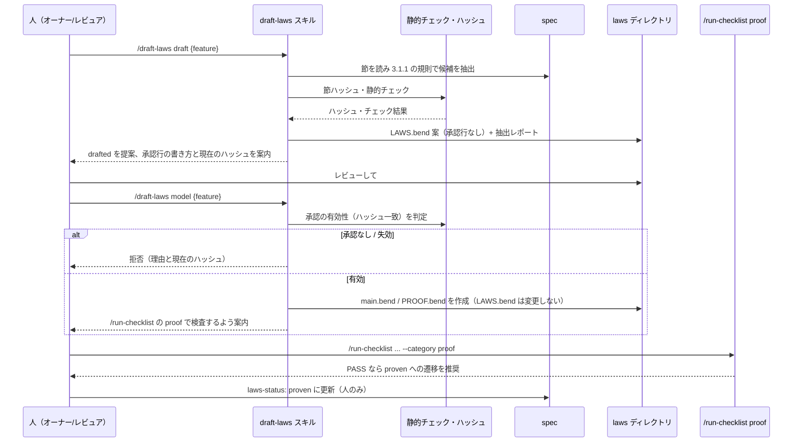

# 法則案の生成と承認フロー

**関連 ADR:** [proof-gate.md](../../adr/task-implementation/proof-gate.md)（2026-10-19 の第 2 弾の決定）
**関連 PRD:** [proof-gate.md](../../requirement/task-implementation/proof-gate.md)（FR_006。親: [task-implementation](../../requirement/task-implementation/index.md)）
**関連 spec:** [proof-gate_spec.md](proof-gate_spec.md)（第 1 弾。法則ディレクトリ・先頭コメント規約・判定表・`laws-status` の定義元。同 spec の FR-010 が境界定義を本 spec に委ねる）,
[front-matter-validation_spec.md](../quality-guardrails/front-matter-validation_spec.md)（`laws:` / `laws-status:` の検証）,
[stale-doc-detection_spec.md](../quality-guardrails/stale-doc-detection_spec.md)（見直しリマインド）
**準拠する原則:** [CONSTITUTION.md](../../CONSTITUTION.md)（参照した版: v2.0.0）A-001（Skills-First）, A-002（フックとスクリプトの責務分離）, B-001（Vibe Coding 防止）, B-002（多言語対応の一貫性）, D-001（Specification-Driven）, D-002（ファイル命名規則の厳守）, D-003（ドキュメント永続性）, T-002（plugin.json 登録の徹底）

---

# 1. 背景

第 1 弾（[proof-gate_spec.md](proof-gate_spec.md)）で、法則ファイルを置けば `/run-checklist` の `proof` カテゴリが検査する
仕組みが完成した。ただし法則ファイル（`LAWS.bend` / `main.bend` / `PROOF.bend`）は手で書く運用のままで、
dogfooding 用の法則 5 件も手書きである。第 2 弾は、spec から法則案を生成して人の承認に回し、承認後に
参照モデルと証明を書く工程を定義する（PRD FR_006）。

最大の危険は第 1 弾と同じ「自己採点」である。AI が法則を生成し、AI が承認し、AI が証明すれば PASS が空虚になる。
本 spec は、生成を `drafted` で止め、承認を人に残し、承認後の工程を承認の内容ハッシュで束縛することで、この経路を作らない。

# 2. 概要

新規スキル `/draft-laws`（仮称。スキル名は実装チケットで確定。以降の `draft-laws` も同じ）を提供する。`laws-status` の遷移と 1 対 1 に対応する
3 段階の工程のうち、AI が担う `draft` と `model` の 2 つをスキルのサブコマンドとして持ち、間の「承認」と最後の「昇格」は人の作業である（下表 4 行のうち 2 行がサブコマンド）。

| 段階（サブコマンド） | 入力の前提 | 出力 | 遷移 | 主体 |
|:--|:--|:--|:--|:--|
| `draft` | spec が存在する | `LAWS.bend` 案（承認行なし）と抽出レポート。`laws:` / `laws-status: drafted` は提案 | `none` → `drafted` | AI（提案）／人（front matter への適用） |
| （承認） | `drafted` の `LAWS.bend` | `# approved:` 行の追記 | `drafted` → `approved` | **人のみ** |
| `model` | 承認行が有効（内容ハッシュ一致） | `main.bend` と `PROOF.bend` | `approved` のまま | AI |
| （検査・昇格） | `PROOF.bend` | `/run-checklist` の `CHK-205` の判定 | `approved` → `proven` | 検査は run-checklist、遷移は**人のみ** |

主要な設計原則は以下のとおり。

- **spec が正典、生成は一方向**: spec → 法則案のみ。法則・抽出結果から spec・PRD を書き換えない（PRD DC_002）
- **承認行は AI が書かない**: 生成物に `# approved:` を置かない。スキルは `--print-laws-hash` の値と書き方を案内するだけに留める
- **機械的に等式化できるものだけを法則にする**: 散文の要件は法則にせず、法則化しない理由を抽出レポートに残す
- **bend は必須依存にしない**: `draft` と静的検査は `bend` 無しで動く。`bend` を要するのは `/run-checklist` 側の検査だけである
- **新しい検証経路を作らない**: 検査・判定は第 1 弾の `proof` カテゴリに委ね、本スキルは `bend` を呼ばない

# 3. 要求定義

## 3.1. 機能要件 (Functional Requirements)

優先度「必須」は、第 2 弾（本 spec の実装チケット）を実装する際の必須を指す。上流の PRD FR_006 は Could であり、第 2 弾自体が任意機能である。

| ID | 要件 | 優先度 | 根拠（上流要求） |
|:--|:--|:--|:--|
| FR-001 | `/draft-laws draft <spec>` は、対象 spec から 3.1.1 の抽出ルールで法則候補を抽出し、`${SDD_LAWS_PATH}/{feature}/LAWS.bend` の案と抽出レポートを出力する。承認行は書かない | 必須 | PRD FR_006 |
| FR-002 | `LAWS.bend` 案の先頭コメントは `# spec: <spec の id>` を持ち、承認行を持たない。spec の front matter への `laws:`（`${SDD_ROOT}` 相対）と `laws-status: drafted` の追加は**提案に留め**、スキルは spec を書き換えない（PRD DC_002。第 1 弾 FR-008 の「`drafted` は生成スキルが付与してよい」は許可であり、本スキルは行使しない）。適用は人が行う。`laws:` を追加するまでは、第 1 弾の判定表 #4（孤児 laws → FAIL）が #5（承認なし → SKIPPED）より先に評価されるため、`drafted` の `LAWS.bend` は `laws:` 追加後に初めて SKIPPED になる。抽出レポートにこの順序を注記する | 必須 | 第 1 弾 FR-008・判定表 #4/#5・PRD DC_002 |
| FR-003 | 各法則は、法則宣言の直前に `# source: <spec の id> §<節番号> sha256:<節本文の内容ハッシュ先頭 12 桁>` を持つ。出典コメントは法則本文側に置くため、第 1 弾 FR-004 の内容ハッシュの対象に含まれる | 必須 | Q5（2026-10-19 オーナー承認） |
| FR-004 | 法則候補が既定上限（10。`.sdd-config.json` の `laws.max_laws` で変更可）を超える場合、3.1.2 の優先順位で上位を採用し、超過分を抽出レポートの「未採用の候補」節に理由付きで残す。黙って捨てない | 必須 | Q3 |
| FR-005 | 法則化できる性質が 1 件も無い spec は、`LAWS.bend` を作らず、抽出レポートに「法則化しない理由」を節ごとに残して正常終了する（失敗ではない。`LAWS.draft.bend` も作らず、既存の `LAWS.bend` にも触れない）。spec が存在しない・読めない場合のみ失敗とする | 必須 | ADR 2026-10-19（Q1・Q3） |
| FR-006 | 生成後に静的チェック（`bend` 不要）を実行し、結果を抽出レポートに併記する。チェックは 3.1.3 の 7 項目（および `# model-api:` 行の有無・`Model.*` 参照との整合の確認。欠落・不整合は error）で、適用範囲は `draft` が出力した法則案に限る（第 1 弾の手書き法則には適用しない）。error があれば `LAWS.bend` 案は出力するが `drafted` 付与を提案しない | 必須 | Q5 |
| FR-007 | `/draft-laws model <spec>` は、`LAWS.bend` に有効な承認行（第 1 弾 FR-004。内容ハッシュ一致）が無ければ**拒否**し（前提は承認行の有効性のみ。spec の `laws-status` が `approved` でなければ warning として併記するが、拒否の条件にはしない）、理由（承認行なし / 形式不正 / ハッシュ不一致と現在のハッシュ）を返す。spec に `laws:` が無い、または当該ディレクトリを指していない場合も、拒否はせず warning（孤児 laws として第 1 弾の判定表 #4 で FAIL になる旨）を併記する。有効なら `main.bend`（`# spec:` / `# model-of:` 付き）と `PROOF.bend` を書く | 必須 | Q4 |
| FR-008 | `model` 段階は `LAWS.bend` を変更しない。法則の誤りに気付いた場合は、変更せずに指摘として返し、法則の改訂は人が行う（本文が変わるとハッシュが変わり承認は失効する）。`draft` の再実行は、承認行を持つ `LAWS.bend` を**上書きしない**: 差分を抽出レポートに出すだけとし、人が採用を決める。承認行の無い案も既定では温存し、再生成案は `LAWS.draft.bend` に出力する（上書きは明示オプション `--overwrite` のときだけ。承認行を持つ場合は `--overwrite` でも拒否する）。`LAWS.draft.bend` は人が採用または削除するまで残り、第 1 弾 FR-005 の静的検査と見直し促しの対象になる。モデルが実装すべき関数シグネチャ（固定の優先順位は 3.1.4。法則が参照する `Model.*` の関数名・引数の型と順序・戻り値の型、および数値の符号化）は、`draft` が `LAWS.bend` の本文に `# model-api:` コメント行として書き、抽出レポートの「モデル API」節にも列挙する。`# model-api:` は本文側なので内容ハッシュの対象になり、承認時に人が確認する。`model` 段階はこの行（と `LAWS.bend` の `Model.*` 参照）だけを入力とし、レポートや `task/` の一時ファイルには依存しない。`LAWS.draft.bend` にも FR-006 の静的チェックを適用する。`PROOF.bend` は第 1 弾 FR-005 の import 許可形式（`import ./LAWS.bend as Laws` と `import Base`）だけを使う。なお `LAWS.draft.bend` は正本ではないため、孤児検査と `# spec:` 照合の対象外である（[front-matter-validation_spec.md](../quality-guardrails/front-matter-validation_spec.md) FR-009）。 | 必須 | Q4・第 1 弾 FR-005 |
| FR-009 | スキルは `# approved:` 行・`laws-status: approved` / `proven` を書かない。承認が必要な時点では、`--print-laws-hash` で得た現在のハッシュと、承認行の書式（`# approved: YYYY-MM-DD <承認者> sha256:<12 桁>`）を案内する | 必須 | 第 1 弾の決定（承認行は AI が書かない） |
| FR-010 | `bend` が PATH に無い環境でも `draft` と静的チェックは動作する。`model` 段階で作った `PROOF.bend` の検査は `/run-checklist` に委ね、`bend` 不在は第 1 弾の TOOL_NOT_FOUND として扱う。本スキルが `bend` を直接呼ぶことはない | 必須 | 第 1 弾 NFR-001 |
| FR-011 | spec の変更時に法則の見直しを非ブロッキングで促す。既存の `.bend` 編集時・`# model-of:` 編集時の促し（第 1 弾 FR-009）に加え、`laws:` を持つ spec の編集時に「`# source:` の節ハッシュが現在の spec と一致しない法則がある場合は `draft`（再抽出）を検討する」旨を促す。節ハッシュの計算は、フックから import できる共有モジュールに置く（A-002）。stale-doc-detection_spec FR-009（spec 編集時の再抽出の促し）と front-matter-validation_spec FR-009（`LAWS.draft.bend` の扱い）の追従は #173 で済み | 必須 | ADR 2026-10-19（Q5）・第 1 弾 FR-009 |
| FR-012 | 抽出レポート（`${SDD_ROOT}/task/{ticket}/laws-draft-report.md` または標準出力）は、採用した法則、モデル API（FR-008）、未採用の候補、法則化しない理由、静的チェックの結果を `SDD_LANG` に従い en / ja で出力する | 必須 | 原則 B-002 |
| FR-013 | proof ゲート（`CHK-205`）は、`# source:` を持つ法則について節ハッシュと現在の spec の該当節のずれを検出し、**warning** として結果に併記する。承認は失効させず、PASS も止めない（非ブロッキング）。`# source:` を持たない法則（第 1 弾の手書き法則）は対象外。判定表（第 1 弾 3.1.1）の判定・集約は変えない。条件: 有効な承認行を持つディレクトリ（#5 を通過したもの）のみで評価する（`drafted` で SKIPPED のものは対象外。生成直後の不一致は静的チェック #1 の error）。出力: `run-verification.py proof` の各ディレクトリの結果に任意の `warnings` 配列（要素は `{"code": "source_drift", "law": <法則名>, "source": <節>}`）を加える追加フィールド（既存フィールドは不変）。`CHK-205` の結果欄に件数と該当法則を `SDD_LANG` の文言で併記する。`source` は `§` を除いた節番号（例: `3.1.1`）。節が消えた・番号が変わった場合もずれに含め、`# source:` の書式が不正なものは warning として別コード（`source_invalid`）で報告する。`bend` 不在（判定表 #1 の TOOL_NOT_FOUND）の環境では検査器を起動しないため `warnings` は出さない（節ハッシュの検査は `draft` 側の静的チェックとフックが担う） | 必須 | オーナー判断（2026-10-19）・Q5 |

### 3.1.0. 状態別の挙動（FR-001・FR-007・FR-008）

| 現在の状態（`LAWS.bend` / 承認行 / `main.bend`・`PROOF.bend`） | `draft` | `model` |
|:--|:--|:--|
| 法則ディレクトリなし（`none`） | 新規作成 | 拒否（`LAWS.bend` なし） |
| `LAWS.bend` あり・承認行なし（`drafted`） | 既定は温存し、再生成案を `LAWS.draft.bend` に出力して差分を表示。`--overwrite` のときだけ `LAWS.bend` を上書き | 拒否（承認行なし） |
| 承認行が有効（`approved`） | `LAWS.bend` は一切触らない（`--overwrite` でも拒否）。再生成案は `LAWS.draft.bend` に出力し差分を報告 | `main.bend` / `PROOF.bend` を作成。既存があれば上書きせず、差分を報告する |
| 承認行はあるが内容ハッシュ不一致（承認失効） | `approved` と同じ（承認行を持つ `LAWS.bend` は触らない） | 拒否（現在のハッシュを案内） |
| `proven`（承認行が有効で検査済み） | `approved` と同じ | `approved` と同じ |

挙動を決めるのは承認行とその内容ハッシュだけで、spec の front matter の `laws-status` は表示用であり判定に使わない。承認行を持つ `LAWS.bend` はどの段階でも AI が上書き・削除しない。spec の `laws-status` が承認行の状態と食い違う場合（例: 承認行ありで `drafted` のまま）は warning として併記する。承認後に `laws-status: approved` へ更新するのは人である（FR-009 の案内に含める）。

### 3.1.1. 抽出ルール（FR-001）

| 優先 | 抽出元（spec の節） | 法則化する性質 | 法則化しないもの |
|:--|:--|:--|:--|
| 1 | 判定表・状態遷移（行の順序、最初の一致を採用する規則） | 判定の単調性・順序（「ある行に該当すれば、それより下の行に関わらずその判定」）、特定入力での固定判定 | 外部プロセスの出力解析・文字列整形そのもの |
| 2 | 集約規則（最悪判定、優先順位、空入力の扱い） | 結合律・可換律・単一要素の不動・空入力の結果 | 集約の表示形式 |
| 3 | 制約事項・不変条件（「〜しない」「〜でなければならない」形の純粋な性質） | 状態・値に関する不変条件（決定的な関数で書けるもの） | IO・ネットワーク・ファイルシステム・時刻に依存するもの |
| 4 | 非機能要件・制約事項の数値目標 | 数値の境界（上限・下限・倍率）を満たす値の関係 | 性能・応答時間などの実測値 |

機能要件表（FR 表）の散文は、判定表・集約規則・制約事項に同じ内容が構造化されている場合のみ、その構造化された節から抽出する。
FR 表の文言のみを根拠に法則を作らない（等式にできず、解釈の揺れから幻覚法則を生むため）。

**順位の表し方**: 固定 API（3.1.4）に順位を返す定数関数（`rank_pass()` / `rank_skipped()` / `rank_fail()` など）がある場合、法則は数値リテラル（`1n`・`4n`）ではなくその関数（`Model.rank_skipped()`）で書く。固定 API に無い場合だけリテラルを使い、符号化を `# model-api:` に注記する。どちらかに揃える（同じ法則の中で混ぜない）。検収の比較（§11）は、`main.bend` の定数関数をリテラルに読み替えるので、どちらの書き方でも一致する。

**集約関数を先に書く**: 固定 API（3.1.4）に集約関数（例: `Model.aggregate`）があり、その下位に二項演算（例: `Model.worse`）がある場合、交換則・単位元・空入力・単一要素の性質は、まず**集約関数の側**で書く（例: `aggregate([a, b]) == aggregate([b, a])`。`worse(a, b) == worse(b, a)` ではない）。二項演算の側の同種の性質は、上限（3.1.2）に余裕があるときだけ追加する。候補には `level: "binary"` を付ける（集約関数の側は付けない）。

**値域の前提**: 法則は `for x: Nat` のように Nat 全域を量化する。順位などの有限な値だけで成り立つ吸収律・固定値の等式
（例: `worse(4n, a) == 4n` は `a > 4` で偽）を、値域の制限なしに立てない。値域を型や引数の形で閉じられない性質は法則化せず、
抽出レポートの「未採用の候補」に理由（`unbounded_nat`）つきで残す（3.1.3 の検査 7 が残りを警告する）。

### 3.1.2. 上限と優先順位（FR-004）

1. 3.1.1 の優先順（1 → 4）で採用する。同一優先内は、基本的な性質（候補の `kind` が `commutative`（交換則）・`associative`（結合則）・`identity`（単位元）・`empty`（空入力）・`singleton`（単一要素）のもの）を先に採り、そのあと spec の節番号順、最後に名前順。上限で切るときに基本的な性質より狭い性質が残らないようにする。ただし集約関数がある場合に二項演算の側で書いた候補（`level` が `binary`）は、同一優先内の最後に回す（3.1.1「集約関数を先に書く」）
2. 次の候補は**自明法則**として採用しない（抽出レポートの「未採用」に理由を残す）: 恒真（`x == x`）、定義の言い換え（モデル関数の本体をそのまま等式にしたもの）、入力の型だけで決まる性質
3. 同じ命題を表す法則は 1 つにまとめる（重複の除去。3.1.3 の検査 3）
4. 上限超過は採用数を打ち切り、残りは優先順位つきで「未採用の候補」に残す

### 3.1.3. 静的チェック（FR-006。`bend` 不要）

| # | 検査 | 重大度 | 内容 |
|:--|:--|:--|:--|
| 1 | 出典の実在 | error | すべての `# source:` の節番号が spec に実在し、`draft` 直後は節ハッシュが現在の spec の該当節と一致する（生成時点の不一致は生成の不具合）。承認後に spec が変わって生じた不一致は、ゲート・フックでは warning（FR-011・FR-013） |
| 2 | 出典の欠落 | error | `draft` が出力した法則案で `law` 宣言が `# source:` を持たない（第 1 弾の手書き法則には適用しない） |
| 3 | 重複 | warning | 空白を正規化した本体が同一の法則が複数ある |
| 4 | 自明法則 | warning | 等式の両辺が構文的に同一（恒真。例: `x == x`）。定義の言い換えは `draft` 時点でモデルが無いため判定せず、抽出時の LLM 判断と `model` 段階の指摘に委ねる |
| 5 | import 許可形式 | error | 第 1 弾 FR-005 の許可形式以外の import が無い（`bend` 実行前の静的検査を再利用）。ただし `draft` 時点では `main.bend` が未作成なので、`import ./main.bend as Model` に限り存在しなくても許容する（`model` 段階で作る。ゲートは `PROOF.bend` 作成後にのみ #8 で評価する） |
| 6 | 固定 API 外のモデル参照 | error | 3.1.4 で固定された API（spec の宣言、無ければ既存 `main.bend`）がある場合、法則本文の `Model.*` 参照と `# model-api:` 行が固定済みの関数だけであること。固定が無い（`unfixed`）ときは検査しない。固定元が壊れている場合（`main.bend` があるのに `def` を 1 件も読めない = `main.bend-unreadable`）は、検査 6 を行えないため warning `model_api_source_unreadable` を出す。`# model-api:` 行の引数の個数・型が固定済みシグネチャと違うときは warning `model_api_signature_mismatch` |
| 7 | 値域の前提のない Nat 等式 | warning | `for n: Nat` の変数を引数に含むモデル呼び出しと Nat リテラル（`4n` など）の等式。Nat 全域で偽になりうる。`bend` が無いため偽の判定はできず、ヒューリスティックとして警告し、承認前の人のレビューに回す（`drafted` 付与の提案は止めない）。定数側はリテラルを `+` / `*` と括弧でつないだ式（`4n`・`(4n)`・`3n + 1n`）。素の `0n` は対象外。変数宣言は `for a: Nat` と `for a, b: Nat`。限界: Model 以外の関数を挟んだ変数、2 つのモデル呼び出しの比較、Nat 以外の型は見ない |

### 3.1.4. モデル API の固定（FR-008）

`draft` が書く `# model-api:` と法則が参照する `Model.*` は、再現のたびに揺れないよう、次の優先順位で固定する。

| 優先 | 固定元 | 内容 |
|:--|:--|:--|
| 1 | spec の宣言 | spec 本文（コードブロック内でもよい）の行頭 `model-api: Model.<関数>(<引数>) -> <戻り値>`（`#` を付けない）。関数ごとに 1 行。符号化の注記は行末のコメントに書く |
| 2 | 既存 `main.bend` | 最上位の `def`（`main` を除く）のシグネチャ。`Model.<関数>` として使える |
| 3 | 未固定（`unfixed`） | 固定元が無い。`draft` が API を提案し、抽出レポートに「未固定・要確認」と明記する。承認時に人が確認する |

`draft_laws.py model-api <feature>` が固定元・関数・シグネチャを返す（書き込みなし）。`draft` は固定済みの関数だけを使い、
固定済みの API に無い関数（別のモデル関数や空入力用の関数を新設した案）は静的チェックの検査 6 で error になる。
固定済み API を広げる場合は spec の宣言または `main.bend` を人が更新する。

`draft_laws.py check` は、`--feature <feature> [--project-root <dir>]` を渡すと、`status` / `model-api` と同じ方法（feature の spec と laws ディレクトリの `main.bend`）で固定 API を解決する。法則案をリポジトリ外に置いて検査するときは必ず渡す。渡さない場合は法則ファイルの隣の `main.bend` と `--spec` の宣言だけを見る。固定 API が得られない（`unfixed`）ときは、結果の `model_api.source` と `notes` で検査 6 が動かなかったことを明示する。

- spec が 1 関数でも宣言していれば、`main.bend` は参照せず、両者をマージしない（spec の宣言が API の全体になる）。宣言していない関数を使いたいときは spec に追記する
- 同じ関数を spec が複数行で宣言した場合は最初の行を採用し、検査で warning `model_api_duplicate` を出す
- `main.bend` の `def` は、インデント付き・型引数付き（`def f<T>(...)`）・複数行にわたるシグネチャも読む。読めない場合は上記の `main.bend-unreadable`（「固定元が無い」とは区別する）

## 3.2. 非機能要件 (Non-Functional Requirements)

| ID | カテゴリ | 要件 | 目標値 |
|:--|:--|:--|:--|
| NFR-001 | 任意依存 | `bend` が無くても `draft` と静的チェックが動作する | `bend` の有無で `draft` の結果が変わらない |
| NFR-002 | 決定性 | 静的チェック（3.1.3）と内容ハッシュ・節ハッシュの計算は決定的なスクリプトが行い、LLM に委ねない | A-002 |
| NFR-003 | 権限最小化 | スキルは `bend` を呼ばず、ベアな Bash を持たない。内容ハッシュは draft-laws 側のスクリプト（`laws_header.py` を再利用）で得て `allowed-tools` に宣言する。書き込みは `${SDD_LAWS_PATH}` 配下と抽出レポートに限定する | 第 1 弾 NFR-006 |
| NFR-004 | 多言語 | スキルの出力・テンプレート・レポートの文言を `SDD_LANG` で切り替え、単一文書内で混在させない | en / ja |
| NFR-005 | 再現性 | 候補の抽出は LLM の判断であり集合の同一性は保証しない。保証するのは、与えられた候補集合に対する整列・上限での打ち切り・静的チェックの結果が決定的であること | 同じ候補集合なら同じ順序・同じ採否。§11 の検収は、固定のプロンプト・入力での 1 回以上の再現確認で行う |

# 4. 提供コンポーネント

| 種別 | 名称 | 責務 |
|:--|:--|:--|
| スキル | `draft-laws`（仮称） | `draft` / `model` の 2 サブコマンド（承認と昇格は人の作業でサブコマンドを持たない）。抽出（LLM の判断を要する部分）とファイル書き出し |
| スクリプト | `skills/draft-laws/scripts/`（名称は実装で確定） | 節ハッシュ計算（フックと共有する `scripts/` 配下の共有モジュール。`laws_header.py` と同じ場所）、静的チェック（3.1.3）、承認有効性の判定（`laws_header.py` を再利用）、候補一覧の決定的な整列 |
| 既存スクリプト | `run-verification.py`（`proof`） | FR-013 の `warnings` 追加（出力は加算のみ。判定・集約は不変） |
| 既存テンプレート | run-checklist の結果フォーマット（en/ja） | `CHK-205` の warning 文言（FR-013） |
| フック | `post-tool-use.py` | FR-011 の見直し促し（`laws:` を持つ spec の編集時） |
| テンプレート | `skills/draft-laws/templates/{en,ja}/` | `LAWS.bend` 案の先頭コメント、`main.bend` / `PROOF.bend` の雛形、抽出レポート |

`plugin.json` の更新は不要（`skills` は宣言しない。T-002）。エージェントは新設しない。

## 4.1. 入出力定義

### `LAWS.bend` 案（`draft` の出力）

```
# spec: spec-task-implementation-proof-gate
#
# Laws drafted from the spec. NOT approved: a human adds the approval line
# (# approved: YYYY-MM-DD <approver> sha256:<hash>) after review.

import Base
import ./main.bend as Model

# model-api: Model.judge(approved: Bool, exit_ok: Bool, marker: Bool) -> Nat  # ranks: PASS=0 SKIPPED=1 FAIL=4

# source: spec-task-implementation-proof-gate §3.1.1 sha256:<節ハッシュ>
law unapproved_never_pass:
  for e: Bool
  for m: Bool
  {Model.judge(False{}, e, m) == 1n : Nat}
```

- 先頭コメント部は第 1 弾の規約（`laws_header.py` の実装どおり、ファイル先頭から最初の非コメント・非空行の直前まで。途中の空行を含む）に従い、内容ハッシュの対象外とする。承認行は人がこの先頭コメント部の末尾（`import` の前の空行より上）に追記する
- `# source:` は先頭コメント部の**外**（`import` より後）に置く。したがって内容ハッシュの対象になり、出典の変更は承認の失効を伴う
- 節ハッシュは spec の該当節の本文（見出し行の次から、次の同階層以上の見出しの直前まで。子節は含む）を、各行の前後空白を除去し連続する空行を 1 つにまとめて正規化した後の sha256 先頭 12 桁。節番号は見出しの先頭の番号（末尾のピリオドは無視）で解決し、番号の無い見出しの節は出典にできない（その性質は抽出レポートの「法則化しない理由」に回す）

### 引数とレポートの出力先

`/draft-laws draft <feature>`（`<feature>` は spec の feature 名。階層は `parent/child`）。`--ticket <n>` があれば `${SDD_ROOT}/task/<n>/laws-draft-report.md` に書き、なければ標準出力に出す。入力 spec が front matter の `id` を持たない場合は `# spec:` を書けないため失敗とする。

### 抽出レポート

| 節 | 内容 |
|:--|:--|
| 採用した法則 | 法則名、出典（節番号）、命題の日本語（または英語）説明 |
| モデル API | 法則が参照する `Model.*` の関数名・引数型・戻り値型の一覧。`model` 段階はこれに従い実装する（FR-008） |
| 未採用の候補 | 候補、出典、未採用の理由（上限超過 / 自明法則 / 重複） |
| 法則化しない理由 | spec の節ごとに法則化しなかった理由（IO 依存・性能・散文のみ 等） |
| 静的チェック | 3.1.3 の結果 |
| 次の手順 | 承認行の書き方と現在の内容ハッシュ（FR-009） |

### `.sdd-config.json` 拡張（`laws.max_laws` はスキルが読む。既存の `directories.laws` と同様、実装チケットで config 読み込みを追加する）

```json
{
  "laws": { "max_laws": 10 }
}
```

省略時は 10。1 以上の整数のみ有効とし、0・負数・非整数・整数でない型は無効として既定値 10 にフォールバックし、抽出レポートに warning を残す。

# 5. 用語集

| 用語 | 説明 |
|:--|:--|
| 法則案 | `/draft-laws draft` が生成する、承認行を持たない `LAWS.bend`。`laws-status: drafted` に対応する |
| 抽出ルール | spec のどの節から、どの性質を法則候補にするかの規則（3.1.1） |
| 出典コメント | 法則宣言の直前の `# source:` 行。節番号と節ハッシュで法則と spec を結ぶ |
| 節ハッシュ | spec の 1 つの節の本文から算出した sha256 の先頭 12 桁。節が変わったかを機械的に判定する |
| 自明法則 | 恒真・定義の言い換えなど、証明しても spec の保証を増やさない法則 |
| 未採用の候補 | 法則にできるが上限・重複・自明性のために採用しなかった候補。抽出レポートに残す |

# 6. 使用例

```
/draft-laws draft task-implementation/proof-gate        # 法則案と抽出レポートを生成（drafted）
python3 "${CLAUDE_PLUGIN_ROOT}/skills/run-checklist/scripts/run-verification.py" proof \
  --print-laws-hash --laws-dir .sdd/laws/task-implementation/proof-gate   # 人がハッシュを得て承認行を追記
/draft-laws model task-implementation/proof-gate        # 承認済みなら main.bend / PROOF.bend を作成（未承認は拒否）
/run-checklist task-implementation/proof-gate 168 --category proof        # 検査（PASS なら proven への遷移を推奨）
```

# 7. 振る舞い図

## 7.1. 3 段階の承認フロー



## 7.2. 法則の状態遷移（第 1 弾 §7.2 との対応）

`none → drafted`（`draft` が案を作り、`laws:` / `drafted` は AI が提案して人が適用）、`drafted → approved`（承認行の追記、人）、`approved → proven`（検査 PASS 後に人）。
法則本文を変えると内容ハッシュが変わり承認は失効する（`approved → drafted`）。第 1 弾の遷移図を変更しない。

# 8. 制約事項

- **承認は人のみ**: スキルは承認行・`laws-status: approved` / `proven` を書かない。承認後の法則改訂は承認の失効を意味し、再承認が要る
- **spec 変更で承認は自動では失効しない**: 内容ハッシュは `LAWS.bend` の本文のみを対象にするため、spec だけが変わっても承認は有効のままである。失効するのは `# source:` の節ハッシュを更新するなど法則本文が変わったとき。spec の変更は静的チェック（3.1.3-1 の節ハッシュ不一致）と FR-011 の促しで検出し、再抽出と再承認の判断を人に回す。承認の手間が増えるトレードオフは [proof-gate.md](../../adr/task-implementation/proof-gate.md) の 2026-10-19 エントリに記録済み
- **節ハッシュの粒度**: 節ハッシュは節（見出し）単位のため、判定表の 1 行を変えても同じ節を出典とする法則すべてが不一致になる。行単位の追跡は対象外とし、再抽出時に人が影響範囲を判断する
- **PASS の意味は第 1 弾のまま**: 参照モデルが法則を満たす保証であり、実装の正しさの保証ではない
- **表現できる範囲**: 3.1.1 の「法則化しないもの」は対象外。IO・外部境界は法則にしない
- **一方向派生**: 法則・抽出結果から spec・PRD を書き換えない。矛盾は報告し人が判断する。PRD は変更しない（提案は PR 本文に記載）
- **任意依存**: CI に `bend` を導入しない。スキルと静的チェックのテストは `bend` 無しで通る
- **スコープ外**: 実装（スキル・スクリプト・フック・テンプレート）は別チケット。proof-gate 以外の spec への適用（dogfooding の拡大）は別チケットで提案する

# 9. 原則との整合性

| 原則ID | 原則名 | 本仕様への適用内容 |
|:--|:--|:--|
| A-001 | Skills-First | 法則案生成を新規スキルとして提供する。新しいコマンドは追加しない |
| A-002 | フックとスクリプトの責務分離 | 候補の判断は LLM、ハッシュ・静的チェック・承認有効性の判定は決定的スクリプト、見直し促しはフックに置く |
| B-001 | Vibe Coding 防止 | spec の節に出典を持たない法則を許さず（静的チェック）、承認行は人が書く。AI の自己採点を作らない |
| B-002 | 多言語対応の一貫性 | 出力・テンプレート・レポートを en / ja で維持する |
| D-001 | Specification-Driven | spec を正典に、法則を一方向に派生させる。法則から spec・PRD を書き換えない |
| D-002 | ファイル命名規則の厳守 | 法則ファイルは固定名。本 spec は `laws-drafting_spec.md`（`_spec` 接尾辞は任意の範囲） |
| D-003 | ドキュメント永続性 | 生成した法則は `laws/` の永続ドキュメントとして spec と同じライフサイクルで保守する |
| T-002 | plugin.json 登録の徹底 | エージェントを新設しないため `plugin.json` の更新は不要 |

# 10. PRD 整合性レビュー結果

| PRD 要求 ID | 内容 | spec での対応 |
|:--|:--|:--|
| FR_006 | spec から法則案を生成し人が承認してからモデルと証明を書く | FR-001〜FR-012, §2 の 3 段階, §7.1 |
| DC_002 | 一方向派生（PRD / spec 非自動化） | §2, §8 |
| DC_001 / NFR_001 | Bend を必須依存にしない | FR-010, NFR-001 |
| NFR_003 | PASS の意味の明示 | §8 |
| FR_004 | 人による承認ゲート | FR-007, FR-009 |
| FR_003 | spec からの一方向参照 | FR-002（`laws:` は提案に留める） |
| FR_005 | 法則の見直し促し | FR-011, FR-013 |
| FR_006（追加） | spec 変更時のずれの可視化 | FR-013 |
| DC_003 | スコープ付きの呼び出し | NFR-003 |

PRD の変更提案（人の判断。PRD は本 PR で変更しない）: FR_006 は「制約事項・機能要件表から生成」「境界のみ定義し実装は別チケット」と書かれている。本 spec で境界が確定したため、(1) 本文に「承認の有効性がモデル・証明の作成の前提である」旨、(2) 検証方法に静的チェックを加えること、(3) 抽出元を構造化された節（FR 表の散文のみは対象外）に改めることを提案する。

# 11. 第 1 弾の法則 5 件との対応（検収基準）

第 1 弾の `.sdd/laws/task-implementation/proof-gate/LAWS.bend` の 5 法則が、3.1.1 の抽出ルールで再現できることを、実装時の検収基準とする。合格条件は 2 段階で判定する（片方向。余分な法則は不合格にせず、レポートで確認する）。

1. **段 1（機械的な一致）**: 双方から `# source:` と `# model-api:` の行を除去し空白を正規化した後の `law` 宣言本体を比較する。比較の前に、`for` 変数を宣言順に付け替える（変数名だけが違う式は一致とする。α 同値）、`main.bend` の定数関数（引数 0 個で本体がリテラル 1 つ）の呼び出し `Model.rank_fail()` をそのリテラルに置き換える（`--model` で `main.bend` を指定。省略時は reference と同じディレクトリ）、空リストの `[]` を `Nil{}` と読む。モデル関数名は 3.1.4 で固定した API（第 1 弾の `main.bend` の `Model.aggregate` / `Model.judge`）に揃える。一致した法則は合格とする。
2. **段 2（意味の対応）**: 段 1 で一致しなかった法則だけ、人が `equivalent`（同じ命題）/ `weak`（関係はあるが別の命題）/ `none`（対応なし）を判定して記録する。`draft_laws.py compare --judgement <json>` はその判定（`{"法則名": "equivalent"}`、または `{"verdict": ..., "generated_name": ..., "note": ...}` の形）を受け取る。機械的に一致した法則への判定は無視し（`ignored_judgements`）、reference に無い名前は `unknown_judgements` に出す。`--check-result <json>`（生成物への `check` の出力）に error があれば `passed` は偽になる。reference に法則が 0 件のときは error（`passed` は偽）。**`weak` と `none` は不合格**とする（基準は下げない）。

`passed_mechanical` は段 1 のみ（全件一致）、`passed` は「全件が段 1 で一致、または段 2 で `equivalent`」を表す。判定が未記録の法則は `pending_judgement` に残り、`passed` は偽になる。
加えて、承認前に Nat 全域で偽になる法則が残らないこと（生成結果に無い、または検査 7 の警告に出ている）を確認する。
検収の入力は、proof-gate_spec 全文と、モデル API（既存 `main.bend` の関数シグネチャと順位の数値符号化 PASS=0・SKIPPED=1・FAIL=4 など）である。第 1 弾の法則は `# source:` を持たず承認済みで変更できない。数値の符号化は spec に書かれていないため入力として与える。
LLM の抽出は再現を保証しない（NFR-005）ため、検収は固定のプロンプト・入力で 1 回以上の再現を確認することで行う（既存ファイルは変更しない）。集約の 3 法則は、spec が明記する「最悪判定を採る」規則から導出した性質であり、spec が個別の文として述べているわけではない。

**現状**: 独立再現での合格は未完で、[#180](https://github.com/ToshikiImagawa/ai-sdd-workflow-dev/issues/180) で扱う（ADR 2026-10-20 の決定）。

| 法則 | 導出元（proof-gate_spec） | 抽出ルール |
|:--|:--|:--|
| `agg_empty_skipped` | §3.1.1 集約（最悪判定。結果が無い場合の SKIPPED は #3/#6 の「空を PASS にしない」方針から導出） | 2 集約規則（空入力） |
| `agg_single_identity` | §3.1.1 集約（最悪判定から導出。単一ディレクトリの判定はそのまま） | 2 集約規則（単一要素の不動） |
| `agg_pair_commutes` | §3.1.1 集約（最悪判定から導出。順序に依存しない） | 2 集約規則（可換律） |
| `unapproved_never_pass` | §3.1.1 #5（有効な承認行が無ければ SKIPPED） | 1 判定表（固定判定） |
| `pass_requires_marker` | §3.1.1 #10・#12（`ALL PROOFS CHECK` が無ければ FAIL） | 1 判定表（単調性） |
