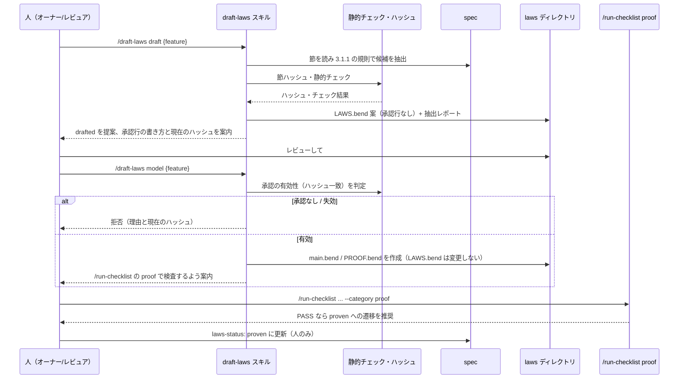

# 法則案の生成と承認フロー

**関連 ADR:** [proof-gate.md](../../adr/task-implementation/proof-gate.md)（2026-10-19 の第 2 弾の決定）
**関連 PRD:** [proof-gate.md](../../requirement/task-implementation/proof-gate.md)（FR_006。親: [task-implementation](../../requirement/task-implementation/index.md)）
**関連 spec:** [proof-gate_spec.md](proof-gate_spec.md)（第 1 弾。法則ディレクトリ・先頭コメント規約・判定表・`laws-status` の定義元。本 spec の FR-010 の置き換え先）,
[front-matter-validation_spec.md](../quality-guardrails/front-matter-validation_spec.md)（`laws:` / `laws-status:` の検証）,
[stale-doc-detection_spec.md](../quality-guardrails/stale-doc-detection_spec.md)（見直しリマインド）
**準拠する原則:** [CONSTITUTION.md](../../CONSTITUTION.md)（参照した版: v2.0.0）A-001（Skills-First）, A-002（フックとスクリプトの責務分離）, B-001（Vibe Coding 防止）, B-002（多言語対応の一貫性）, D-001（Specification-Driven）, D-002（ファイル命名規則の厳守）, D-003（ドキュメント永続性）, T-002（plugin.json 登録の徹底）

---

# 1. 背景

第 1 弾（[proof-gate_spec.md](proof-gate_spec.md)）で、法則ファイルを置けば `/run-checklist` の `proof` カテゴリが検査する
仕組みが完成した。ただし法則ファイル（`LAWS.bend` / `main.bend` / `PROOF.bend`）は手で書く運用のままで、
dogfooding 用の法則 5 件も手書きである。第 2 弾は、spec から法則案を生成して人の承認に回し、承認後に
参照モデルと証明を書く工程を定義する（PRD FR_006）。

最大の危険は第 1 弾と同じ「自己採点」である。AI が法則を生成し、AI が承認し、AI が証明すれば PASS が空虚になる。
本 spec は、生成を `drafted` で止め、承認を人に残し、承認後の工程を承認の内容ハッシュで束縛することで、この経路を作らない。

# 2. 概要

新規スキル `/draft-laws`（仮称。スキル名は実装チケットで確定）を提供し、`laws-status` の遷移と 1 対 1 に対応する
3 段階の工程を 1 つのスキルのサブコマンドとして持つ。

| 段階（サブコマンド） | 入力の前提 | 出力 | 遷移 | 主体 |
|:--|:--|:--|:--|:--|
| `draft` | spec が存在する | `LAWS.bend` 案（承認行なし）と抽出レポート | `none` → `drafted` | AI |
| （承認） | `drafted` の `LAWS.bend` | `# approved:` 行の追記 | `drafted` → `approved` | **人のみ** |
| `model` | `approved` かつ内容ハッシュ一致 | `main.bend` と `PROOF.bend` | `approved` のまま | AI |
| （検査・昇格） | `PROOF.bend` | `/run-checklist` の `CHK-205` の判定 | `approved` → `proven` | 検査は run-checklist、遷移は**人のみ** |

主要な設計原則は以下のとおり。

- **spec が正典、生成は一方向**: spec → 法則案のみ。法則・抽出結果から spec・PRD を書き換えない（PRD DC_002）
- **承認行は AI が書かない**: 生成物に `# approved:` を置かない。スキルは `--print-laws-hash` の値と書き方を案内するだけに留める
- **機械的に等式化できるものだけを法則にする**: 散文の要件は法則にせず、法則化しない理由を抽出レポートに残す
- **bend は必須依存にしない**: `draft` と静的検査は `bend` 無しで動く。`bend` を要するのは `/run-checklist` 側の検査だけである
- **新しい検証経路を作らない**: 検査・判定は第 1 弾の `proof` カテゴリに委ね、本スキルは `bend` を呼ばない

# 3. 要求定義

## 3.1. 機能要件 (Functional Requirements)

| ID | 要件 | 優先度 | 根拠（上流要求） |
|:--|:--|:--|:--|
| FR-001 | `/draft-laws draft <spec>` は、対象 spec から 3.1.1 の抽出ルールで法則候補を抽出し、`${SDD_LAWS_PATH}/{feature}/LAWS.bend` の案と抽出レポートを出力する。承認行は書かない | 必須 | PRD FR_006 |
| FR-002 | `LAWS.bend` 案の先頭コメントは `# spec: <spec の id>` を持ち、その直後に承認行が無いことを保証する（第 1 弾の判定表 #5 により、承認前は SKIPPED として扱われる）。spec の front matter に `laws:`（`${SDD_ROOT}` 相対）を追加し `laws-status: drafted` を付与する提案を出す（書き込みは、spec が `draft` 段階の AI 生成スキルの責務として許される `laws:` / `laws-status: drafted` の 2 項目に限る） | 必須 | 第 1 弾 FR-008 |
| FR-003 | 各法則は、法則宣言の直前に `# source: <spec の id> §<節番号> sha256:<節本文の内容ハッシュ先頭 12 桁>` を持つ。出典コメントは法則本文側に置くため、第 1 弾 FR-004 の内容ハッシュの対象に含まれる | 必須 | Q5（2026-10-19 オーナー承認） |
| FR-004 | 法則候補が既定上限（10。`.sdd-config.json` の `laws.max_laws` で変更可）を超える場合、3.1.2 の優先順位で上位を採用し、超過分を抽出レポートの「未採用の候補」節に理由付きで残す。黙って捨てない | 必須 | Q3 |
| FR-005 | 法則化できる性質が 1 件も無い spec は、`LAWS.bend` を作らず、抽出レポートに「法則化しない理由」を節ごとに残して正常終了する（失敗ではない）。spec が存在しない・読めない場合のみ失敗とする | 必須 | issue #168 設計事項 |
| FR-006 | 生成後に静的チェック（`bend` 不要）を実行し、結果を抽出レポートに併記する。チェックは 3.1.3 の 5 項目。error があれば `LAWS.bend` 案は出力するが `drafted` 付与を提案しない | 必須 | Q5 |
| FR-007 | `/draft-laws model <spec>` は、`LAWS.bend` に有効な承認行（第 1 弾 FR-004。内容ハッシュ一致）が無ければ**拒否**し、理由（承認行なし / 形式不正 / ハッシュ不一致と現在のハッシュ）を返す。有効なら `main.bend`（`# spec:` / `# model-of:` 付き）と `PROOF.bend` を書く | 必須 | Q4 |
| FR-008 | `model` 段階は `LAWS.bend` を変更しない。法則の誤りに気付いた場合は、変更せずに指摘として返し、法則の改訂は `draft` を再実行するか人が行う（本文が変わるとハッシュが変わり承認は失効する）。`PROOF.bend` は第 1 弾 FR-005 の import 許可形式（`import ./LAWS.bend as Laws` と `import Base`）だけを使う | 必須 | Q4・第 1 弾 FR-005 |
| FR-009 | スキルは `# approved:` 行・`laws-status: approved` / `proven` を書かない。承認が必要な時点では、`--print-laws-hash` で得た現在のハッシュと、承認行の書式（`# approved: YYYY-MM-DD <承認者> sha256:<12 桁>`）を案内する | 必須 | 第 1 弾の決定（承認行は AI が書かない） |
| FR-010 | `bend` が PATH に無い環境でも `draft` と静的チェックは動作する。`model` 段階で作った `PROOF.bend` の検査は `/run-checklist` に委ね、`bend` 不在は第 1 弾の TOOL_NOT_FOUND として扱う。本スキルが `bend` を直接呼ぶことはない | 必須 | 第 1 弾 NFR-001 |
| FR-011 | spec の変更時に法則の見直しを非ブロッキングで促す。既存の `.bend` 編集時・`# model-of:` 編集時の促し（第 1 弾 FR-009）に加え、`laws:` を持つ spec の編集時に「`# source:` の節ハッシュが現在の spec と一致しない法則がある場合は `draft`（再抽出）を検討する」旨を促す | 必須 | issue #168 設計スコープ 5 |
| FR-012 | 抽出レポート（`${SDD_ROOT}/task/{ticket}/laws-draft-report.md` または標準出力）は、採用した法則、未採用の候補、法則化しない理由、静的チェックの結果を `SDD_LANG` に従い en / ja で出力する | 必須 | 原則 B-002 |

### 3.1.1. 抽出ルール（FR-001）

| 優先 | 抽出元（spec の節） | 法則化する性質 | 法則化しないもの |
|:--|:--|:--|:--|
| 1 | 判定表・遷移表（行の順序、最初の一致を採用する規則） | 判定の単調性・順序（「ある行に該当すれば、それより下の行に関わらずその判定」）、特定入力での固定判定 | 外部プロセスの出力解析・文字列整形そのもの |
| 2 | 集約規則（最悪判定、優先順位、空入力の扱い） | 結合律・可換律・単位元・空入力の結果 | 集約の表示形式 |
| 3 | 制約事項・不変条件（「〜しない」「〜でなければならない」形の純粋な性質） | 状態・値に関する不変条件（決定的な関数で書けるもの） | IO・ネットワーク・ファイルシステム・時刻に依存するもの |
| 4 | 非機能要件・状態遷移図の数値目標 | 数値の境界（上限・下限・倍率）を満たす値の関係 | 性能・応答時間などの実測値 |

機能要件表（FR 表）の散文は、判定表・集約規則・制約事項に同じ内容が構造化されている場合のみ、その構造化された節から抽出する。
FR 表の文言のみを根拠に法則を作らない（等式にできず、解釈の揺れから幻覚法則を生むため）。

### 3.1.2. 上限と優先順位（FR-004）

1. 3.1.1 の優先順（1 → 4）で採用する。同一優先内は spec の節番号順
2. 次の候補は**自明法則**として採用しない（抽出レポートの「未採用」に理由を残す）: 恒真（`x == x`）、定義の言い換え（モデル関数の本体をそのまま等式にしたもの）、入力の型だけで決まる性質
3. 同じ命題を表す法則は 1 つにまとめる（重複の除去。3.1.3 の検査 3）
4. 上限超過は採用数を打ち切り、残りは優先順位つきで「未採用の候補」に残す

### 3.1.3. 静的チェック（FR-006。`bend` 不要）

| # | 検査 | 重大度 | 内容 |
|:--|:--|:--|:--|
| 1 | 出典の実在 | error | すべての `# source:` の節番号が spec に実在し、節ハッシュが現在の spec の該当節と一致する |
| 2 | 出典の欠落 | error | `law` 宣言が `# source:` を持たない |
| 3 | 重複 | warning | 同一の本体を持つ法則、または同一の出典・同一の命題が複数ある |
| 4 | 自明法則 | warning | 恒真・定義の言い換えと判定できる形（3.1.2-2 の機械的に判定できる範囲のみ） |
| 5 | import 許可形式 | error | 第 1 弾 FR-005 の許可形式以外の import が無い（`bend` 実行前の静的検査を再利用） |

## 3.2. 非機能要件 (Non-Functional Requirements)

| ID | カテゴリ | 要件 | 目標値 |
|:--|:--|:--|:--|
| NFR-001 | 任意依存 | `bend` が無くても `draft` と静的チェックが動作する | `bend` の有無で `draft` の結果が変わらない |
| NFR-002 | 決定性 | 静的チェック（3.1.3）と内容ハッシュ・節ハッシュの計算は決定的なスクリプトが行い、LLM に委ねない | A-002 |
| NFR-003 | 権限最小化 | スキルは `bend` を呼ばず、ベアな Bash を持たない。`.sdd/laws/` と抽出レポートへの書き込みに限定する | 第 1 弾 NFR-006 |
| NFR-004 | 多言語 | スキルの出力・テンプレート・レポートの文言を `SDD_LANG` で切り替え、単一文書内で混在させない | en / ja |
| NFR-005 | 再現性 | 同じ spec・同じ上限で `draft` を再実行すると同じ法則集合と順序になる（スクリプトで決定できる部分） | 候補の並びが決定的 |

# 4. 提供コンポーネント

| 種別 | 名称 | 責務 |
|:--|:--|:--|
| スキル | `draft-laws`（仮称） | `draft` / `model` の 2 サブコマンド。抽出（LLM の判断を要する部分）とファイル書き出し |
| スクリプト | `skills/draft-laws/scripts/`（名称は実装で確定） | 節ハッシュ計算、静的チェック（3.1.3）、承認有効性の判定（`laws_header.py` を再利用）、候補一覧の決定的な整列 |
| フック | `post-tool-use.py` | FR-011 の見直し促し（`laws:` を持つ spec の編集時） |
| テンプレート | `skills/draft-laws/templates/{en,ja}/` | `LAWS.bend` 案の先頭コメント、`main.bend` / `PROOF.bend` の雛形、抽出レポート |

`plugin.json` の更新は不要（`skills` は宣言しない。T-002）。エージェントは新設しない。

## 4.1. 入出力定義

### `LAWS.bend` 案（`draft` の出力）

```
# spec: spec-task-implementation-proof-gate
#
# Laws drafted from the spec. NOT approved: a human adds the approval line
# (# approved: YYYY-MM-DD <approver> sha256:<hash>) after review.

import Base
import ./main.bend as Model

# source: spec-task-implementation-proof-gate §3.1.1 sha256:<節ハッシュ>
law unapproved_never_pass:
  for e: Bool
  for m: Bool
  {Model.judge(False{}, e, m) == 1n : Nat}
```

- 先頭コメント部（`# spec:` から最初の空行または非コメント行まで）は内容ハッシュの対象外（第 1 弾の規約）
- `# source:` は先頭コメント部の**外**（`import` より後）に置く。したがって内容ハッシュの対象になり、出典の変更は承認の失効を伴う
- 節ハッシュは spec の該当節の本文（見出し行の次から次の同階層以上の見出し直前まで。空白・改行の正規化後）の sha256 先頭 12 桁

### 抽出レポート

| 節 | 内容 |
|:--|:--|
| 採用した法則 | 法則名、出典（節番号）、命題の日本語（または英語）説明 |
| 未採用の候補 | 候補、出典、未採用の理由（上限超過 / 自明法則 / 重複） |
| 法則化しない理由 | spec の節ごとに法則化しなかった理由（IO 依存・性能・散文のみ 等） |
| 静的チェック | 3.1.3 の結果 |
| 次の手順 | 承認行の書き方と現在の内容ハッシュ（FR-009） |

### `.sdd-config.json` 拡張

```json
{
  "laws": { "max_laws": 10 }
}
```

省略時は 10。

# 5. 用語集

| 用語 | 説明 |
|:--|:--|
| 法則案 | `/draft-laws draft` が生成する、承認行を持たない `LAWS.bend`。`laws-status: drafted` に対応する |
| 抽出ルール | spec のどの節から、どの性質を法則候補にするかの規則（3.1.1） |
| 出典コメント | 法則宣言の直前の `# source:` 行。節番号と節ハッシュで法則と spec を結ぶ |
| 節ハッシュ | spec の 1 つの節の本文から算出した sha256 の先頭 12 桁。節が変わったかを機械的に判定する |
| 自明法則 | 恒真・定義の言い換えなど、証明しても spec の保証を増やさない法則 |
| 未採用の候補 | 法則にできるが上限・重複・自明性のために採用しなかった候補。抽出レポートに残す |

# 6. 使用例

```
/draft-laws draft task-implementation/proof-gate        # 法則案と抽出レポートを生成（drafted）
python3 "${CLAUDE_PLUGIN_ROOT}/skills/run-checklist/scripts/run-verification.py" proof \
  --print-laws-hash --laws-dir .sdd/laws/task-implementation/proof-gate   # 人がハッシュを得て承認行を追記
/draft-laws model task-implementation/proof-gate        # 承認済みなら main.bend / PROOF.bend を作成（未承認は拒否）
/run-checklist task-implementation/proof-gate 168 --category proof        # 検査（PASS なら proven への遷移を推奨）
```

# 7. 振る舞い図

## 7.1. 3 段階の承認フロー



## 7.2. 法則の状態遷移（第 1 弾 §7.2 との対応）

`none → drafted`（`draft`、AI）、`drafted → approved`（承認行の追記、人）、`approved → proven`（検査 PASS 後に人）。
法則本文を変えると内容ハッシュが変わり承認は失効する（`approved → drafted`）。第 1 弾の遷移図を変更しない。

# 8. 制約事項

- **承認は人のみ**: スキルは承認行・`laws-status: approved` / `proven` を書かない。承認後の法則改訂は承認の失効を意味し、再承認が要る
- **spec 変更で承認は自動では失効しない**: 内容ハッシュは `LAWS.bend` の本文のみを対象にするため、spec だけが変わっても承認は有効のままである。失効するのは `# source:` の節ハッシュを更新するなど法則本文が変わったとき。spec の変更は静的チェック（3.1.3-1 の節ハッシュ不一致）と FR-011 の促しで検出し、再抽出と再承認の判断を人に回す。承認の手間が増えるトレードオフは決定ログに記録する
- **PASS の意味は第 1 弾のまま**: 参照モデルが法則を満たす保証であり、実装の正しさの保証ではない
- **表現できる範囲**: 3.1.1 の「法則化しないもの」は対象外。IO・外部境界は法則にしない
- **一方向派生**: 法則・抽出結果から spec・PRD を書き換えない。矛盾は報告し人が判断する。PRD は変更しない（提案は PR 本文に記載）
- **任意依存**: CI に `bend` を導入しない。スキルと静的チェックのテストは `bend` 無しで通る
- **スコープ外**: 実装（スキル・スクリプト・フック・テンプレート）は別チケット。proof-gate 以外の spec への適用（dogfooding の拡大）は別チケットで提案する

# 9. 原則との整合性

| 原則ID | 原則名 | 本仕様への適用内容 |
|:--|:--|:--|
| A-001 | Skills-First | 法則案生成を新規スキルとして提供する。新しいコマンドは追加しない |
| A-002 | フックとスクリプトの責務分離 | 候補の判断は LLM、ハッシュ・静的チェック・承認有効性の判定は決定的スクリプト、見直し促しはフックに置く |
| B-001 | Vibe Coding 防止 | spec の節に出典を持たない法則を許さず（静的チェック）、承認行は人が書く。AI の自己採点を作らない |
| B-002 | 多言語対応の一貫性 | 出力・テンプレート・レポートを en / ja で維持する |
| D-001 | Specification-Driven | spec を正典に、法則を一方向に派生させる。法則から spec・PRD を書き換えない |
| D-002 | ファイル命名規則の厳守 | 法則ファイルは固定名。本 spec は `laws-drafting_spec.md`（`_spec` 接尾辞は任意の範囲） |
| D-003 | ドキュメント永続性 | 生成した法則は `laws/` の永続ドキュメントとして spec と同じライフサイクルで保守する |
| T-002 | plugin.json 登録の徹底 | エージェントを新設しないため `plugin.json` の更新は不要 |

# 10. PRD 整合性レビュー結果

| PRD 要求 ID | 内容 | spec での対応 |
|:--|:--|:--|
| FR_006 | spec から法則案を生成し人が承認してからモデルと証明を書く | FR-001〜FR-012, §2 の 3 段階, §7.1 |
| DC_002 | 一方向派生（PRD / spec 非自動化） | §2, §8 |
| DC_001 / NFR_001 | Bend を必須依存にしない | FR-010, NFR-001 |
| NFR_003 | PASS の意味の明示 | §8 |
| FR_004 | 人による承認ゲート | FR-002, FR-007, FR-009 |

PRD の変更提案（人の判断）: FR_006 は「境界のみ定義し実装は別チケット」と書かれている。本 spec で境界が確定したため、
FR_006 の本文に「承認の有効性（内容ハッシュ一致）がモデル・証明の作成の前提である」旨と、検証方法に静的チェックを加えることを提案する（PRD は本 PR で変更しない）。

# 11. 第 1 弾の法則 5 件との対応（検収基準）

第 1 弾の `.sdd/laws/task-implementation/proof-gate/LAWS.bend` の 5 法則が、3.1.1 の抽出ルールで再現できることを、実装時の検収基準とする。

| 法則 | 導出元（proof-gate_spec） | 抽出ルール |
|:--|:--|:--|
| `agg_empty_skipped` | §3.1.1 集約（結果が無ければ SKIPPED。#6 の「空の集合を PASS にしない」） | 2 集約規則（空入力） |
| `agg_single_identity` | §3.1.1 集約（単一ディレクトリの判定はそのまま） | 2 集約規則（単位元） |
| `agg_pair_commutes` | §3.1.1 集約（最も悪いものを採る。順序に依存しない） | 2 集約規則（可換律） |
| `unapproved_never_pass` | §3.1.1 #5（有効な承認行が無ければ SKIPPED） | 1 判定表（固定判定） |
| `pass_requires_marker` | §3.1.1 #10・#12（`ALL PROOFS CHECK` が無ければ FAIL） | 1 判定表（単調性） |
