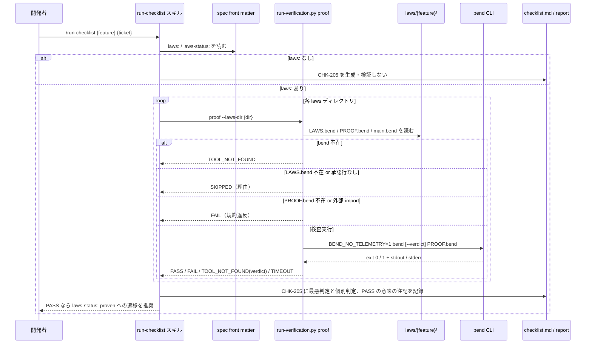
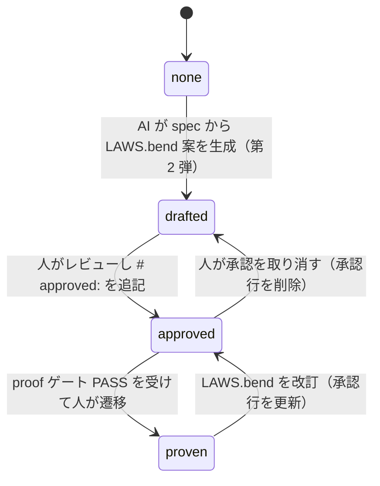

# Bend 証明ゲート

**関連 Design Doc:** [design-draft.md](../../task/149/design-draft.md)（一時ドラフト。実装完了後に `adr/task-implementation/proof-gate.md` へ統合）
**関連 PRD:** [proof-gate.md](../../requirement/task-implementation/proof-gate.md)（親: [task-implementation](../../requirement/task-implementation/index.md)）
**関連 spec:** [run-checklist_spec.md](run-checklist_spec.md)（`proof` カテゴリを受け入れる検証基盤）,
[front-matter-validation_spec.md](../quality-guardrails/front-matter-validation_spec.md)（`laws:` / `laws-status:` の検証ルール）,
[stale-doc-detection_spec.md](../quality-guardrails/stale-doc-detection_spec.md)（法則の見直しリマインド）
**準拠する原則:** [CONSTITUTION.md](../../CONSTITUTION.md)（参照した版: v2.0.0）A-002（フックとスクリプトの責務分離）, B-001（Vibe Coding 防止）, B-002（多言語対応の一貫性）, D-001（Specification-Driven）, D-002（ファイル命名規則の厳守）

---

# 1. 背景

抽象仕様書（spec）は自然言語と Mermaid 図で書かれ、「制約事項」「機能要件」に書かれた不変条件・事後条件が
実装で守られているかは、テストとレビューでしか確かめられない。調査（issue #148）の結論は、`.sdd` ドキュメント全体を
Bend ファイルに置き換えることは不可能だが、**spec の制約・不変条件・事後条件に限れば** Bend の法則（`law`）として
表現でき、Bend で書いた参照モデルについて証明検査器で検証できる、というものであった。

一方で、証明検査は次の 3 つの危険を伴う。(1) 検査器を必須依存にすると未導入環境で検証全体が止まる。
(2) AI が生成した法則を AI 自身が証明して合格を得る「自己採点」が成立してしまう。(3) 証明の合格が「実装が正しい」と
誤読される。本機能はこれらを opt-in・人による承認・PASS の意味の明示で抑え、チェックリスト自動検証
（[run-checklist_spec.md](run-checklist_spec.md)）の `proof` カテゴリとして証明検査を組み込む。

# 2. 概要

本機能は、spec から一方向に派生させた法則ファイル（`${SDD_ROOT}/laws/{feature}/`）を Bend の証明検査器にかけ、
その判定をチェックリスト項目として記録する opt-in の品質ゲートである。主要な設計原則は以下のとおり。

- **spec が正典、法則は派生物**: spec（`.md`）を真実の源に残し、法則ファイルは spec の front matter `laws:` から
  一方向に参照する。法則や検査結果から spec・PRD を書き換えない
- **opt-in・任意依存**: `bend` 不在時は TOOL_NOT_FOUND、法則ファイル不在時は SKIPPED として他カテゴリの検証を継続する
- **人による承認ゲート**: `LAWS.bend` に人の `# approved:` 行が無ければ PASS にしない（AI の自己採点防止）
- **外部通信なし**: テレメトリ停止の環境変数を常に付与し、ローカルファイル以外の import は検査前に規約違反とする
- **PASS の意味を限定する**: PASS は「参照モデルが法則を満たす」保証であり、対象プロジェクトの実装の正しさの保証ではない
- **既存の検証契約に乗る**: 判定は run-checklist の検証スクリプトが返す JSON 契約（PASS / FAIL / SKIPPED /
  TOOL_NOT_FOUND / TIMEOUT）に従う。新しいスキルやベアな Bash 権限は追加しない

「何を検査し、どう判定・記録するか」を定義し、検査器の呼び出し方式・コメント解析・フック実装の具体は
[design-draft.md](../../task/149/design-draft.md)（実装完了後は `adr/task-implementation/proof-gate.md`）に委ねる。

# 3. 要求定義

## 3.1. 機能要件 (Functional Requirements)

| ID     | 要件                                                                                                                                                   | 優先度 | 根拠（上流要求）                          |
|--------|------------------------------------------------------------------------------------------------------------------------------------------------------|-----|-----------------------------------------|
| FR-001 | 検証カテゴリ `proof` を受け付け、対象 spec の `laws:` が指す各法則ディレクトリについて証明検査を実行し、判定を返す                                                      | 必須  | 子 PRD FR_001 / 親 PRD UR_003            |
| FR-002 | 判定ロジック: `bend` 不在 → TOOL_NOT_FOUND、`LAWS.bend` 不在 → SKIPPED、`LAWS.bend` に承認行なし → SKIPPED（未承認）、`PROOF.bend` 不在 → FAIL、検査器 exit 0 → PASS、exit 1 かつ再検査基盤不備 → TOOL_NOT_FOUND（verdict）、exit 1 → FAIL、制限時間超過 → TIMEOUT | 必須  | 子 PRD FR_001・FR_004・NFR_001           |
| FR-003 | 法則ディレクトリは `${SDD_ROOT}/{laws}/{feature}/`（`{laws}` は `.sdd-config.json` の `directories.laws`、既定 `laws`）とし、`LAWS.bend` / `PROOF.bend` / `main.bend` の固定ファイル名で構成する。識別子はディレクトリ名に置く | 必須  | 子 PRD FR_002・IR_002                    |
| FR-004 | 法則ファイル先頭のコメント行（`# spec:` / `# model-of:` / `# approved:`）を規約として解析する。`# spec:` は対象 spec の id、`# model-of:` は参照モデルが写す実装ファイルのプロジェクト相対パス、`# approved:` は承認日と承認者 | 必須  | 子 PRD FR_002・FR_004                    |
| FR-005 | 検査器の子プロセスには常に `BEND_NO_TELEMETRY=1` を付与し、法則ディレクトリ内のファイル以外を指す import 行（hub import・URL・ディレクトリ外パス）が 1 行でもあれば検査器を実行せず FAIL（規約違反）とする | 必須  | 子 PRD NFR_002                           |
| FR-006 | Lean 形式化カーネルによる再検査（`--verdict`）は opt-in とし、再検査基盤の不備（`BendTT infrastructure` エラー）時は通常検査にフォールバックして判定を返し、再検査が未実施であることを結果に併記する | 任意  | 子 PRD FR_001（`--verdict` の opt-in）    |
| FR-007 | 判定を仕様レビューカテゴリの固定項目 `CHK-205`（P2）としてチェックリストと検証レポートに記録し、PASS の意味（参照モデルが法則を満たす保証であり実装の正しさではない）を結果に併記する。`laws:` を持たない spec では項目を生成・検証しない | 必須  | 子 PRD IR_001・NFR_003                   |
| FR-008 | spec の front matter に `laws:`（`${SDD_ROOT}` 相対ディレクトリのリスト）と `laws-status:`（`none` / `drafted` / `approved` / `proven`）を定義する。法則は下流であり `depends-on` に含めない。`proven` への遷移は人が行い、ゲートは PASS 時に遷移を**推奨**するに留める | 必須  | 子 PRD FR_003 / DC_002                   |
| FR-009 | 法則ファイル（`.bend`）編集後は proof ゲートの再実行を、`# model-of:` に記録された実装ファイルの編集後は参照モデルと法則の見直しを、非ブロッキングで促す | 必須  | 子 PRD FR_005                            |
| FR-010 | spec の制約事項・機能要件表から `LAWS.bend` 案を生成し、人の承認後に参照モデルと証明を書く承認フローの境界（入力・出力・状態遷移）を定義する。生成スキルの実装は別チケット | 任意  | 子 PRD FR_006 / DC_002                   |

FR-002 の判定は法則ディレクトリ単位で行い、spec が複数の法則ディレクトリを参照する場合は最も悪い判定
（FAIL > TIMEOUT > TOOL_NOT_FOUND > SKIPPED > PASS）をチェックリスト項目の判定とし、個別の判定を併記する。
FR-009 の促しの提供機能は [stale-doc-detection_spec.md](../quality-guardrails/stale-doc-detection_spec.md) に、
FR-008 の形式検証ルールは [front-matter-validation_spec.md](../quality-guardrails/front-matter-validation_spec.md) に定義する。

## 3.2. 非機能要件 (Non-Functional Requirements)

| ID      | カテゴリ      | 要件                                                                                   | 目標値                                          |
|---------|------------|--------------------------------------------------------------------------------------|------------------------------------------------|
| NFR-001 | 任意依存     | `bend` 未導入・法則ファイル不在で検証全体を失敗させず、他カテゴリの検証を継続する                       | TOOL_NOT_FOUND / SKIPPED で素通り（子 PRD NFR_001・DC_001） |
| NFR-002 | 応答性       | 検査は制限時間内に判定を返す。超過時は TIMEOUT として記録し手動確認へ回す                              | 既定 300 秒（run-checklist の他カテゴリと同じ）。`.sdd-config.json` で変更可 |
| NFR-003 | 再現性       | 判定はネットワークに依存せずオフラインで再現できる                                                 | 外部 import なし・テレメトリ停止（子 PRD NFR_002）    |
| NFR-004 | 移植性       | macOS / Linux で動作し、Windows は WSL 経由のみ。未対応環境では検査器不在として素通りする                | 子 PRD DC_004                                   |
| NFR-005 | 多言語       | チェックリスト項目・結果・レポートの文言を `SDD_LANG` に従い切り替え、単一文書内で混在させない           | en / ja（原則 B-002）                            |
| NFR-006 | 権限最小化    | `bend` の呼び出し経路は事前承認済みの検証スクリプト 1 本に限定し、スキルにベアな Bash を与えない        | 子 PRD DC_003                                   |

# 4. 提供コンポーネント

本機能は新しいスキル・エージェントを追加せず、既存コンポーネントの拡張として提供する。

| 種別       | 配置場所                                                              | 名前                        | 概要                                                                                         |
|----------|-------------------------------------------------------------------|---------------------------|--------------------------------------------------------------------------------------------|
| script   | `skills/run-checklist/scripts/run-verification.py`                | `proof` カテゴリ              | 法則ディレクトリの探索・import 静的検査・`bend` 実行・判定（FR-001〜006）。既存の JSON 契約で結果を返す              |
| skill    | `skills/run-checklist/SKILL.md`                                   | run-checklist（拡張）         | `proof` カテゴリの呼び出し手順・判定表・PASS の意味の注記（FR-007）                                          |
| reference | `skills/run-checklist/references/verification_commands.md`       | verification_commands（拡張） | `proof` の呼び出し例と判定対応表                                                                   |
| template | `skills/checklist/templates/{en,ja}/checklist_template.md`        | `CHK-205`                 | 仕様レビューカテゴリの固定項目「法則証明（proof ゲート）」（FR-007、NFR-005）                                 |
| template | `skills/run-checklist/templates/{en,ja}/result_format.md`         | proof 結果ブロック             | `proof` カテゴリの自動検証結果ブロック例と PASS の意味の注記（FR-007、NFR-005）                                 |
| script   | `scripts/hook_common.py` / `scripts/session-start.py`             | laws ディレクトリ解決            | `directories.laws` の読込と `SDD_LAWS_DIR` / `SDD_LAWS_PATH` のエクスポート（FR-003）                 |
| script   | `scripts/fm_parser.py`                                            | `LIST_KEYS` 拡張            | `laws` をリスト値キーとして解析する（FR-008）                                                          |
| hook     | `scripts/post-tool-use.py`                                        | PostToolUse フック（拡張）      | `.bend` 編集時の再実行促し・`# model-of:` 対象編集時の見直し促し（FR-009。仕様は stale-doc-detection_spec）        |
| agent    | `agents/front-matter-reviewer.md`                                 | front-matter-reviewer（拡張） | `laws:` / `laws-status:` の検証（FR-008。仕様は front-matter-validation_spec）                        |
| reference | `shared/references/front_matter_reference.md`                    | front_matter_reference（拡張） | spec の `laws:` / `laws-status:` フィールド定義と状態遷移                                              |
| skill    | （第 2 弾・別チケット）                                                   | 法則案生成スキル（名称未定）        | spec の制約事項・FR 表から `LAWS.bend` 案を生成し `laws-status: drafted` を付与する（FR-010。本 spec では境界のみ） |

## 4.1. 入出力定義

### `proof` カテゴリ（検証スクリプト）

**入力**:

| 引数 / 入力              | 必須 | 説明                                                                                                  |
|:----------------------|:---|:----------------------------------------------------------------------------------------------------|
| カテゴリ `proof`          | 必須 | 既存の `test` / `lint` / `typecheck` / `security` に並ぶ検証カテゴリ                                            |
| `--laws-dir <path>`   | 任意 | 検査する法則ディレクトリ（プロジェクト相対。複数指定可）。省略時は `${SDD_LAWS_PATH}` 配下の全ディレクトリを対象にする                        |
| `--verdict`           | 任意 | Lean 形式化カーネルによる再検査を要求する（FR-006）                                                                    |
| `--timeout <sec>`     | 任意 | 制限時間（既定は `.sdd-config.json` の `proof.timeout_seconds`、未設定なら 300）                                     |
| 環境変数 `SDD_LAWS_PATH` | 任意 | 法則ディレクトリの既定の探索先（session-start が `.sdd-config.json` から解決してエクスポートする）                                   |

スキル（run-checklist）は、対象 spec の front matter `laws:` を読み、その各要素を `--laws-dir` に渡して呼び出す。
`laws:` を持たない spec では `proof` カテゴリを呼び出さない（FR-007）。

**出力**: 標準出力に JSON を 1 件。既存カテゴリと同じ `status` / `reason` に加え、法則ディレクトリごとの判定を `results` に持つ。

```json
{
  "category": "proof",
  "status": "PASS",
  "verdict": "unavailable",
  "results": [
    {
      "laws_dir": ".sdd/laws/task-implementation/proof-gate",
      "spec": "spec-task-implementation-proof-gate",
      "approved": "2026-10-17 @reviewer",
      "status": "PASS",
      "command": "bend PROOF.bend",
      "exit_code": 0,
      "stdout": "ALL PROOFS CHECK",
      "stderr": ""
    }
  ],
  "note": "PASS means the reference model satisfies the approved laws. It does not prove the project's implementation."
}
```

`status` の意味（run-checklist の判定表と同じ。`proof` 固有の `reason` を併記する）:

| `status`         | `proof` での意味                                                                         | チェックリスト上の扱い |
|:-----------------|:--------------------------------------------------------------------------------------|:------------|
| `PASS`           | 承認済みの全法則について `bend` が `ALL PROOFS CHECK` を返した                                        | 合格          |
| `FAIL`           | `SOME PROOFS FAIL` / 構文エラー、`PROOF.bend` 不在、または外部 import の規約違反                          | 不合格         |
| `SKIPPED`        | `LAWS.bend` が無い、または `# approved:` 行が無い（未承認）                                            | 失敗ではない      |
| `TOOL_NOT_FOUND` | `bend` が PATH に無い。`--verdict` 時に Lean 基盤が無い場合は `verdict: "unavailable"` を併記して通常検査の判定を返す | 失敗ではない      |
| `TIMEOUT`        | 制限時間を超過した                                                                            | 手動確認が必要     |

### 法則ディレクトリと先頭コメント規約

```
${SDD_ROOT}/laws/{feature}/          # 階層 spec は spec と同じ階層（例: laws/task-implementation/proof-gate/）
├── LAWS.bend                        # 法則の宣言。先頭コメント: # spec: / # approved:
├── PROOF.bend                       # 証明。LAWS.bend を import する（bend 自身が import 漏れを拒否する）
└── main.bend                        # 参照モデル（任意）。先頭コメント: # spec: / # model-of:
```

| 規約行           | 配置                 | 値                                                | 必須                        |
|:--------------|:-------------------|:-------------------------------------------------|:--------------------------|
| `# spec:`     | `LAWS.bend`（他は任意） | 対象 spec の front matter `id`（例: `spec-task-implementation-proof-gate`） | 必須                        |
| `# approved:` | `LAWS.bend`        | `YYYY-MM-DD` と承認者（例: `2026-10-17 @reviewer`）。人がレビュー後に追記する | PASS の前提（無ければ SKIPPED）     |
| `# model-of:` | `main.bend`        | 参照モデルが写す実装ファイルのプロジェクト相対パス。1 行 1 パス、複数可           | 任意（あれば FR-009 の見直し促しの対象になる） |

規約行は、ファイル先頭の連続するコメント行・空行（検査器が import より前に読み飛ばす範囲）に置く。

### spec の front matter 拡張

```yaml
laws: [".sdd/laws/task-implementation/proof-gate"]   # ${SDD_ROOT} 相対ディレクトリのリスト。省略可
laws-status: "approved"                              # none / drafted / approved / proven。省略時は none 相当
```

| 値          | 意味                                            | 遷移させる主体                         |
|:-----------|:----------------------------------------------|:--------------------------------|
| `none`     | 法則を持たない（省略時の既定）                            | -                               |
| `drafted`  | AI が `LAWS.bend` 案を生成した（未承認）                  | 法則案生成スキル（第 2 弾）または人            |
| `approved` | 人が `LAWS.bend` をレビューし `# approved:` 行を追記した     | 人                               |
| `proven`   | 承認済み法則の証明が検査に合格した                           | 人（ゲートは PASS 時に遷移を推奨するに留める）    |

### `.sdd-config.json` 拡張

```json
{
  "directories": { "laws": "laws" },
  "proof": { "timeout_seconds": 300, "verdict": false }
}
```

いずれも省略可（省略時は上記の既定値）。`directories.laws` は他のディレクトリと同様に `SDD_LAWS_DIR` /
`SDD_LAWS_PATH` としてエクスポートされる。

# 5. 用語集

| 用語            | 説明                                                                                            |
|:--------------|:----------------------------------------------------------------------------------------------|
| 法則（law）      | Bend の `law` 宣言。spec の制約・不変条件・事後条件を参照モデルの関数についての命題として書いたもの                            |
| 証明（proof）    | 法則と同名の定義として与える証明。`PROOF.bend` に置く                                                          |
| 参照モデル        | 法則が述べる対象として Bend で書いた型・関数（`main.bend`）。対象プロジェクトの実装を写したものであり、実装そのものではない                   |
| 証明検査器        | `bend` CLI。全法則が証明済みなら終了コード 0 と `ALL PROOFS CHECK`、それ以外は終了コード 1 と `SOME PROOFS FAIL` を返す     |
| 承認行           | `LAWS.bend` の `# approved:` コメント行。人がレビューしたことを示し、無ければゲートは PASS にしない                           |
| hub import    | ローカルファイル以外（Bend Hub 名前空間・URL・法則ディレクトリ外のパス）を指す import。ゲートでは規約違反（FAIL）として扱う                 |
| 再検査（verdict） | `bend --verdict` による Lean 形式化カーネルでの再検査。基盤不在時は `verdict: "unavailable"` を併記して通常検査にフォールバックする |
| laws-status   | spec の front matter フィールド。法則の状態（`none` → `drafted` → `approved` → `proven`）                    |
| 自己採点          | AI が生成した法則を AI 自身が証明して合格を得ること。承認行の要求で防ぐ                                                 |

# 6. 使用例

```
/run-checklist proof-gate 149                          # checklist.md 全項目を検証（spec に laws: があれば CHK-205 も検証）
/run-checklist proof-gate 149 --category proof         # proof カテゴリのみ検証
python3 "${CLAUDE_PLUGIN_ROOT}/skills/run-checklist/scripts/run-verification.py" proof \
  --laws-dir .sdd/laws/task-implementation/proof-gate  # スキルが内部で呼ぶ形（単一の法則ディレクトリ）
python3 "${CLAUDE_PLUGIN_ROOT}/skills/run-checklist/scripts/run-verification.py" proof --verdict
                                                       # ${SDD_LAWS_PATH} 配下すべてを Lean 再検査付きで検査
```

# 7. 振る舞い図

## 7.1. 証明検査（`proof` カテゴリ）



## 7.2. 法則の状態遷移（`laws-status`）



# 8. 制約事項

- **PASS の意味**: PASS は「参照モデル（`main.bend`）が承認済みの法則を満たす」ことの保証であり、対象プロジェクトの
  実装の正しさを保証しない。参照モデルと実装の乖離は証明では検知できず、`# model-of:` に基づく見直し促し（FR-009）で緩和する
- **表現できる範囲**: 法則にできるのは spec の制約・不変条件・事後条件（純粋な性質）に限る。PRD・ADR・CONSTITUTION・
  API の IO・外部境界は証明対象外（issue #148 の結論）
- **任意依存**: Bend は必須依存ではなく、本リポジトリの CI にも導入しない。Windows は WSL 経由のみ
- **承認は人のプロセス**: ゲートが検査するのは承認行の有無のみで、誰が書いたかは検証できない。承認行の追加は
  レビュー（PR）で確認する運用とし、AI は承認行を書かない
- **一方向派生**: 法則・検査結果から spec・PRD を書き換えない。spec と法則の矛盾は報告し人が判断する
- **命名の書き込み時ブロックはしない**: 法則ファイルの固定ファイル名の不備は、書き込み時の deny ではなく
  ゲート実行時の SKIPPED / FAIL の理由として報告する（naming-enforcement の対象に含めない）
- **スコープ外**: チェックリストの生成そのもの・`proof` 以外の検証カテゴリ・front matter 形式検証の実行・
  リマインドの実装は、それぞれ checklist-generation / run-checklist / front-matter-validation / stale-doc-detection が担う

# 9. 原則との整合性

| 原則ID  | 原則名                    | 本仕様への適用内容                                                                                   |
|-------|--------------------------|---------------------------------------------------------------------------------------------|
| A-002 | フックとスクリプトの責務分離   | 法則ディレクトリ探索・import 検査・`bend` 実行・判定を検証スクリプトに委ね、スキルは JSON を読んで記録・推奨に専念する。見直し促しはフックに置く |
| B-001 | Vibe Coding 防止          | spec の制約を命題として固定し、承認済み法則の証明という客観的根拠で判定する。承認行の要求で AI の自己採点を排除する              |
| B-002 | 多言語対応（EN/JA）の一貫性 | `CHK-205`・結果ブロック・レポートの文言を en / ja テンプレートで維持し `SDD_LANG` で切り替える                            |
| D-001 | Specification-Driven      | spec を正典に残し、法則は spec から一方向に派生させる。法則から spec・PRD を書き換えない                                   |
| D-002 | ファイル命名規則の厳守      | 法則ファイルは固定名（`LAWS.bend` / `PROOF.bend` / `main.bend`）とし、識別子はディレクトリ名に置く。`.md` の命名規則には影響しない   |

# 10. PRD 整合性レビュー結果

本 spec は [proof-gate.md](../../requirement/task-implementation/proof-gate.md) の要求を以下のとおりカバーする。

| PRD 要求 ID       | 内容                                      | spec での対応                       |
|:----------------|:----------------------------------------|:--------------------------------|
| FR_001          | 法則ファイルの証明検査（判定・テレメトリ停止・`--verdict`・タイムアウト） | FR-001, FR-002, FR-005, FR-006, NFR-002 |
| FR_002          | 法則ファイルの配置と識別                          | FR-003, FR-004                   |
| FR_003          | spec からの一方向参照                           | FR-008                           |
| FR_004          | 人による承認ゲート                              | FR-002（承認行なし → SKIPPED）, FR-004 |
| FR_005          | 法則の見直し促し                               | FR-009                           |
| FR_006          | spec から法則案を生成する承認フロー（第 2 弾）           | FR-010, §7.2 状態遷移               |
| NFR_001         | 任意依存                                    | NFR-001                          |
| NFR_002         | ネットワーク非依存                              | FR-005, NFR-003                  |
| NFR_003         | PASS の意味の明示                             | FR-007, §8 制約事項                 |
| IR_001          | 検証契約とチェックリスト ID                       | FR-007, §4.1 出力                 |
| IR_002          | 法則ディレクトリの解決                            | FR-003, §4.1 `.sdd-config.json`   |
| DC_001          | Bend を必須依存にしない                          | NFR-001, §8                      |
| DC_002          | 一方向派生（PRD / spec 非自動化）                 | FR-008, FR-010, §8               |
| DC_003          | スコープ付きの呼び出し                            | NFR-006, §4 提供コンポーネント          |
| DC_004          | プラットフォーム制限                              | NFR-004                          |
| 親 UR_003        | 体系的な品質検証                               | FR-001, FR-007                   |
