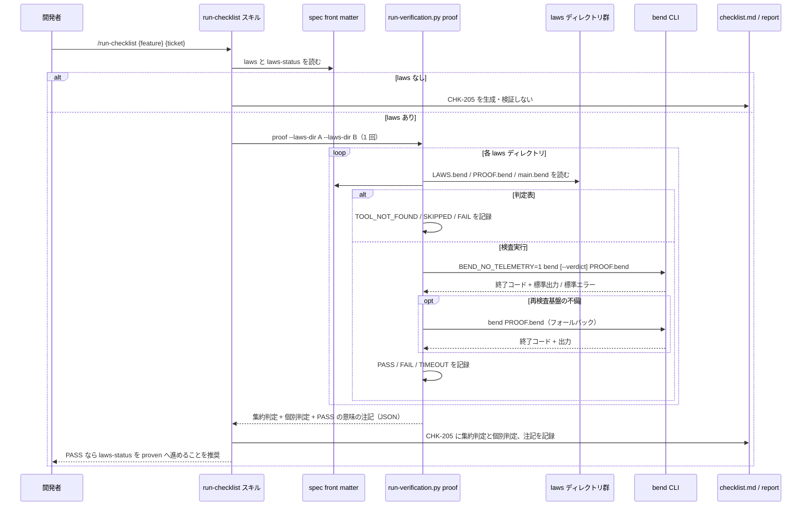
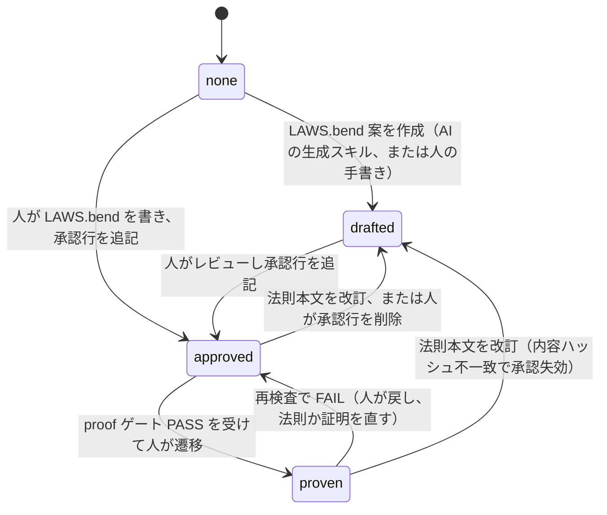

# Bend 証明ゲート

**関連 ADR:** [proof-gate.md](../../adr/task-implementation/proof-gate.md)（決定と却下案の決定ログ）
**関連 PRD:** [proof-gate.md](../../requirement/task-implementation/proof-gate.md)（親: [task-implementation](../../requirement/task-implementation/index.md)）
**関連 spec:** [run-checklist_spec.md](run-checklist_spec.md)（`proof` カテゴリを受け入れる検証基盤）,
[checklist-generation_spec.md](checklist-generation_spec.md)（固定項目 `CHK-205` の生成）,
[front-matter-validation_spec.md](../quality-guardrails/front-matter-validation_spec.md)（`laws:` / `laws-status:` の検証ルールと孤児 laws の逆方向検査）,
[stale-doc-detection_spec.md](../quality-guardrails/stale-doc-detection_spec.md)（法則の見直しリマインド）
**準拠する原則:** [CONSTITUTION.md](../../CONSTITUTION.md)（参照した版: v2.0.0）A-001（Skills-First）, A-002（フックとスクリプトの責務分離）, B-001（Vibe Coding 防止）, B-002（多言語対応の一貫性）, D-001（Specification-Driven）, D-002（ファイル命名規則の厳守）, T-002（plugin.json 登録の徹底）

---

# 1. 背景

抽象仕様書（spec）は自然言語と Mermaid 図で書かれ、「制約事項」「機能要件」に書かれた不変条件・事後条件が
実装で守られているかは、テストとレビューでしか確かめられない。調査（issue #148）の結論は、`.sdd` ドキュメント全体を
Bend ファイルに置き換えることは不可能だが、**spec の制約・不変条件・事後条件に限れば** Bend の法則（`law`）として
表現でき、Bend で書いた参照モデルについて証明検査器で検証できる、というものであった。

一方で、証明検査は次の 3 つの危険を伴う。(1) 検査器を必須依存にすると未導入環境で検証全体が止まる。
(2) AI が生成した法則を AI 自身が証明して合格を得る「自己採点」が成立してしまう。(3) 証明の合格が「実装が正しい」と
誤読される。本機能はこれらを opt-in・人による承認・PASS の意味の明示で抑え、チェックリスト自動検証
（[run-checklist_spec.md](run-checklist_spec.md)）の `proof` カテゴリとして証明検査を組み込む。

# 2. 概要

本機能は、spec から一方向に派生させた法則ファイル（`${SDD_LAWS_PATH}/{feature}/`）を Bend の証明検査器にかけ、
その判定をチェックリスト項目として記録する opt-in の品質ゲートである。主要な設計原則は以下のとおり。

- **spec が正典、法則は派生物**: spec（`.md`）を真実の源に残し、法則ファイルは spec の front matter `laws:` から
  一方向に参照する。法則や検査結果から spec・PRD を書き換えない
- **opt-in・任意依存**: `bend` 不在時は TOOL_NOT_FOUND、法則ファイル不在時は SKIPPED として他カテゴリの検証を継続する
- **人による承認ゲート**: `LAWS.bend` に有効な承認行（承認日・承認者・法則本文の内容ハッシュ）が無ければ PASS にしない。
  承認後に法則本文を変えると承認は失効する（AI の自己採点と「承認後に法則を弱める」抜け道を抑止する）
- **外部通信なし**: テレメトリ停止の環境変数を常に付与し、法則ディレクトリ外を指す import は検査前に規約違反とする
- **PASS の意味を限定する**: PASS は「参照モデルが法則を満たす」保証であり、対象プロジェクトの実装の正しさの保証ではない
- **既存の検証契約に乗る**: 判定は run-checklist の検証スクリプトが返す結果契約（PASS / FAIL / SKIPPED /
  TOOL_NOT_FOUND / TIMEOUT）に従う。新しいスキル・エージェント・ベアな Bash 権限は追加しない

「何を検査し、どう判定・記録するか」を定義し、検査器の呼び出し方式・コメント解析・フック実装の具体は
[proof-gate.md](../../adr/task-implementation/proof-gate.md)（決定ログ）と実装に委ねる。

# 3. 要求定義

## 3.1. 機能要件 (Functional Requirements)

| ID     | 要件                                                                                                                                                   | 優先度 | 根拠（上流要求）                          |
|--------|------------------------------------------------------------------------------------------------------------------------------------------------------|-----|-----------------------------------------|
| FR-001 | 検証カテゴリ `proof` を受け付け、指定された法則ディレクトリ（複数可）について証明検査を実行し、ディレクトリごとの判定と集約判定を 1 回の呼び出しで返す                                   | 必須  | 子 PRD FR_001 / 親 PRD UR_003            |
| FR-002 | 判定は「3.1.1 判定表」の順で最初に該当したものを採用する                                                                                                           | 必須  | 子 PRD FR_001・FR_004・NFR_001           |
| FR-003 | 法則ディレクトリは `${SDD_LAWS_PATH}/{feature}/`（`SDD_LAWS_PATH` は `${SDD_ROOT}/` + `.sdd-config.json` の `directories.laws`、既定 `laws`）とし、`LAWS.bend` / `PROOF.bend` / `main.bend` の固定ファイル名で構成する。識別子はディレクトリ名に置く | 必須  | 子 PRD FR_002・IR_002                    |
| FR-004 | 法則ファイル先頭のコメント行（`# spec:` / `# model-of:` / `# approved:`）を規約として解析する。`# spec:` は対象 spec の id、`# model-of:` は参照モデルが写す実装ファイルのプロジェクト相対パス、`# approved:` は承認日・承認者・承認時点の法則本文の内容ハッシュ。承認行は、内容ハッシュが現在の法則本文（先頭コメント部を除いた `LAWS.bend` の内容）のハッシュと一致するときのみ有効とする。`# spec:` の id が実在する spec に解決でき、かつその spec の `laws:` が当該ディレクトリを指すこと（双方向の結びつき）を法則ディレクトリの成立条件とし、満たさないものは孤児 laws として FAIL にする（3.1.1 #4） | 必須  | 子 PRD FR_002・FR_004                    |
| FR-005 | 検査器の子プロセスには常に `BEND_NO_TELEMETRY=1` を付与する。法則ディレクトリ内の全 `.bend` ファイルの import 文を静的に検査し、「同じ法則ディレクトリ内に実在する `.bend` ファイルを相対パスで指す別名付き import（`import ./<file>.bend as <Name>`。`<Name>` は英字または `_` で始まる英数字と `_`。Bend 2.0.37 は別名のないローカル import を構文エラーにする）」と「Bend 同梱の標準ライブラリ（`import Base`）」以外の import 文（hub import、URL、絶対パス、親ディレクトリ、ディレクトリ内に実在しないファイル名、別名のないローカル import、`from` 形式等の未知の形式）が 1 行でもあれば検査器を実行せず FAIL（規約違反）とする | 必須  | 子 PRD NFR_002                           |
| FR-006 | Lean 形式化カーネルによる再検査（`--verdict`）は opt-in とする。再検査基盤の不備を検査器が示した場合は通常検査にフォールバックして判定を返し、再検査が未実施であること（`verdict: "unavailable"`）を結果に併記する | 任意  | 子 PRD FR_001（`--verdict` の opt-in）    |
| FR-007 | 判定を仕様レビューカテゴリの固定項目 `CHK-205`（P2）としてチェックリストと検証レポートに記録し、PASS の意味（参照モデルが法則を満たす保証であり実装の正しさではない）を結果に併記する。`CHK-205` は `laws:` を持つ spec でのみ生成・検証する。`/run-checklist` の `--category` は CHK のカテゴリ名を取るため、`--category specification`（2xx）と無指定で `CHK-205` を検証し、加えて `--category proof` を「`CHK-205` のみを検証する別名」として受理する | 必須  | 子 PRD IR_001・NFR_003                   |
| FR-008 | spec の front matter に `laws:`（`${SDD_ROOT}` 相対ディレクトリのリスト。例: `laws/task-implementation/proof-gate`）と `laws-status:`（`none` / `drafted` / `approved` / `proven`）を定義する。法則は下流であり `depends-on` に含めない（`laws:` は依存関係ではなく探索用ポインタ）。`laws-status` のうち `approved` / `proven` への遷移は人が行い（`drafted` は法則案生成スキルが付与してよい）、ゲートは PASS 時に `proven` への遷移を**推奨**するに留める | 必須  | 子 PRD FR_003 / DC_002                   |
| FR-009 | 法則ファイル（`.bend`）編集後は proof ゲートの再実行を、`# model-of:` に記録された実装ファイルの編集後は参照モデルと法則の見直しを、非ブロッキングで促す | 必須  | 子 PRD FR_005                            |
| FR-010 | spec の制約事項・機能要件表から `LAWS.bend` 案を生成し、人の承認後に参照モデルと証明を書く承認フローの境界（入力・出力・状態遷移）を定義する。生成スキルの実装は別チケット | 任意  | 子 PRD FR_006 / DC_002                   |

FR-009 の促しの提供機能は [stale-doc-detection_spec.md](../quality-guardrails/stale-doc-detection_spec.md) に、
FR-008 の形式検証ルールと孤児 laws の静的検査（reviewer 側）は [front-matter-validation_spec.md](../quality-guardrails/front-matter-validation_spec.md) に、
FR-007 の固定項目の生成は [checklist-generation_spec.md](checklist-generation_spec.md) に定義する。

### 3.1.1. 判定表（FR-002）

法則ディレクトリ 1 つに対する判定。上から順に評価し、最初に該当した行を採用する。

| #  | 条件                                                                                      | 判定             | 補足                                                   |
|:---|:----------------------------------------------------------------------------------------|:---------------|:-----------------------------------------------------|
| 1  | `bend` が PATH に無い（または起動できない）                                                            | TOOL_NOT_FOUND | 失敗ではない                                              |
| 2  | 明示指定された法則ディレクトリが存在しない                                                                  | FAIL           | `laws:` のタイプミスを素通りさせない（spec → laws 方向の不整合）                |
| 3  | `LAWS.bend` が無い                                                                           | SKIPPED        | 法則を持たない（失敗ではない）                                      |
| 4  | 孤児 laws: `LAWS.bend` に `# spec:` 行が無い、`# spec:` が指す id の spec ファイルが存在しない、または解決先 spec の front matter `laws:` に当該ディレクトリ（`${SDD_ROOT}` 相対）が含まれていない | FAIL           | spec に結びつかない法則は派生物として成立しない（laws → spec 方向の不整合。#2 と対になる）。`--laws-dir` 省略時の再帰走査でも明示指定でも同じ条件を課す。`reason` に「`# spec:` 行が無い」、解決できなかった id、または「どの spec の `laws:` に無いか」を含める |
| 5  | `LAWS.bend` に有効な承認行が無い（行が無い、形式不正、内容ハッシュ不一致）                                              | SKIPPED        | 未承認・承認失効。承認前の下書きには規約違反の有無を問わず FAIL を出さない（孤児判定 #4 は承認より前に評価する） |
| 6  | `LAWS.bend` に `law` 宣言が 1 つも無い                                                            | SKIPPED        | 空の法則集合を PASS にしない                                        |
| 7  | `PROOF.bend` が無い                                                                          | FAIL           | 承認済みなのに証明が無い                                            |
| 8  | `PROOF.bend` が `LAWS.bend` を import していない、または規約外の import がある（FR-005。hub / URL / 親ディレクトリ / 別名なしローカル import / 実在しないローカルファイル名を含む） | FAIL           | 検査器を実行せず規約違反として扱う                                      |
| 9  | 検査器が制限時間を超過した                                                                           | TIMEOUT        | 手動確認が必要                                              |
| 10 | 検査器が成功（終了コード 0）かつ標準出力に `ALL PROOFS CHECK` を含む                                            | PASS           | `--verdict` で再検査済みなら `verdict: "checked"`                   |
| 11 | `--verdict` 指定時に、検査器が再検査基盤の不備を示した                                                        | （フォールバック）    | `--verdict` なしで再実行し、その結果を #9〜#12 で判定。`verdict: "unavailable"` を併記（FR-006） |
| 12 | 上記以外（終了コード 0 以外、または成功なのに `ALL PROOFS CHECK` を含まない）                                         | FAIL           | 証明失敗・構文エラー・想定外の出力                                       |

#2 と #4 は spec と法則ディレクトリの結びつきを双方向から検査する対の行である。#2 は spec の `laws:` が指す先が無い
（spec → laws）、#4 は法則ディレクトリが spec に結びつかない（laws → spec）。spec → laws と laws → spec の双方向が
揃って初めて正とする。#4 の id → spec ファイルの解決は、front matter の `id` を走査する既存の仕組み
（[front-matter-validation_spec.md](../quality-guardrails/front-matter-validation_spec.md) FR-009 の逆方向検査と同じ規則）に
従い、ゲートは `${SDD_SPECIFICATION_PATH}` 配下の spec を読んで解決する。検査の向きは相補的で、ゲートは spec 側を全走査して `# spec:` の id を解決し、front-matter-reviewer は laws 側（`${SDD_LAWS_PATH}` 配下）を走査して ID レジストリと照合する。

複数ディレクトリの集約判定は FAIL > TIMEOUT > TOOL_NOT_FOUND > SKIPPED > PASS の順で最も悪いものとし、個別判定を併記する。
集約の `verdict` は、いずれかが `unavailable` なら `unavailable`、`--verdict` 指定時はそれ以外 `checked`、未指定なら `not-requested`。
`--laws-dir` を省略した場合は `${SDD_LAWS_PATH}` 配下を再帰的に走査し、`LAWS.bend` または `PROOF.bend` を直接含むディレクトリだけを
対象にする（階層の中間ディレクトリを SKIPPED として数えない）。

## 3.2. 非機能要件 (Non-Functional Requirements)

| ID      | カテゴリ      | 要件                                                                                   | 目標値                                          |
|---------|------------|--------------------------------------------------------------------------------------|------------------------------------------------|
| NFR-001 | 任意依存     | `bend` 未導入・法則ファイル不在で検証全体を失敗させず、他カテゴリの検証を継続する                       | TOOL_NOT_FOUND / SKIPPED で素通り（子 PRD NFR_001・DC_001） |
| NFR-002 | 応答性       | 検査は法則ディレクトリごとに制限時間内に判定を返す。超過時は TIMEOUT として記録し手動確認へ回す。フォールバック（FR-006）時は再実行分で最大 2 倍、ディレクトリ数 N で最大 N × 制限時間 × 2 | 既定 300 秒 / ディレクトリ（run-checklist の他カテゴリと同じ）。`.sdd-config.json` で変更可 |
| NFR-003 | 再現性       | 判定はネットワークに依存せずオフラインで再現できる                                                 | 外部 import なし・テレメトリ停止（子 PRD NFR_002）    |
| NFR-004 | 移植性       | macOS / Linux で動作し、Windows は WSL 経由のみ。未対応環境では検査器不在として素通りする                | 子 PRD DC_004                                   |
| NFR-005 | 多言語       | チェックリスト項目・結果・レポートの文言を `SDD_LANG` に従い切り替え、単一文書内で混在させない           | en / ja（原則 B-002）                            |
| NFR-006 | 権限最小化    | `bend` の呼び出し経路は事前承認済みの検証スクリプト 1 本に限定し、スキルにベアな Bash を与えない        | 子 PRD DC_003                                   |
| NFR-007 | 版の前提     | 判定表は Bend v2.0.37 の終了コード・出力で実測したものであり、それ未満の版の挙動は保証しない。再検査は Bend が要求する Lean v4.34.0 を前提とする | 子 PRD 前提条件                                  |

# 4. 提供コンポーネント

本機能は新しいスキル・エージェントを追加せず、既存コンポーネントの拡張として提供する（T-002: `plugin.json` の変更なし）。

| 種別       | 配置場所                                                              | 名前                        | 概要                                                                                         |
|----------|-------------------------------------------------------------------|---------------------------|--------------------------------------------------------------------------------------------|
| script   | `skills/run-checklist/scripts/run-verification.py`                | `proof` カテゴリ              | 法則ディレクトリの探索・import 静的検査・`bend` 実行・判定・集約（FR-001〜006）。既存の結果契約で返す                      |
| script   | `scripts/`（共有モジュール）                                               | 法則ファイル規約の解析              | 先頭コメント規約（`# spec:` / `# approved:` / `# model-of:`）・法則本文の内容ハッシュ・import 文の抽出（FR-004・FR-005）。検証スクリプトとフックで共用 |
| skill    | `skills/run-checklist/SKILL.md`                                   | run-checklist（拡張）         | `proof` カテゴリの呼び出し手順・判定表・`--category proof` 別名・PASS の意味の注記（FR-007）                        |
| skill    | `skills/checklist/SKILL.md`                                       | checklist（拡張）             | `laws:` を持つ spec でのみ固定項目 `CHK-205` を生成する（FR-007）                                          |
| reference | `skills/run-checklist/references/verification_commands.md`       | verification_commands（拡張） | `proof` の呼び出し例と判定対応表                                                                   |
| template | `skills/checklist/templates/{en,ja}/checklist_template.md`        | `CHK-205`                 | 仕様レビューカテゴリの固定項目「法則証明（proof ゲート）」（FR-007、NFR-005）                                 |
| template | `skills/run-checklist/templates/{en,ja}/result_format.md`, `report_format.md` | proof 結果ブロック      | `proof` カテゴリの自動検証結果ブロック例・レポート節と PASS の意味の注記（FR-007、NFR-005）                         |
| script   | `scripts/hook_common.py` / `scripts/session-start.py`             | laws ディレクトリ解決            | `directories.laws` と `proof.*` の読込、`SDD_LAWS_DIR` / `SDD_LAWS_PATH` のエクスポート（FR-003）        |
| script   | `scripts/fm_parser.py`                                            | front matter 解析（拡張）       | `laws` をリスト値として解析する（FR-008）                                                             |
| hook     | `scripts/post-tool-use.py`                                        | PostToolUse フック（拡張）      | `.bend` 編集時の再実行促し・`# model-of:` 対象編集時の見直し促し（FR-009。仕様は stale-doc-detection_spec）        |
| agent    | `agents/front-matter-reviewer.md`                                 | front-matter-reviewer（拡張） | `laws:` / `laws-status:` の検証（FR-008。仕様は front-matter-validation_spec）                        |
| reference | `shared/references/front_matter_reference.md`                    | front_matter_reference（拡張） | spec の `laws:` / `laws-status:` フィールド定義と状態遷移                                              |
| doc      | `README.md` / `README.ja.md`                                      | 利用者向けドキュメント（拡張）        | 「Bend 証明ゲート（opt-in）」節: PASS の意味、法則ディレクトリの作り方、承認行の書き方（子 PRD NFR_003）                      |
| skill    | （第 2 弾・別チケット）                                                   | 法則案生成スキル（名称未定）        | spec の制約事項・FR 表から `LAWS.bend` 案を生成し `laws-status: drafted` を付与する（FR-010。本 spec では境界のみ） |

## 4.1. 入出力定義

### `proof` カテゴリ（検証スクリプト）

**入力**:

| 引数 / 入力              | 必須 | 説明                                                                                                  |
|:----------------------|:---|:----------------------------------------------------------------------------------------------------|
| カテゴリ `proof`          | 必須 | 既存の `test` / `lint` / `typecheck` / `security` に並ぶ検証カテゴリ                                            |
| `--laws-dir <path>`   | 任意 | 検査する法則ディレクトリ（プロジェクトルート相対。複数指定可）。省略時は `${SDD_LAWS_PATH}` 配下を再帰走査する（3.1.1 末尾）                 |
| `--verdict`           | 任意 | Lean 形式化カーネルによる再検査を要求する（FR-006）。`.sdd-config.json` の `proof.verdict` が既定値で、CLI 指定が優先する             |
| `--timeout <sec>`     | 任意 | ディレクトリごとの制限時間。既定は `.sdd-config.json` の `proof.timeout_seconds`、未設定なら 300                            |
| `--print-laws-hash`   | 任意 | 指定した法則ディレクトリの `LAWS.bend` 法則本文の内容ハッシュを表示して終了する（読み取り専用。人が承認行を書くときに使う）           |
| 環境変数 `SDD_LAWS_PATH` | 任意 | 法則ディレクトリの既定の探索先（session-start が `.sdd-config.json` から解決してエクスポートする）                                   |

スキル（run-checklist）は、対象 spec の front matter `laws:` を読み、各要素に `${SDD_ROOT}/` を前置したプロジェクト相対パスを
`--laws-dir` に並べて **1 回**呼び出す。集約はスクリプトが行い、スキルは返された集約判定と個別判定をそのまま記録する。
`laws:` を持たない spec では `proof` カテゴリを呼び出さない（FR-007）。

**出力**: 標準出力に JSON を 1 件。既存カテゴリと同じトップレベルの `category` / `status` / `reason` に加え、
`verdict`・`timeout_seconds`・法則ディレクトリごとの `results`・PASS の意味の `note` を持つ。本節の形を正とし、
実装の差分は決定ログ（[proof-gate.md](../../adr/task-implementation/proof-gate.md)）に記録する。

```json
{
  "category": "proof",
  "status": "PASS",
  "reason": "1 of 1 laws directories PASS: .sdd/laws/task-implementation/proof-gate - bend reported ALL PROOFS CHECK",
  "verdict": "unavailable",
  "timeout_seconds": 300,
  "results": [
    {
      "laws_dir": ".sdd/laws/task-implementation/proof-gate",
      "spec": "spec-task-implementation-proof-gate",
      "approved": "2026-10-17 @reviewer sha256:3f9a1c0b7d2e",
      "model_of": ["plugins/sdd-workflow/skills/run-checklist/scripts/run-verification.py"],
      "status": "PASS",
      "reason": "bend reported ALL PROOFS CHECK",
      "verdict": "unavailable",
      "command": "bend PROOF.bend",
      "exit_code": 0,
      "stdout": "ALL PROOFS CHECK",
      "stderr": ""
    }
  ],
  "note": "PASS means the reference model (main.bend) satisfies the approved laws. It does not prove the project's implementation."
}
```

`status` の意味（run-checklist の判定表と同じ。`proof` 固有の `reason` を併記する）:

| `status`         | `proof` での意味                                                                 | チェックリスト上の扱い |
|:-----------------|:------------------------------------------------------------------------------|:------------|
| `PASS`           | 承認済みの全法則について `bend` が成功し `ALL PROOFS CHECK` を返した                            | 合格          |
| `FAIL`           | 証明失敗・構文エラー、`PROOF.bend` 不在、`LAWS.bend` 未 import、規約外 import、指定ディレクトリ不在、孤児 laws（`# spec:` が解決できない・spec の `laws:` に無い） | 不合格         |
| `SKIPPED`        | `LAWS.bend` が無い、有効な承認行が無い（未承認・承認失効）、`law` 宣言が無い                              | 失敗ではない      |
| `TOOL_NOT_FOUND` | `bend` が PATH に無い。再検査基盤（Lean）の不在はこの判定ではなく `verdict: "unavailable"` で表す       | 失敗ではない      |
| `TIMEOUT`        | ディレクトリごとの制限時間を超過した                                                        | 手動確認が必要     |

### 法則ディレクトリと先頭コメント規約

```
${SDD_LAWS_PATH}/{feature}/          # 既定 .sdd/laws/{feature}/。階層 spec は spec と同じ階層（例: laws/task-implementation/proof-gate/）
├── LAWS.bend                        # 法則の宣言。先頭コメント: # spec: / # approved:
├── PROOF.bend                       # 証明。LAWS.bend を import する（未 import はゲートが FAIL にする）
└── main.bend                        # 参照モデル（法則がモデル関数を参照しない場合は省略可）。先頭コメント: # spec: / # model-of:
```

| 規約行           | 配置                 | 値                                                | 必須                        |
|:--------------|:-------------------|:-------------------------------------------------|:--------------------------|
| `# spec:`     | `LAWS.bend`（他は任意） | 対象 spec の front matter `id`（例: `spec-task-implementation-proof-gate`）。実在する spec に解決でき、その spec の `laws:` が当該ディレクトリを指していなければ孤児 laws（3.1.1 #4、FAIL） | 必須                        |
| `# approved:` | `LAWS.bend`        | `YYYY-MM-DD <承認者> sha256:<内容ハッシュ先頭 12 桁>`（例: `2026-10-17 @reviewer sha256:3f9a1c0b7d2e`）。人がレビュー後に追記する。内容ハッシュは先頭コメント部を除いた `LAWS.bend` の内容から算出し、`--print-laws-hash` で得る | PASS の前提（無い・不一致なら SKIPPED） |
| `# model-of:` | `main.bend`        | 参照モデルが写す実装ファイルのプロジェクト相対パス。1 行 1 パス、複数可           | 任意（あれば FR-009 の見直し促しの対象になる） |

承認行は追記式でよい。古い承認行を残したまま新しい承認行を足しても、いずれか 1 行の内容ハッシュが現在の法則本文と一致すれば有効とする。
未承認（承認行なし・形式不正）または承認失効で SKIPPED にする際は、`reason` に現在の内容ハッシュ（`sha256:<12 桁>`）を含め、`--print-laws-hash` を別途実行せずに承認行を書き直せるようにする。

規約行は、ファイル先頭の連続するコメント行・空行に置く。この範囲を検査器が import より前に読み飛ばすこと、および
`PROOF.bend` の `LAWS.bend` import 漏れを検査器自身も拒否することは調査（issue #148・#149）時点の観察であり、
実装時に Bend で再確認して結果を決定ログに記録する（ゲートは観察に依存せず、自前の静的検査で同じ条件を課す）。
再確認の結果は決定ログ（[proof-gate.md](../../adr/task-implementation/proof-gate.md)）の 2026-10-18「Bend 側の観察を実機で再確認した」に記録した。

### spec の front matter 拡張

```yaml
laws: ["laws/task-implementation/proof-gate"]   # ${SDD_ROOT} 相対ディレクトリのリスト。省略可
laws-status: "approved"                          # none / drafted / approved / proven。省略時は none 相当
```

| 値          | 意味                                            | 遷移させる主体                         |
|:-----------|:----------------------------------------------|:--------------------------------|
| `none`     | 法則を持たない（省略時の既定）                            | -                               |
| `drafted`  | `LAWS.bend` 案が存在する（未承認）                       | 法則案生成スキル（第 2 弾）または人            |
| `approved` | 人が `LAWS.bend` をレビューし有効な承認行を追記した               | 人                               |
| `proven`   | 承認済み法則の証明が検査に合格した                           | 人（ゲートは PASS 時に遷移を推奨するに留める）    |

### `.sdd-config.json` 拡張

```json
{
  "directories": { "laws": "laws" },
  "proof": { "timeout_seconds": 300, "verdict": false }
}
```

いずれも省略可（省略時は上記の既定値）。`directories.laws` は他のディレクトリと同様に `SDD_LAWS_DIR` /
`SDD_LAWS_PATH` としてエクスポートされる。

# 5. 用語集

| 用語            | 説明                                                                                            |
|:--------------|:----------------------------------------------------------------------------------------------|
| 法則（law）      | Bend の `law` 宣言。spec の制約・不変条件・事後条件を参照モデルの関数についての命題として書いたもの                            |
| 証明（proof）    | 法則と同名の定義として与える証明。`PROOF.bend` に置く                                                          |
| 参照モデル        | 法則が述べる対象として Bend で書いた型・関数（`main.bend`）。対象プロジェクトの実装を写したものであり、実装そのものではない                   |
| 証明検査器        | `bend` CLI。全法則が証明済みなら成功（終了コード 0、`ALL PROOFS CHECK`）、それ以外は失敗（終了コード 1、`SOME PROOFS FAIL`）を返す |
| 承認行           | `LAWS.bend` の `# approved:` コメント行（承認日・承認者・内容ハッシュ）。人がレビューしたことを示し、無い・内容ハッシュ不一致ならゲートは PASS にしない |
| 内容ハッシュ        | 先頭コメント部を除いた `LAWS.bend` の内容から算出したハッシュの先頭 12 桁。承認を法則本文に束縛する                                 |
| hub import    | 法則ディレクトリ外を指す import（Bend Hub 名前空間・URL・親ディレクトリ・絶対パス、ディレクトリ内に実在しないファイル名を含む）。Bend 同梱の標準ライブラリ `Base` は除く。ゲートでは規約違反（FAIL）として扱う |
| 再検査（verdict） | `bend --verdict` による Lean 形式化カーネルでの再検査。基盤不在時は `verdict: "unavailable"` を併記して通常検査にフォールバックする |
| laws-status   | spec の front matter フィールド。法則の状態（`none` → `drafted` → `approved` → `proven`）                    |
| 自己採点          | AI が生成した法則を AI 自身が証明して合格を得ること。承認行の要求で抑止する                                                 |
| 孤児 laws       | `LAWS.bend` に `# spec:` 行が無い、`# spec:` が指す id の spec が存在しない、または解決先 spec の front matter `laws:` に当該ディレクトリが含まれていない法則ディレクトリ。spec に結びつかない法則は派生物として成立しないため、ゲート（3.1.1 #4）と front-matter-reviewer（`--cross-ref`）の双方が規約違反（FAIL / error）として検出する |

# 6. 使用例

```
/run-checklist task-implementation/proof-gate 149                        # checklist.md 全項目を検証（spec に laws: があれば CHK-205 も検証）
/run-checklist task-implementation/proof-gate 149 --category proof       # CHK-205 のみ検証（別名。--category specification でも含まれる）
python3 "${CLAUDE_PLUGIN_ROOT}/skills/run-checklist/scripts/run-verification.py" proof \
  --laws-dir .sdd/laws/task-implementation/proof-gate                    # スキルが内部で呼ぶ形（spec の laws: に ${SDD_ROOT}/ を前置）
python3 "${CLAUDE_PLUGIN_ROOT}/skills/run-checklist/scripts/run-verification.py" proof --verdict
                                                                         # ${SDD_LAWS_PATH} 配下すべてを Lean 再検査付きで検査
python3 "${CLAUDE_PLUGIN_ROOT}/skills/run-checklist/scripts/run-verification.py" proof \
  --print-laws-hash --laws-dir .sdd/laws/task-implementation/proof-gate  # 承認行に書く内容ハッシュを表示（人が使う）
```

# 7. 振る舞い図

## 7.1. 証明検査（`proof` カテゴリ）



## 7.2. 法則の状態遷移（`laws-status`）



# 8. 制約事項

- **PASS の意味**: PASS は「参照モデル（`main.bend`）が承認済みの法則を満たす」ことの保証であり、対象プロジェクトの
  実装の正しさを保証しない。参照モデルと実装の乖離は証明では検知できず、`# model-of:` に基づく見直し促し（FR-009）で緩和する
- **表現できる範囲**: 法則にできるのは spec の制約・不変条件・事後条件（純粋な性質）に限る。PRD・ADR・CONSTITUTION・
  API の IO・外部境界は証明対象外（issue #148 の結論）
- **任意依存**: Bend は必須依存ではなく、本リポジトリの CI にも導入しない。Windows は WSL 経由のみ
- **承認は人のプロセス**: ゲートが検査するのは承認行の有無と内容ハッシュの一致までで、誰が書いたかは検証できない。
  承認行の追加はレビュー（PR）で確認する運用とし、AI は承認行を書かない。承認後に法則本文を変えると承認は失効する
- **一方向派生**: 法則・検査結果から spec・PRD（本文・front matter とも）を書き換えない。spec と法則の矛盾は報告し人が判断する。
  `LAWS.bend` の `# spec:` による laws → spec の参照、および孤児判定（3.1.1 #4）で行う id の解決は**検証のため**の照合であり、
  依存方向（`depends-on`）には影響しない（法則は引き続き下流であり、spec が法則に依存することにはならない）
- **命名の書き込み時ブロックはしない**: 法則ファイルの固定ファイル名の不備は、書き込み時の deny ではなく
  ゲート実行時の SKIPPED / FAIL の理由として報告する（naming-enforcement の対象に含めない）
- **スコープ外**: チェックリストの生成そのもの・`proof` 以外の検証カテゴリ・front matter 形式検証の実行・
  リマインドの実装は、それぞれ checklist-generation / run-checklist / front-matter-validation / stale-doc-detection が担う

# 9. 原則との整合性

| 原則ID  | 原則名                    | 本仕様への適用内容                                                                                   |
|-------|--------------------------|---------------------------------------------------------------------------------------------|
| A-001 | Skills-First              | 新規コマンドは追加しない。第 2 弾の法則案生成も `skills/` として実装する                                                 |
| A-002 | フックとスクリプトの責務分離   | 法則ディレクトリ探索・import 検査・`bend` 実行・判定・集約を検証スクリプトに委ね、スキルは JSON を読んで記録・推奨に専念する。見直し促しはフックに置く |
| B-001 | Vibe Coding 防止          | spec の制約を命題として固定し、承認済み法則の証明という客観的根拠で判定する。内容ハッシュ付き承認行の要求で AI の自己採点を抑止する      |
| B-002 | 多言語対応（EN/JA）の一貫性 | `CHK-205`・結果ブロック・レポートの文言を en / ja テンプレートで維持し `SDD_LANG` で切り替える                            |
| D-001 | Specification-Driven      | spec を正典に残し、法則は spec から一方向に派生させる。法則から spec・PRD を書き換えない                                   |
| D-002 | ファイル命名規則の厳守      | 法則ファイルは固定名（`LAWS.bend` / `PROOF.bend` / `main.bend`）とし、識別子はディレクトリ名に置く。`.md` の命名規則には影響しない   |
| T-002 | plugin.json 登録の徹底      | エージェントは新設せず既存の front-matter-reviewer を拡張する。`skills` / `hooks` は宣言しない                           |

# 10. PRD 整合性レビュー結果

本 spec は [proof-gate.md](../../requirement/task-implementation/proof-gate.md) の要求を以下のとおりカバーする。

| PRD 要求 ID       | 内容                                      | spec での対応                       |
|:----------------|:----------------------------------------|:--------------------------------|
| FR_001          | 法則ファイルの証明検査（判定・テレメトリ停止・再検査の opt-in・タイムアウト） | FR-001, FR-002（3.1.1 判定表、12 行）, FR-005, FR-006, NFR-002 |
| FR_002          | 法則ファイルの配置と識別                          | FR-003, FR-004, 3.1.1 #4（孤児 laws → FAIL） |
| FR_003          | spec からの一方向参照                           | FR-008, 3.1.1 #4（laws → spec の逆参照を検証のみに用いる） |
| FR_004          | 人による承認ゲート                              | 3.1.1 #5（有効な承認行なし → SKIPPED）, FR-004（内容ハッシュによる承認の束縛） |
| FR_005          | 法則の見直し促し                               | FR-009                           |
| FR_006          | spec から法則案を生成する承認フロー（第 2 弾）           | FR-010, §7.2 状態遷移               |
| NFR_001         | 任意依存                                    | NFR-001                          |
| NFR_002         | ネットワーク非依存                              | FR-005, NFR-003                  |
| NFR_003         | PASS の意味の明示                             | FR-007, §4（README 行）, §8 制約事項     |
| IR_001          | 検証契約とチェックリスト ID                       | FR-007, §4.1 出力                 |
| IR_002          | 法則ディレクトリの解決                            | FR-003, §4.1 `.sdd-config.json`   |
| DC_001          | Bend を必須依存にしない                          | NFR-001, §8                      |
| DC_002          | 一方向派生（PRD / spec 非自動化）                 | FR-008, FR-010, §8               |
| DC_003          | スコープ付きの呼び出し                            | NFR-006, §4 提供コンポーネント          |
| DC_004          | プラットフォーム制限                              | NFR-004                          |
| 前提条件（版）        | Bend v2.0.37 / Lean v4.34.0                | NFR-007                          |
| 親 UR_003        | 体系的な品質検証                               | FR-001, FR-007                   |
