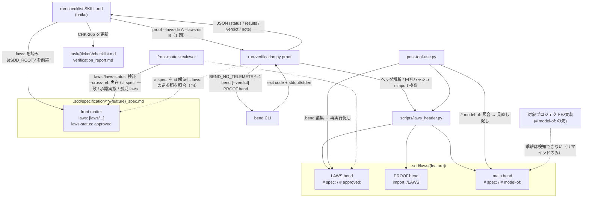
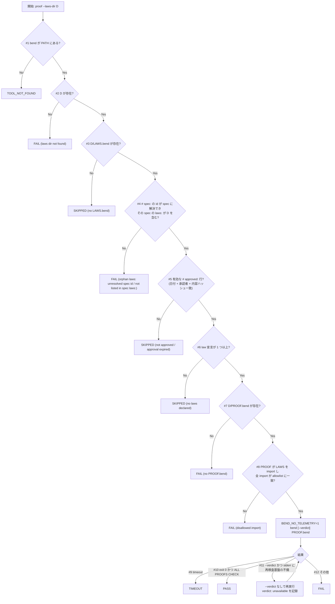

# Bend 証明ゲート（run-checklist の proof カテゴリ）の技術設計

**関連 Spec:** [proof-gate_spec.md](../../specification/task-implementation/proof-gate_spec.md),
[run-checklist_spec.md](../../specification/task-implementation/run-checklist_spec.md),
[checklist-generation_spec.md](../../specification/task-implementation/checklist-generation_spec.md),
[front-matter-validation_spec.md](../../specification/quality-guardrails/front-matter-validation_spec.md),
[stale-doc-detection_spec.md](../../specification/quality-guardrails/stale-doc-detection_spec.md)
**関連 PRD:** [proof-gate.md](../../requirement/task-implementation/proof-gate.md)（GitHub issue #149。調査: #148, #5）
**準拠する原則:** [CONSTITUTION.md](../../CONSTITUTION.md)（参照した版: v2.0.0）の A-002（フックとスクリプトの責務分離）, B-001（Vibe Coding 防止）, B-002（多言語対応の一貫性）, D-001（Specification-Driven）, D-002（ファイル命名規則の厳守）, T-002（plugin.json 登録の徹底）

---

# 1. 実装ステータス

**ステータス:** 🟢 実装済み（第 2 弾の法則案生成スキルを除く。PR で提出）

## 1.1. 実装進捗

| モジュール/機能                                                    | ステータス | 備考                                                       |
|------------------------------------------------------------|-------|----------------------------------------------------------|
| `scripts/laws_header.py`（新規共有モジュール）                        | 🟢    | §5.5 前半                                                   |
| `run-verification.py` の `proof` カテゴリ                       | 🟢    | §4.3 / §5.5 後半 / §9.1 D-01〜D-12（孤児 laws 判定を含む）           |
| `hook_common.py` / `session-start.py` の `directories.laws` と `proof.*` | 🟢 | `SddPaths.laws_dir`、`load_proof_config()`、`SDD_LAWS_DIR` / `SDD_LAWS_PATH` |
| `fm_parser.py` の `LIST_KEYS` に `laws`                        | 🟢    | 1 行変更 + テスト                                              |
| `post-tool-use.py` の `.bend` / `# model-of:` リマインド           | 🟢    | stale-doc-detection_spec FR-007 / FR-008                 |
| `front-matter-reviewer.md` / `front_matter_reference.md` の拡張 | 🟢    | front-matter-validation_spec FR-009（`--cross-ref` の孤児 laws 逆方向検査を含む） |
| checklist テンプレート `CHK-205`（en/ja）と checklist SKILL.md        | 🟢    | checklist-generation_spec FR-006                         |
| run-checklist の SKILL.md / `verification_commands.md` / テンプレート | 🟢  | 判定表・`--category proof` 別名・PASS の意味の注記                     |
| README / CHANGELOG / 原則文書の構成図                               | 🟢    | README / CHANGELOG のみ。`AI-SDD-PRINCIPLES.source.md` は本チケットの範囲外（§7.1 のモデル作成ガイドは README に反映）                             |
| 第 2 弾: 法則案生成スキル                                            | ⏸️    | 境界は spec §4.1・§7.2 に一元化。本書 §4.4 は実装上の置き場所のみ。別チケット        |

---

# 2. 設計目標

1. **既存の検証契約に乗せる**: `run-verification.py` に `proof` を 5 番目のカテゴリとして追加し、スキル側は既存の
   JSON 契約（`status` / `reason`）を読むだけで済む形にする。新しいスキル・エージェント・ベアな Bash 権限は追加しない
2. **不在時は無害**: `bend` が無い・法則ファイルが無い・Windows である、のいずれでも TOOL_NOT_FOUND / SKIPPED で
   素通りし、他カテゴリの検証と CI（bend 非導入）に影響を与えない
3. **自己採点を構造的に抑止する**: 有効な `# approved:` 行（承認日・承認者・法則本文の内容ハッシュ）が無い限り PASS を返さない。
   承認後に法則本文を弱めると承認が失効する。AI は承認行を書かない
4. **外部通信ゼロ**: `BEND_NO_TELEMETRY=1` を常に付与し、法則ディレクトリ内に実在するファイルへの相対 import と標準ライブラリ `Base`
   以外の import 文は検査器を起動する前に FAIL にする（allowlist。未知の形式・未解決の名前は FAIL 側に倒れる）
5. **spec を正典に保つ**: spec → `laws:` → 法則ファイルの一方向参照だけを持ち、`depends-on`・PRD・spec の本文・front matter を
   法則から変更しない。spec に結びつかない法則ディレクトリ（孤児 laws）は派生物として成立しないので、ゲートと
   front-matter-reviewer の双方が静的に検出する（D-12）
6. **PASS の意味を誤読させない**: 判定 JSON・結果ブロック・SKILL.md・README のすべてに「参照モデルが法則を満たす保証であり、
   実装の正しさではない」を載せる

---

# 3. 実装方式

| 領域                              | 採用方式                                                                                              | 選定理由                                                                                                               |
|---------------------------------|---------------------------------------------------------------------------------------------------|--------------------------------------------------------------------------------------------------------------------|
| 証明検査の実行                        | `run-verification.py` に `proof` カテゴリを追加（Python。`subprocess.run` で `bend` を起動）                      | スキルの `allowed-tools` が事前承認しているのはこのスクリプト 1 本だけ（Check 5.4 のスコープ付き Bash）。bend を直接呼ぶ経路を作らない（PRD DC_003、A-002）        |
| 法則ディレクトリの指定                    | CLI 引数 `--laws-dir`（複数可、1 回の呼び出しで全部渡す）。省略時は `SDD_LAWS_PATH` 配下を再帰走査し `LAWS.bend` / `PROOF.bend` を直接含むディレクトリだけを対象にする | spec の `laws:` を読むのはスキル（LLM）の仕事、ディレクトリを検査・集約するのはスクリプトの仕事に分ける（haiku に集約させない）。既存の `Bash(... run-verification.py *)` パターンは追加引数を許す |
| 判定                              | 純粋関数 `precheck()` / `judge_run()` / `needs_plain_fallback()`（ファイル有無・承認・import 検査 / 終了コード・出力 → status） | 判定表（spec 3.1.1）を `subprocess` から切り離してユニットテストできるようにする                                                               |
| 孤児 laws の判定（spec 3.1.1 #4）         | `LAWS.bend` の `# spec:` の id を `${SDD_SPECIFICATION_PATH}` 配下の spec の front matter `id` に解決し、解決先の `laws:` に当該ディレクトリ（`${SDD_ROOT}` 相対）が含まれるかを見る。解決は `doc_walker.iter_specification_docs()` + `fm_parser.split_front_matter()` / `parse_front_matter()` を再利用し、新しい id 解決ロジックは書かない | spec が正典であり、spec に結びつかない法則は派生物として成立しない（D-12）。`.cache/index.md` に依存せず spec を直接走査すれば、インデックス未生成の環境でも判定が揺れない。走査は `proof` 実行 1 回につき 1 度だけ行い、全ディレクトリで共有する |
| import の静的検査                    | `import` / `from` で始まる行をすべて拾い、「同じ法則ディレクトリ内に実在する `.bend` を相対パスで指す `import <path>`」と「Bend 同梱の標準ライブラリ `import Base`」だけを allowlist で許可する。それ以外（実在しないファイル名を含む）は FAIL | Bend Hub の import 構文を網羅的に deny するより allowlist のほうが構文変更に強い。コメント付き・別名・`from` 形式も「許可形式に一致しない」として FAIL 側に倒れる         |
| 先頭コメント規約の解析                    | `scripts/laws_header.py`（新規共有モジュール）で `# key: value` 行を dict に読み、法則本文（先頭コメント部を除く）の内容ハッシュを算出する。`run-verification.py` / `post-tool-use.py` / 第 2 弾スキルで共用 | 規約の定義を 1 箇所に置く（naming.py / fm_parser.py と同じ「single source of truth」の流儀）                                           |
| `.sdd-config.json` の拡張           | `directories.laws`（既定 `laws`）、`proof.timeout_seconds`（既定 300）、`proof.verdict`（既定 false）。CLI 引数が設定より優先 | 既存の `directories` の流儀に合わせる。`SddPaths` にフィールド追加、session-start が `SDD_LAWS_DIR` / `SDD_LAWS_PATH` をエクスポート            |
| spec front matter                | `fm_parser.LIST_KEYS` に `laws` を追加。`laws-status` はスカラー                                              | インデックス・recommend-front-matter・reviewer がリストとして扱える                                                                   |
| front matter の検証                | `front-matter-reviewer.md` の Spec 種別チェックに行追加、`--cross-ref` に `laws:` ディレクトリ実在（`${SDD_ROOT}/` + 要素値）・`# spec:` 一致・実態整合、および逆方向（`${SDD_LAWS_PATH}` 配下の全 `LAWS.bend` について `# spec:` が ID レジストリに解決でき、解決先 spec の `laws:` が当該ディレクトリを指す。いずれも error）を追加 | 既存の「ルール基盤の軽量検証（haiku）」の範囲内。ファイル存在と先頭数行の照合だけで済み、Read / Glob / Grep で完結する（ハッシュ計算なし）                                                                    |
| フックのリマインド                       | `post-tool-use.py` に 2 分岐を追加（`.bend` 編集 → 再実行促し、ソース編集 → `main.bend` の `# model-of:` 照合。spec 同期の促しと両方注入しうる） | 非ブロッキング `additionalContext`（stale-doc-detection の既定方針）。ソース編集時の照合は `laws/**/main.bend` の先頭コメント部だけ読む                     |
| チェックリスト項目                      | `checklist_template.md`（en/ja）の仕様レビューに `CHK-205 [P2]` を固定項目として追加。`laws:` が無い spec では生成しない旨を checklist SKILL.md に記載。run-checklist SKILL.md は `--category proof` を「CHK-205 のみ」の別名として受理する | 既存 ID 体系（`CHK-{category}{nn}`、カテゴリ 1〜9）を崩さない（親 PRD IR_002）。既存の `--category` は CHK カテゴリ名を取るため、別名として足す       |
| Windows                         | 分岐を設けない。`bend` が PATH に無ければ TOOL_NOT_FOUND                                                        | PRD DC_004。WSL 内では Linux として動く                                                                                       |

---

# 4. アーキテクチャ

## 4.1. システム構成図



## 4.2. モジュール分割

| モジュール名                                              | 責務                                                                                     | 依存関係                                        | 配置場所                                                   |
|-----------------------------------------------------|----------------------------------------------------------------------------------------|---------------------------------------------|--------------------------------------------------------|
| `laws_header.py`（新規）                                | 先頭コメント規約（`# spec:` / `# approved:` / `# model-of:`）の解析、法則本文の内容ハッシュ、承認行の有効性、import 文の allowlist 検査、`law` 宣言の有無 | なし（stdlib のみ）                                | `scripts/`（共有モジュール。sdd_index 等と同じ流儀）                   |
| `run-verification.py`（拡張）                           | `proof` カテゴリ: 引数解析、設定読込、法則ディレクトリ探索、spec id レジストリ構築（孤児判定）、事前判定、`bend` 実行、フォールバック、判定、集約、JSON 出力。`--print-laws-hash` | `laws_header.py`, `hook_common`, `fm_parser`, `doc_walker` | `skills/run-checklist/scripts/`                        |
| `hook_common.py`（拡張）                                | `SddPaths.laws_dir` / `laws_prefix`、`load_proof_config()`（timeout / verdict）              | -                                           | `scripts/`                                             |
| `session-start.py`（拡張）                              | `SDD_LAWS_DIR` / `SDD_LAWS_PATH` のエクスポート                                                 | `env_export.py`                             | `scripts/`                                             |
| `fm_parser.py`（拡張）                                  | `LIST_KEYS = {"depends-on", "tags", "laws"}`                                             | -                                           | `scripts/`                                             |
| `post-tool-use.py`（拡張）                              | `.bend` 編集時の再実行促し、ソース編集時の `# model-of:` 照合                                            | `laws_header.py`, `hook_common`             | `scripts/`                                             |
| `front-matter-reviewer.md` / `front_matter_reference.md`（拡張） | Spec 種別チェック（`laws:` / `laws-status`）、`--cross-ref` の実在・一致・実態整合・孤児 laws の逆方向検査（error）     | -                                           | `agents/` / `shared/references/`                       |
| `checklist_template.md`（en/ja）・checklist `SKILL.md`（拡張） | `CHK-205 [P2] 法則証明（proof ゲート）`、`laws:` 無しなら生成しない                                        | -                                           | `skills/checklist/`                                    |
| `result_format.md` / `report_format.md`（en/ja、拡張）    | proof の自動検証結果ブロック例・レポート節と PASS の意味の注記                                                   | -                                           | `skills/run-checklist/templates/{en,ja}/`              |
| run-checklist `SKILL.md` / `verification_commands.md`（拡張） | `proof` の呼び出し手順（`laws:` → `--laws-dir` を 1 回で渡す）・判定表・`--category proof` 別名                 | -                                           | `skills/run-checklist/`                                |

## 4.3. 判定フロー（`proof` カテゴリ、法則ディレクトリ 1 つ分）

spec 3.1.1 の判定表の実装順。番号は判定表の # に対応する。



複数ディレクトリの集約順位は FAIL > TIMEOUT > TOOL_NOT_FOUND > SKIPPED > PASS（最も悪い判定を全体の `status` にし、
その判定を出したディレクトリの `reason` を全体の `reason` にする）。

#4（孤児 laws）は `--laws-dir` 明示指定でも省略時の再帰走査でも同じ条件で評価する。#2 が spec → laws 方向（`laws:` の指す先が無い）、
#4 が laws → spec 方向（`# spec:` が解決できない、または解決先の `laws:` に無い）の不整合で、両方向が揃って初めて正とする。
#4 を承認判定（#5）より前に置くのは、承認行の有無にかかわらず「spec に結びつかない法則ディレクトリ」を SKIPPED で素通りさせないため。
id → spec ファイルの解決は `doc_walker.iter_specification_docs()` で `${SDD_SPECIFICATION_PATH}` 配下を走査し、各ファイルの
`fm_parser.split_front_matter()` / `parse_front_matter()` の結果から `id` → (path, `laws`) のレジストリを 1 回だけ組み立てる（§5.5.2 `build_spec_registry()`）。

## 4.4. 第 2 弾（spec → LAWS 案生成）の実装上の置き場所

境界（入力・出力・状態遷移・禁止事項）は spec §4.1 / §7.2 / §8 に一元化し、本書では実装上の配置だけを決める。

| 項目        | 内容                                                                                                                                       |
|:----------|:-----------------------------------------------------------------------------------------------------------------------------------------|
| 実装の置き場所   | 新規スキル（名称は実装チケットで決定。`skills/` 配下、`plugin.json` 登録不要 — T-002）                                                                              |
| 権限        | `allowed-tools` は `Read, Glob, Grep, Edit(.sdd/**)` と、`run-verification.py` のスコープ付き Bash（`--print-laws-hash` を人に案内するためで、スキル自身は承認行を書かない）に限る |
| 共有部品      | `laws_header.py` のヘッダ書き出しユーティリティ（`# spec:` を先頭に置く。`# approved:` は書かない）を再利用する                                                               |
| 承認フローの導線  | 生成後に「レビューして `# approved: YYYY-MM-DD <承認者> sha256:<ハッシュ>` を追記し、`laws-status` を `approved` にしてください」と、`--print-laws-hash` の実行例を提示する              |

---

# 5. データ構造

## 5.1. `run-verification.py proof` の出力 JSON

契約は spec §4.1 を正とする。本節は spec の例に対する差分だけを示す。

- トップレベル `reason` は、集約判定を出したディレクトリの `reason`（ディレクトリが 1 つなら同じ値）。
  例: `"1 of 2 laws directories FAILED: .sdd/laws/auth/user-login - bend reported SOME PROOFS FAIL"`
- `results[]` の各要素は `laws_dir` / `spec` / `approved` / `model_of` / `status` / `reason` / `verdict` を常に持ち、
  bend を実行した場合のみ `command` / `exit_code` / `stdout` / `stderr` を持つ
- `project_type` は含めない（`proof` はプロジェクト種別に依存しない。既存カテゴリは従来どおり）
- `verdict` の値は `"checked"` / `"unavailable"` / `"not-requested"` の 3 値。集約はいずれかが `unavailable` なら
  `unavailable`、`--verdict` 指定時はそれ以外 `checked`、未指定なら `not-requested`
- `stdout` / `stderr` は既存どおり末尾 8000 / 4000 文字に切り詰める
- `--print-laws-hash` 指定時は `{"category": "proof", "laws_hash": {"<laws_dir>": "<12 hex>"}}` だけを出力する

## 5.2. `.sdd-config.json`

```json
{
  "root": ".sdd",
  "directories": {
    "requirement": "requirement",
    "specification": "specification",
    "adr": "adr",
    "task": "task",
    "laws": "laws"
  },
  "proof": {
    "timeout_seconds": 300,
    "verdict": false
  }
}
```

`directories.laws` → `SddPaths.laws_dir`（既定 `"laws"`）、`laws_prefix` = `{root}/{laws_dir}`。session-start は
`SDD_LAWS_DIR` / `SDD_LAWS_PATH` をエクスポートする（`sdd-init` の `init-structure.py` が書く `.sdd-config.json`
の既定に `laws` を**含めない**: ディレクトリは opt-in 時に初めて作る）。CLI の `--timeout` / `--verdict` は設定値より優先する。

## 5.3. spec front matter

```yaml
---
id: "spec-{parent}-{feature}"
type: "spec"
sdd-phase: "specify"
depends-on: ["prd-{parent}-{feature}"]                    # laws は含めない（下流）
laws: ["laws/{parent}/{feature}"]                         # ${SDD_ROOT} 相対ディレクトリ。LIST_KEYS。スキルは ${SDD_ROOT}/ を前置して渡す
laws-status: "approved"                                   # none | drafted | approved | proven
---
```

## 5.4. 法則ファイルの先頭コメント規約（`laws_header.py` が解析する範囲）

`LAWS.bend` の先頭:

```
# spec: spec-{parent}-{feature}
# approved: 2026-10-17 @reviewer sha256:3f9a1c0b7d2e

import Base
import ./main
```

`main.bend` の先頭:

```
# spec: spec-{parent}-{feature}
# model-of: src/{module}.py
# model-of: src/{other-module}.py

import Base
```

- 解析するのは**先頭から連続する**コメント行（`#` 始まり）と空行のみ。最初の非コメント・非空行で打ち切る。UTF-8 BOM は読み飛ばす
- キーは `spec` / `approved` / `model-of` の 3 つ。`model-of` は複数行可。未知のキーは無視する
- 承認行は追記式でよい（`valid_approval()` は全承認行を走査し、いずれか 1 行がハッシュ一致すれば有効）。失効時の `reason` には現在のハッシュを含める
- `approved` の値は `^\d{4}-\d{2}-\d{2}\s+\S+\s+sha256:[0-9a-f]{12}$` に一致し、かつ日付が暦日として有効であること
  （日付・承認者・内容ハッシュのいずれかが無い行、不正な日付の行は承認行とみなさない）。内容ハッシュは
  **先頭コメント部を除いた** `LAWS.bend` の残り全文を UTF-8 で SHA-256 したものの先頭 12 桁。先頭コメント部を除くのは、
  `# spec:` や承認行自体の追記で承認が失効しないようにするため。現在の本文から算出した値と一致しないとき承認は失効（SKIPPED）。
  `run-verification.py proof --print-laws-hash --laws-dir D` がこの値を表示する（読み取り専用。人が承認行を書くときに使う）
- import の allowlist: `import` または `from` で始まる行はすべて検査対象。許可するのは (a) `import Base`（Bend 同梱の標準ライブラリ。
  `STDLIB_IMPORTS` に列挙）と、(b) `^import\s+(\./)?([A-Za-z0-9_\-]+/)*[A-Za-z0-9_\-]+(\.bend)?$`（行全体。末尾コメント・別名・`from` 形式は
  不一致 → FAIL）に一致し、解決先が法則ディレクトリ内に収まり、かつ対応する `.bend` ファイルが**実在**するもの。実在確認により、
  bare 名の Hub import（`import SomePkg`）が相対 import に見えて素通りすることを防ぐ。絶対パス・`..`・`@` 始まりの Hub 名前空間・URL は FAIL。
  サブディレクトリの `.bend` も再帰的に検査する。Bend 側の正確な import 構文は実装時に `guide/GUIDE.md` で再確認し、必要なら allowlist の正規表現だけを調整する
- `PROOF.bend` は `LAWS` を import していなければ FAIL（検査器自身が拒否するという調査時の観察に依存せず、ゲートが自前で課す）
- `law` 宣言の有無は `^\s*law\s+[A-Za-z_]` に一致する行の有無で見る（実装時に GUIDE.md で構文を再確認）

## 5.5. pseudocode（verbatim で動く完全性を保つ）

### 5.5.1. `scripts/laws_header.py`（新規共有モジュール）

```python
"""laws_header.py - Shared parsing of Bend law-file conventions (proof gate).

Single source of truth for the leading-comment conventions (``# spec:`` /
``# approved:`` / ``# model-of:``), the law-body content hash that binds an
approval to the law text, the import allowlist, and the ``law`` declaration
check. Consumed by run-verification.py (proof category) and post-tool-use.py.
"""

import datetime
import hashlib
import re
from pathlib import Path
from typing import Dict, List, Optional

LAWS_FILE = "LAWS.bend"
PROOF_FILE = "PROOF.bend"
MODEL_FILE = "main.bend"

HEADER_RE = re.compile(r"^#\s*([A-Za-z][\w-]*):\s*(.*)$")
APPROVED_RE = re.compile(
    r"^(?P<date>\d{4}-\d{2}-\d{2})\s+(?P<approver>\S+)\s+sha256:(?P<digest>[0-9a-f]{12})$"
)
IMPORT_LINE_RE = re.compile(r"^\s*(?:import|from)\b")
LOCAL_IMPORT_RE = re.compile(
    r"^import\s+(?P<target>(?:\./)?(?:[A-Za-z0-9_\-]+/)*[A-Za-z0-9_\-]+(?:\.bend)?)$"
)
LAWS_IMPORT_RE = re.compile(r"^import\s+(?:\./)?LAWS(?:\.bend)?$")
# Bend's bundled standard library: importable by bare name without a file in the laws dir.
# Confirm the exact name against guide/GUIDE.md at implementation time.
STDLIB_IMPORTS = frozenset({"Base"})
LAW_DECL_RE = re.compile(r"^\s*law\s+[A-Za-z_]")


def _read_lines(path: Path) -> List[str]:
    text = path.read_text(encoding="utf-8", errors="replace")
    if text.startswith(""):
        text = text[1:]
    return text.splitlines()


def _header_end(lines: List[str]) -> int:
    """Index of the first line that is neither blank nor a ``#`` comment."""
    i = 0
    while i < len(lines) and (not lines[i].strip() or lines[i].lstrip().startswith("#")):
        i += 1
    return i


def read_header(path: Path) -> Dict[str, List[str]]:
    """Parse leading ``# key: value`` comment lines; stop at the first code line."""
    header: Dict[str, List[str]] = {}
    lines = _read_lines(path)
    for raw in lines[:_header_end(lines)]:
        m = HEADER_RE.match(raw.strip())
        if m is not None:
            header.setdefault(m.group(1), []).append(m.group(2).strip())
    return header


def law_body_hash(path: Path) -> str:
    """SHA-256 (first 12 hex) of LAWS.bend minus its leading comment/blank header."""
    lines = _read_lines(path)
    body = "\n".join(lines[_header_end(lines):])
    return hashlib.sha256(body.encode("utf-8")).hexdigest()[:12]


def valid_approval(header: Dict[str, List[str]], body_hash: str) -> Optional[str]:
    """Return the approval line whose digest matches the current law body, else None."""
    for value in header.get("approved", []):
        m = APPROVED_RE.match(value)
        if m is None or m.group("digest") != body_hash:
            continue
        try:
            datetime.date.fromisoformat(m.group("date"))
        except ValueError:
            continue
        return value
    return None


def declares_laws(path: Path) -> bool:
    """True if LAWS.bend contains at least one ``law`` declaration."""
    return any(LAW_DECL_RE.match(line) for line in _read_lines(path))


def imports_laws(proof_path: Path) -> bool:
    """True if PROOF.bend imports LAWS (any accepted local spelling)."""
    return any(LAWS_IMPORT_RE.match(line.strip()) for line in _read_lines(proof_path))


def _local_import_exists(bend_file: Path, root: Path, target: str) -> bool:
    """True if ``target`` resolves inside ``root`` to an existing ``.bend`` file."""
    resolved = (bend_file.parent / target).resolve()
    if resolved != root and root not in resolved.parents:
        return False
    candidates = [resolved] if resolved.suffix == ".bend" else [resolved.with_suffix(".bend"), resolved]
    return any(c.is_file() for c in candidates)


def disallowed_imports(laws_dir: Path) -> List[str]:
    """Import lines (any ``import``/``from`` line) that are neither the bundled standard
    library nor a relative import of an existing ``.bend`` file inside ``laws_dir``.
    Everything not matching the allowlist fails (unknown forms, unresolved names)."""
    root = laws_dir.resolve()
    bad: List[str] = []
    for bend_file in sorted(laws_dir.rglob("*.bend")):
        for raw in _read_lines(bend_file):
            if not IMPORT_LINE_RE.match(raw):
                continue
            line = raw.strip()
            m = LOCAL_IMPORT_RE.match(line)
            if m is None:
                bad.append(f"{bend_file.relative_to(laws_dir)}: {line}")
                continue
            target = m.group("target")
            if target in STDLIB_IMPORTS:
                continue
            if not _local_import_exists(bend_file, root, target):
                bad.append(f"{bend_file.relative_to(laws_dir)}: {line}")
    return bad
```

### 5.5.2. `skills/run-checklist/scripts/run-verification.py` の `proof` 部分

既存の `main()` は `len(sys.argv) != 2` を厳密に検査しているため、`proof` では `argparse` を使う分岐を前置し、
既存 4 カテゴリは従来どおり単一位置引数で動かす（後方互換）。

```python
#!/usr/bin/env python3
"""proof category additions to run-verification.py (design pseudocode).

The existing test/lint/typecheck/security path is unchanged. ``proof`` takes
options, so ``main()`` dispatches to ``main_proof()`` before the legacy
single-argument check. Decision rows live in pure functions so the table in
spec 3.1.1 is unit-testable without spawning bend.
"""

import argparse
import json
import os
import shutil
import subprocess
import sys
from pathlib import Path
from typing import Dict, List, Optional

# skills/run-checklist/scripts/ -> plugins/sdd-workflow/scripts/ (shared modules)
sys.path.insert(0, str(Path(__file__).resolve().parents[3] / "scripts"))
from doc_walker import iter_specification_docs  # noqa: E402
from fm_parser import parse_front_matter, split_front_matter  # noqa: E402
from hook_common import load_sdd_paths, read_sdd_config_json  # noqa: E402
from laws_header import (  # noqa: E402
    LAWS_FILE, MODEL_FILE, PROOF_FILE, declares_laws, disallowed_imports,
    imports_laws, law_body_hash, read_header, valid_approval,
)

PROOF_TIMEOUT_DEFAULT = 300
BENDTT_INFRA_MARKER = "BendTT infrastructure"
ALL_PROOFS_CHECK = "ALL PROOFS CHECK"
SEVERITY = {"FAIL": 4, "TIMEOUT": 3, "TOOL_NOT_FOUND": 2, "SKIPPED": 1, "PASS": 0}
PASS_NOTE = ("PASS means the reference model (main.bend) satisfies the approved laws. "
             "It does not prove the project's implementation.")


def load_proof_config(project_root: Path) -> Dict[str, object]:
    raw = read_sdd_config_json(str(project_root)).get("proof") or {}
    timeout = raw.get("timeout_seconds", PROOF_TIMEOUT_DEFAULT)
    return {
        "timeout_seconds": timeout if isinstance(timeout, int) and timeout > 0 else PROOF_TIMEOUT_DEFAULT,
        "verdict": bool(raw.get("verdict", False)),
    }


def discover_laws_dirs(laws_root: Path) -> List[Path]:
    """Directories under laws_root that directly contain LAWS.bend or PROOF.bend."""
    if not laws_root.is_dir():
        return []
    found = {p.parent for name in (LAWS_FILE, PROOF_FILE) for p in laws_root.rglob(name)}
    return sorted(found)


def build_spec_registry(spec_root: Path) -> Dict[str, Dict[str, object]]:
    """id -> {"path": Path, "laws": [str]} for every spec under ${SDD_SPECIFICATION_PATH}.

    Reuses doc_walker / fm_parser (the same front matter rules the hooks and
    sdd_index apply) instead of a new id resolver. Built once per proof run."""
    registry: Dict[str, Dict[str, object]] = {}
    for spec_file in iter_specification_docs(spec_root):
        fm_text, _ = split_front_matter(spec_file.read_text(encoding="utf-8", errors="replace"))
        fm = parse_front_matter(fm_text) if fm_text else {}
        spec_id = fm.get("id")
        if isinstance(spec_id, str) and spec_id:
            laws = fm.get("laws", [])
            registry[spec_id] = {"path": spec_file,
                                 "laws": [laws] if isinstance(laws, str) else list(laws or [])}
    return registry


def orphan_reason(spec_id: Optional[str], laws_dir_sdd_relative: str,
                  registry: Dict[str, Dict[str, object]]) -> Optional[str]:
    """Spec 3.1.1 row #4. None means the laws dir is bound to a spec in both directions."""
    if spec_id is None:
        return f"{LAWS_FILE} has no '# spec:' line, so the laws directory is not bound to any spec"
    entry = registry.get(spec_id)
    if entry is None:
        return f"orphan laws: '# spec: {spec_id}' does not resolve to any spec under the specification directory"
    listed = [str(x).strip("/") for x in entry["laws"]]  # type: ignore[index]
    if laws_dir_sdd_relative.strip("/") not in listed:
        return (f"orphan laws: {entry['path']} (id {spec_id}) does not list "
                f"'{laws_dir_sdd_relative}' in its laws: front matter")
    return None


def precheck(bend_found: bool, dir_exists: bool, has_laws: bool, orphan: Optional[str],
             approved: Optional[str], has_law_decl: bool, has_proof: bool,
             proof_imports_laws: bool, bad_imports: List[str]) -> Optional[Dict[str, str]]:
    """Spec 3.1.1 rows #1-#8. None means "run bend"."""
    if not bend_found:
        return {"status": "TOOL_NOT_FOUND", "reason": "bend is not installed (not on PATH)"}
    if not dir_exists:
        return {"status": "FAIL", "reason": "laws directory not found (check the spec's laws: entry)"}
    if not has_laws:
        return {"status": "SKIPPED", "reason": f"no {LAWS_FILE} in this laws directory"}
    if orphan is not None:
        return {"status": "FAIL", "reason": orphan}
    if approved is None:
        return {"status": "SKIPPED",
                "reason": f"{LAWS_FILE} has no valid '# approved:' line (missing, malformed, or its "
                          "content hash no longer matches the law body); unapproved laws are never "
                          "reported as PASS"}
    if not has_law_decl:
        return {"status": "SKIPPED", "reason": f"{LAWS_FILE} declares no laws"}
    if not has_proof:
        return {"status": "FAIL", "reason": f"{LAWS_FILE} is approved but {PROOF_FILE} is missing"}
    if not proof_imports_laws:
        return {"status": "FAIL", "reason": f"{PROOF_FILE} does not import {LAWS_FILE}"}
    if len(bad_imports) > 0:
        return {"status": "FAIL",
                "reason": "disallowed import (only relative imports of files inside the laws "
                          "directory are allowed): " + "; ".join(bad_imports)}
    return None


def needs_plain_fallback(exit_code: Optional[int], stderr: str, verdict_requested: bool) -> bool:
    """Spec 3.1.1 row #11: --verdict was asked for but the Lean kernel is unavailable."""
    return verdict_requested and exit_code not in (0, None) and BENDTT_INFRA_MARKER in stderr


def judge_run(exit_code: Optional[int], stdout: str, timed_out: bool) -> Dict[str, str]:
    """Spec 3.1.1 rows #9, #10, #12 for a finished bend run."""
    if timed_out:
        return {"status": "TIMEOUT", "reason": "bend exceeded the time limit"}
    if exit_code == 0 and ALL_PROOFS_CHECK in stdout:
        return {"status": "PASS", "reason": f"bend reported {ALL_PROOFS_CHECK}"}
    if exit_code == 0:
        return {"status": "FAIL", "reason": f"bend exited 0 but did not report {ALL_PROOFS_CHECK}"}
    return {"status": "FAIL", "reason": f"bend exited {exit_code} (SOME PROOFS FAIL or a syntax error)"}


def run_bend(laws_dir: Path, verdict: bool, timeout: int) -> Dict[str, object]:
    args = ["bend"] + (["--verdict"] if verdict else []) + [PROOF_FILE]
    env = dict(os.environ, BEND_NO_TELEMETRY="1")
    try:
        r = subprocess.run(args, cwd=laws_dir, env=env, capture_output=True, text=True,
                           timeout=timeout, encoding="utf-8", errors="replace")
        return {"command": " ".join(args), "exit_code": r.returncode,
                "stdout": r.stdout[-8000:], "stderr": r.stderr[-4000:], "timed_out": False}
    except subprocess.TimeoutExpired:
        return {"command": " ".join(args), "exit_code": None, "stdout": "", "stderr": "",
                "timed_out": True}
    except OSError as e:  # bend vanished between which() and run(), or is not executable
        return {"command": " ".join(args), "exit_code": None, "stdout": "", "stderr": str(e),
                "timed_out": False, "launch_error": True}


def run_proof_dir(laws_dir: Path, verdict: bool, timeout: int, sdd_root: Path,
                  registry: Dict[str, Dict[str, object]]) -> Dict[str, object]:
    laws = laws_dir / LAWS_FILE
    proof = laws_dir / PROOF_FILE
    model = laws_dir / MODEL_FILE
    header = read_header(laws) if laws.is_file() else {}
    model_header = read_header(model) if model.is_file() else {}
    approved = valid_approval(header, law_body_hash(laws)) if laws.is_file() else None
    spec_values = header.get("spec", [])
    verdict_label = "not-requested" if not verdict else "checked"
    base: Dict[str, object] = {
        "laws_dir": str(laws_dir),
        "spec": spec_values[0] if len(spec_values) > 0 else None,
        "approved": approved,
        "model_of": model_header.get("model-of", []),
        "verdict": verdict_label,
    }
    try:
        sdd_relative = laws_dir.resolve().relative_to(sdd_root.resolve()).as_posix()
    except ValueError:  # laws dir outside ${SDD_ROOT}: can never match a spec's laws: entry
        sdd_relative = laws_dir.as_posix()
    early = precheck(
        bend_found=shutil.which("bend") is not None,
        dir_exists=laws_dir.is_dir(),
        has_laws=laws.is_file(),
        orphan=orphan_reason(base["spec"], sdd_relative, registry) if laws.is_file() else None,  # type: ignore[arg-type]
        approved=approved,
        has_law_decl=declares_laws(laws) if laws.is_file() else False,
        has_proof=proof.is_file(),
        proof_imports_laws=imports_laws(proof) if proof.is_file() else False,
        bad_imports=disallowed_imports(laws_dir) if laws_dir.is_dir() else [],
    )
    if early is not None:
        if approved is None and laws.is_file() and early["status"] == "SKIPPED":
            # spec §4.1 (R10): give the current hash so the approver can rewrite the line directly.
            early = {**early, "reason": early["reason"] + f" Current law-body hash: sha256:{law_body_hash(laws)}"}
        return {**base, **early}

    run = run_bend(laws_dir, verdict, timeout)
    if run.get("launch_error"):
        return {**base, "status": "TOOL_NOT_FOUND", "reason": f"bend could not be launched: {run['stderr']}"}
    exit_code = run["exit_code"] if isinstance(run["exit_code"], int) else None
    if needs_plain_fallback(exit_code, str(run["stderr"]), verdict):
        base["verdict"] = "unavailable"  # spec FR-006: keep the primary verdict, note the gap
        run = run_bend(laws_dir, False, timeout)
        if run.get("launch_error"):
            return {**base, "status": "TOOL_NOT_FOUND", "reason": f"bend could not be launched: {run['stderr']}"}
        exit_code = run["exit_code"] if isinstance(run["exit_code"], int) else None
    outcome = judge_run(exit_code, str(run["stdout"]), bool(run["timed_out"]))
    return {**base, **outcome,
            **{k: run[k] for k in ("command", "exit_code", "stdout", "stderr")}}


def aggregate(results: List[Dict[str, object]], verdict_requested: bool) -> Dict[str, object]:
    """Worst status wins (FAIL > TIMEOUT > TOOL_NOT_FOUND > SKIPPED > PASS); its reason is the top-level reason."""
    if len(results) == 0:
        return {"status": "SKIPPED", "reason": "no laws directories found", "verdict": "not-requested"}
    worst = max(results, key=lambda r: SEVERITY[str(r["status"])])
    verdicts = {str(r.get("verdict")) for r in results}
    if "unavailable" in verdicts:
        verdict = "unavailable"
    elif verdict_requested:
        verdict = "checked"
    else:
        verdict = "not-requested"
    n_worst = sum(1 for r in results if r["status"] == worst["status"])
    reason = (f"{n_worst} of {len(results)} laws directories {worst['status']}: "
              f"{worst['laws_dir']} - {worst['reason']}")
    return {"status": str(worst["status"]), "reason": reason, "verdict": verdict}


def main_proof(argv: List[str]) -> None:
    parser = argparse.ArgumentParser(prog="run-verification.py proof")
    parser.add_argument("--laws-dir", action="append", default=[],
                        help="laws directory (project-relative); repeatable. Default: discover under SDD_LAWS_PATH")
    parser.add_argument("--verdict", action="store_true", default=None,
                        help="also re-check with the Lean kernel (falls back to the plain check if unavailable)")
    parser.add_argument("--timeout", type=int, default=None, help="seconds per laws directory")
    parser.add_argument("--print-laws-hash", action="store_true",
                        help="print the LAWS.bend law-body hash for each directory and exit")
    ns = parser.parse_args(argv)

    project_root = Path.cwd()
    config = load_proof_config(project_root)
    paths = load_sdd_paths(str(project_root))
    verdict = config["verdict"] if ns.verdict is None else True
    timeout = ns.timeout if ns.timeout is not None and ns.timeout > 0 else int(config["timeout_seconds"])

    if len(ns.laws_dir) > 0:
        laws_dirs = [project_root / d for d in ns.laws_dir]
    else:
        laws_dirs = discover_laws_dirs(project_root / paths.laws_prefix)

    if ns.print_laws_hash:
        hashes = {str(d.relative_to(project_root)): law_body_hash(d / LAWS_FILE)
                  for d in laws_dirs if (d / LAWS_FILE).is_file()}
        print(json.dumps({"category": "proof", "laws_hash": hashes}, ensure_ascii=False, indent=2))
        return

    sdd_root = project_root / paths.root
    registry = build_spec_registry(project_root / paths.specification_prefix)  # once per run (row #4)
    results = [run_proof_dir(d, verdict, timeout, sdd_root, registry) for d in laws_dirs]
    for r in results:
        r["laws_dir"] = os.path.relpath(str(r["laws_dir"]), str(project_root))
    summary = aggregate(results, verdict)
    print(json.dumps({"category": "proof", **summary, "timeout_seconds": timeout,
                      "results": results, "note": PASS_NOTE}, ensure_ascii=False, indent=2))


# In the existing main(): dispatch before the legacy single-argument check.
#
#   if len(sys.argv) >= 2 and sys.argv[1] == "proof":
#       main_proof(sys.argv[2:])
#       return
#   if len(sys.argv) != 2 or sys.argv[1] not in VALID_CATEGORIES:
#       ...  (unchanged)
#
# VALID_CATEGORIES gains "proof" only for the usage message; the legacy branch
# never reaches it because of the dispatch above.
```

実装時に関数の切り方は変えてよいが、**判定表 `precheck` / `orphan_reason` / `needs_plain_fallback` / `judge_run` と `aggregate` の入出力**
（spec 3.1.1）はテストで固定する。`paths.root` / `paths.specification_prefix` は `hook_common.SddPaths` の既存プロパティを使う。`hook_common.SddPaths` に `laws_dir` / `laws_prefix` を足すのは本書 §3 のとおり。

---

# 6. ファイル構成

```
plugins/sdd-workflow/
├── scripts/
│   ├── laws_header.py                       # 新規: 先頭コメント規約・内容ハッシュ・import allowlist・law 宣言（共有）
│   ├── hook_common.py                       # SddPaths.laws_dir / laws_prefix
│   ├── session-start.py                     # SDD_LAWS_DIR / SDD_LAWS_PATH のエクスポート
│   ├── fm_parser.py                         # LIST_KEYS に "laws"
│   └── post-tool-use.py                     # .bend 編集 / # model-of: 照合のリマインド
├── agents/front-matter-reviewer.md          # Spec: laws / laws-status、--cross-ref: 実在・# spec: 一致・承認実態
├── shared/references/front_matter_reference.md   # spec フィールド表に laws / laws-status、状態遷移
├── skills/run-checklist/
│   ├── SKILL.md                             # proof カテゴリの手順・判定表・--category proof 別名・PASS の意味
│   ├── scripts/run-verification.py          # proof カテゴリ（§5.5.2）
│   ├── references/verification_commands.md  # proof の呼び出し例
│   └── templates/{en,ja}/
│       ├── result_format.md                 # proof 結果ブロック例
│       └── report_format.md                 # レポートの proof 節
├── skills/checklist/
│   ├── SKILL.md                             # laws: 無しなら CHK-205 を生成しない
│   └── templates/{en,ja}/checklist_template.md   # CHK-205 [P2] 法則証明（proof ゲート）
├── AI-SDD-PRINCIPLES.source.md              # 構成図に laws/ を追記（任意ディレクトリとして）
├── README.md / README.ja.md                 # 「Bend 証明ゲート（opt-in）」節: PASS の意味、承認行の書き方、モデル作成ガイド（§7.1）
└── CHANGELOG.md / CHANGELOG.ja.md           # [Unreleased] に追加

tests/
├── test_laws_header.py                      # 先頭コメント解析、内容ハッシュ、承認行の形式と失効、import allowlist、law 宣言
├── test_run_verification_proof.py           # precheck / needs_plain_fallback / judge_run / aggregate / discover / CLI
│                                            #   （ハイフン名のため importlib.util.spec_from_file_location で読み込む）
├── test_hook_common.py（拡張）                 # directories.laws / proof.* の既定値
├── test_fm_parser.py（拡張）                   # laws のインライン / ブロックリスト
├── test_post_tool_use.py（拡張）               # .bend 編集 / # model-of: 一致 / 法則ディレクトリ無し（無出力）
└── fixtures/laws/                           # LAWS.bend / PROOF.bend / main.bend の最小 fixture と fake-bend/（ダミー bend シェルスクリプト。§8）

.claude/rules/repository-structure.md        # scripts 一覧に laws_header.py を追記（実装チケットで）
.sdd/laws/                                   # 本リポジトリでは本チケットでは作らない（実装チケットで dogfooding 用に 1 件作るかは別途判断）
```

`.bend` ファイルを `plugins/sdd-workflow/` 配下に置かない（`plugin-lint.sh` Check 2 のサポートファイル拡張子規則に
抵触するため。例はすべて Markdown のコードブロックとして `references/` / README に置く）。

---

# 7. 非機能要件実現方針

| 要件                              | 実現方針                                                                                                                                          |
|---------------------------------|-----------------------------------------------------------------------------------------------------------------------------------------------|
| NFR-001 任意依存                    | `shutil.which("bend")` を最初に見る。`TOOL_NOT_FOUND` / `SKIPPED` は run-checklist の判定表で「失敗ではない」。CI（`ci.yml`）には bend を入れず、テストは判定表の純粋関数と fixture で完結させる |
| NFR-002 応答性（300 秒 / ディレクトリ）     | `subprocess.run(timeout=...)`。調査時の実測では bend 単体は 0.04〜0.25 秒（issue #149 の追加調査。実装時に再計測）。`--verdict` の Lean は遅くなりうるので既定 300 秒を据え置き、`proof.timeout_seconds` / `--timeout` で変更可 |
| NFR-003 再現性                     | `BEND_NO_TELEMETRY=1` を `env` に常に付与。import allowlist で外部参照を排除                                                                                 |
| NFR-004 移植性                     | `pathlib` のみ。Windows 固有分岐なし（bend 不在 → TOOL_NOT_FOUND）                                                                                       |
| NFR-005 多言語                     | `CHK-205`・結果ブロック・レポートの文言を `templates/{en,ja}/` に揃える。スクリプトの JSON は英語固定（既存カテゴリと同じ。文言はテンプレートで切り替える）                                        |
| NFR-006 権限最小化                   | `allowed-tools` は現状の `Bash(python3 "${CLAUDE_PLUGIN_ROOT}/skills/run-checklist/scripts/run-verification.py" *)` のまま（引数 `*` で `proof --laws-dir ...` を許す）。bend を直接呼ぶ権限は与えない |
| NFR-007 版の前提                    | README に「判定表は Bend v2.0.37 で実測。Lean v4.34.0 は bend が要求する固定版」と明記。版の自動検出はしない（`bend --version` の出力形式が未確認のため実装時に判断）                             |
| フックの軽量性（stale-doc 親 NFR_001: 500ms） | ソース編集時の `# model-of:` 照合は `laws_prefix` が存在するときだけ `laws/**/main.bend` を glob し、各ファイルの先頭コメント部だけ読む。法則ディレクトリが無いプロジェクトでは追加コスト 1 回の `is_dir()` のみ        |

## 7.1. モデル作成ガイド（README に載せる要点）

- **PASS の意味**: PASS は `main.bend`（参照モデル）が承認済み法則を満たすことの保証であって、`# model-of:` の先にある
  実装の正しさではない。実装を変えたら参照モデルも見直す（post-tool-use がリマインドする）
- **law と def の相互再帰に注意**: 法則 `X` の証明は `PROOF.bend` の同名 `def X` で与える。参照モデル（`main.bend`）の
  `def` が法則の名前を呼んではならず、証明 `def` が自分の証明する法則を経由して自分自身を呼んでもならない
  （循環すると検査が意味を持たない）。モデルの関数名と法則名は衝突させない（例: 関数 `sort`、法則 `sort_preserves_length`）
- **参照モデルは小さく**: 証明対象は spec の制約・不変条件・事後条件だけ。IO・外部境界・性能はモデルにしない
- **承認行は人が書く**: `# approved: YYYY-MM-DD <承認者> sha256:<ハッシュ>` は PR レビューで追記する（ハッシュは
  `run-verification.py proof --print-laws-hash --laws-dir <dir>` で得る）。AI が書かないことを法則案生成スキルの指示に明記する
- **LAWS.bend の法則本文を改訂したら承認し直す**: 内容ハッシュが変わり承認は自動的に失効する（SKIPPED）。ハッシュは先頭コメント部を
  除いた本文の素のバイト列から取るため、法則の意味を変えないコメント追加・空白や改行の整形だけでも失効する（意図的に単純な方式を
  採り、正規化による取りこぼしを避ける）。承認行を更新し、`laws-status` を `approved` に戻してから再検査する
- **参考**: Bend リポジトリの `guide/GUIDE.md`（law / def 構文）と `demos/proof_insertion_sort`（法則と証明の分割例）。
  いずれも実装時に版を確認する

---

# 8. テスト戦略

| テストレベル | 対象                                                               | カバレッジ目標                                                                                                                           |
|--------|------------------------------------------------------------------|-----------------------------------------------------------------------------------------------------------------------------------|
| ユニット   | `precheck()` / `needs_plain_fallback()` / `judge_run()`           | spec 3.1.1 の全行（bend 不在 / ディレクトリ不在 / LAWS 不在 / 孤児 laws（`# spec:` なし・未解決 id・解決先 `laws:` に無し。明示指定と再帰走査の両方）/ 承認行なし・形式不正・ハッシュ不一致 / law 宣言なし / PROOF 不在 / LAWS 未 import / import 違反 / timeout / exit 0 + ALL PROOFS CHECK / exit 0 のみ / exit 1 + 基盤不備（verdict あり・なし）/ exit 1 / exit 2） |
| ユニット   | `laws_header.py`                                                 | 実在するローカル import の許可、`import Base` の許可、実在しない bare 名（Hub 風）の拒否、絶対パス・`..`・Hub 名前空間・URL・末尾コメント・`as` / `from` 形式の拒否、サブディレクトリの再帰、先頭コメントで打ち切り、BOM、承認行の形式と暦日検証、本文変更でハッシュ不一致、先頭コメント部の変更ではハッシュ不変、`model-of` 複数行、`law` 宣言の有無 |
| ユニット   | `build_spec_registry()` / `orphan_reason()`                      | 複数 spec からの id → path / `laws` レジストリ構築、`laws` がスカラー・リスト・不在の各形、front matter なし spec の無視、末尾 `/` の正規化、`${SDD_ROOT}` 外のディレクトリは常に孤児、双方向一致で None                                                        |
| ユニット   | `aggregate()` / `discover_laws_dirs()`                           | FAIL > TIMEOUT > TOOL_NOT_FOUND > SKIPPED > PASS、`reason` の採用元、`verdict` の集約 3 値、中間ディレクトリを数えない、空集合                                     |
| ユニット   | `run-verification.py` subprocess 経路                            | PATH 先頭に置くダミー `bend` シェルスクリプト fixture（`tests/fixtures/laws/fake-bend/`。環境変数で exit 0 + `ALL PROOFS CHECK` / exit 1 + `SOME PROOFS FAIL` / exit 1 + `BendTT infrastructure` / sleep で timeout を切り替える）で、`run_bend` → `needs_plain_fallback` → `judge_run` の 3 分岐と `BEND_NO_TELEMETRY=1` の付与を自動化する（CI に bend を入れない制約下で成立。monkeypatch で `PATH` を差し替える） |
| ユニット   | `run-verification.py` CLI                                        | `proof --laws-dir` 複数、省略時の `SDD_LAWS_PATH` 走査、`--print-laws-hash`、CLI と設定の優先順位、既存 4 カテゴリの後方互換（位置引数のみで動く）、bend 不在環境での JSON 形状（`importlib.util.spec_from_file_location` で読み込む） |
| ユニット   | `fm_parser` / `hook_common` / `session-start`                    | `laws` のリスト解析、`directories.laws` と `proof.*` の既定値、`SDD_LAWS_*` のエクスポート（常時エクスポートのため `test-session-start.sh` のゴールデン 7 件に `SDD_LAWS_DIR` / `SDD_LAWS_PATH` の 2 行を追記。D-13）         |
| 回帰     | `post-tool-use.py`（`scripts/test-hook-scripts.sh` / pytest）     | `.bend` 編集で再実行促し、`# model-of:` 一致で見直し促し、spec 同期の促しと両方注入、法則ディレクトリ無しで無出力                                                               |
| Lint   | `plugin-lint.sh` / `plugin_lint.py`                              | `allowed-tools` 不変、`.bend` をプラグイン内に置かない、テンプレートの en/ja 対称性                                                                           |
| 手動     | bend 導入環境                                                        | `demos/proof_insertion_sort` 相当の最小 laws で PASS / 未承認 SKIPPED / 本文改変で承認失効 SKIPPED / 証明削除で FAIL / `--verdict`（Lean 無し）で `verdict: unavailable` を確認。合わせて「先頭コメント部の読み飛ばし」「LAWS 未 import の拒否」の観察を再確認して決定ログに記録。CI には入れない |

---

# 9. 設計判断

## 9.1. 決定事項

issue #149「設計時に決める事項」の 4 点（D-01〜D-04）と、設計中に確定した事項（D-05〜D-12）。D-12 は PR #152 レビュー中のユーザー指示（「laws があるけど spec が無いのは NG。静的チェックを入れたい」）で追加した。
D-01 / D-03 / D-04 / D-05 / D-06 / D-10 は clarify Q4 / Q2 / Q5 / Q1 / Q3 / Q6 として提示し、2026-10-17 にユーザーが提案どおりで承認した（確定）。

| ID   | 決定事項                                                | 選択肢                                                                                                            | 決定内容                                                                                                               | 理由                                                                                                                                                                                                                                      |
|------|-----------------------------------------------------|----------------------------------------------------------------------------------------------------------------|--------------------------------------------------------------------------------------------------------------------|-----------------------------------------------------------------------------------------------------------------------------------------------------------------------------------------------------------------------------------------|
| D-01 | hub import（ネットワーク経由の import）をゲートで禁止するか（Q4）          | (A) 一律 FAIL（import 行の静的 allowlist）<br>(B) `.sdd-config.json` で許可可能にする<br>(C) 禁止せず bend に任せる                     | **(A)** Bend 同梱の標準ライブラリ `Base` と、法則ディレクトリ内に実在する `.bend` への相対 `import` だけ許可し、それ以外（未知の形式・未解決の名前を含む）は検査器を起動する前に FAIL                                 | 判定の再現性（オフライン）・テレメトリ停止方針・サプライチェーン面の安全性を揃える。allowlist なら Hub の構文変更に強く、未知の形式は FAIL 側に倒れる。(B) は「許可した途端に PASS がネットワーク状態に依存する」ため、必要になった時点で別途議論する。(C) は bend が解決に行ってしまう（PRD NFR_002）                                  |
| D-02 | `laws/` 配下の命名検証を `naming.py` の対象にするか                 | (A) `naming.py` を `.bend` に拡張し pre-tool-use で deny<br>(B) 対象にせず、固定ファイル名の不備はゲート実行時の SKIPPED / FAIL の理由で報告        | **(B)**                                                                                                              | `naming.py` は「requirement/ と specification/ を名前だけで区別する」ための書き込み時 deny で、opt-in 機能のために `.md` 前提（naming.py / doc_walker / sdd_index）を崩す価値がない。`main.bend` が import する補助 `.bend` を置く余地も残る。front-matter-reviewer の `--cross-ref` と post-tool-use が不備を可視化する |
| D-03 | `laws-status: proven` を run-checklist が自動で立てるか、人が立てるか（Q2） | (A) run-checklist が PASS 時に spec の front matter を書き換える<br>(B) 人が立て、run-checklist はレポートで遷移を推奨するのみ               | **(B)**                                                                                                              | PASS は実行環境（bend の版、Lean の有無）に依存し、AI の自己昇格を許す経路になる。run-checklist の書き込みは `task/{ticket}/` に閉じている（spec 本文・front matter への書き込み経路を増やさない。PRD DC_002）。`impl-status` のように機械更新する前例はあるが、`proven` は「人が承認した法則が証明された」という承認連鎖の終端なので人の手に置く。front-matter-reviewer が `proven` の前提（承認行・PROOF.bend）を warning で検証する |
| D-04 | 対応するチェックリスト ID と優先度（Q5）                             | (A) `CHK-205 [P2]`（仕様レビューの固定項目、`laws:` がある spec のみ生成）<br>(B) `CHK-205 [P1]`<br>(C) 新カテゴリ 10（`CHK-10xx`）     | **(A)**。あわせて `/run-checklist --category proof` を「CHK-205 のみ」の別名として受理する                                                | Bend は必須依存ではないため P1（マージ前必須）にするとマージが環境依存になる（PRD DC_001）。カテゴリ 1〜9 は親 PRD IR_002 で固定され、2xx 既存項目（CHK-204 制約の実装）の隣が意味的にも自然。`laws:` の無い spec に項目を出すと常に SKIPPED のノイズになる。既存の `--category` は CHK カテゴリ名を取るため、`proof` は別名として定義する |
| D-05 | `# spec:` の値（Q1）                                     | (A) spec の `id`<br>(B) `${SDD_ROOT}` 相対パス                                                                      | **(A)** id                                                                                                           | ファイル移動・リネームに強い。front-matter-reviewer の `--cross-ref` が持つ id レジストリで spec `laws:` ↔ LAWS `# spec:` の双方向整合を検証できる。パスは index 無しでも直接検証できる利点があるが、`.cache/index.md` の Metadata で id → path 解決が可能                                                 |
| D-06 | `--verdict` 時に Lean 基盤が無い場合の扱い（Q3）                    | (A) TOOL_NOT_FOUND で終える<br>(B) 通常検査にフォールバックし判定を返し、`verdict: "unavailable"` を併記                                | **(B)**。TOOL_NOT_FOUND は「`bend` 自体が無い」だけに限定する                                                                    | ゲートの主判定（法則が満たされるか）を Lean の有無で失わない。失敗ケースは `--verdict` の有無で出力・終了コードとも同一と実測されているので、フォールバックで判定が揺れない。`verdict` の 3 値で再検査の有無を機械可読に残す                                                                                              |
| D-07 | 法則ディレクトリの指定方法                                       | (A) スクリプトが spec の front matter を読む<br>(B) スキルが `laws:` を読み `${SDD_ROOT}/` を前置して `--laws-dir` で渡す（省略時は `SDD_LAWS_PATH` 走査） | **(B)**                                                                                                              | A-002: spec の解釈（LLM）とディレクトリ検査（スクリプト）を分ける。スクリプトに fm_parser 依存を持ち込まず、`--laws-dir` 無しでも全走査できるので手動実行にも使える。`laws:` は PRD FR_003 どおり `${SDD_ROOT}` 相対に保ち、前置はスキルの定型作業にする                                                                  |
| D-08 | 複数法則ディレクトリの集約                                       | (A) スクリプトが最悪判定を集約し、スキルは 1 回呼ぶ<br>(B) スキルがディレクトリごとに呼び、スキルが集約                                              | **(A)** + `results` に個別判定                                                                                           | run-checklist は 1 項目（CHK-205）に 1 判定を記録する。集約を haiku のスキルに任せると不安定なので決定的なスクリプト側に置く。FAIL > TIMEOUT > TOOL_NOT_FOUND > SKIPPED > PASS の順で「見逃し」を作らない                                                                                        |
| D-09 | `main.bend` の要否                                      | (A) 必須<br>(B) 任意                                                                                               | **(B)** 任意（法則がモデル関数を参照しない自己完結の場合は省略できる）                                                                              | `# model-of:` は `main.bend` にのみ置くので、無ければ見直し促し（FR-009）の対象が無いだけで判定には影響しない                                                                                                                                                          |
| D-10 | 階層 spec の法則ディレクトリ（Q6）                               | (A) `laws/{parent}/{child}/`<br>(B) `laws/{parent}-{child}/`                                                     | **(A)**                                                                                                              | spec / requirement / adr と同じ階層規則（AI-SDD の階層構造）に揃え、識別子をディレクトリ名に置く方針と整合する。`laws:` はパスのリストなので (B) でも動作はするが、既定を揃えておく。省略時の探索は「`LAWS.bend` / `PROOF.bend` を直接含むディレクトリ」だけを対象にし、中間ディレクトリを SKIPPED に数えない                                              |
| D-11 | 承認の束縛                                               | (A) 承認行の有無だけを見る<br>(B) 承認行に法則本文の内容ハッシュを含め、不一致なら承認失効（SKIPPED）<br>(C) git の履歴で承認日以降の変更を検出                       | **(B)**                                                                                                              | (A) は「承認後に法則を弱めて PASS を得る」抜け道を残す（prd-reviewer / spec-reviewer 指摘）。(B) は `LAWS.bend` 単体で検証でき、先頭コメント部を除外することで承認行の追記自体では失効しない。`--print-laws-hash` で人がハッシュを得られる。(C) は git 非依存の方針（フックは git 無しでも動く）と相容れず、日付粒度で曖昧                                 |
| D-12 | spec に結びつかない法則ディレクトリ（孤児 laws）の扱い              | (A) FAIL（ゲート #4）+ front-matter-reviewer `--cross-ref` の error の両方で静的に検出<br>(B) warning / SKIPPED に留める<br>(C) ゲート側のみで検出<br>(D) reviewer 側のみで検出 | **(A)** `LAWS.bend` の `# spec:` が実在する spec に解決でき、かつその spec の `laws:` が当該ディレクトリを指すこと（双方向）を成立条件とし、満たさなければゲートは FAIL、reviewer は error。明示指定・再帰走査とも同条件。承認判定（#5）より前に評価する | spec が正典であり（D-001）、spec に結びつかない法則は派生物として成立しないので「失敗ではない」（SKIPPED / warning）では済まない。(B) は `laws:` の書き忘れ・spec 削除後の取り残しが PASS/SKIPPED のノイズに埋もれ、承認済み法則が spec 無しで PASS を出しうる。(C) は bend 未導入環境（TOOL_NOT_FOUND で #4 に到達しない）で検出経路が無くなる。(D) は `--cross-ref` を実行しない限り見つからず、ゲート単体で判定の完全性を保てない。両方に置くことで bend の有無によらず静的に検出でき、既存 #2（spec → laws）と対になって双方向の整合が閉じる。`# spec:` による laws → spec の参照は検証のための照合で、`depends-on` の依存方向は変えない（spec §8） |
| D-13 | `SDD_LAWS_DIR` / `SDD_LAWS_PATH` のエクスポート条件（実装時） | (A) 常時エクスポート<br>(B) `laws:` を持つ spec があるときだけエクスポート | **(A)**（既定値 `laws` / `${SDD_ROOT}/laws`）。ゴールデン（`tests/fixtures/*/expected_env.txt`）を更新 | spec FR-003「他ディレクトリと同様に」エクスポートと整合する。(B) はセッション開始時に全 spec の front matter を走査する必要があり、フックの軽量性と A-002（スクリプトは決定的・単純）に反する。ディレクトリ自体は opt-in 時に初めて作るので（`init-structure.py` の既定 config に `laws` を含めない）、変数が常に存在しても副作用はない。統括承認済み（2026-10-17） |

## 9.2. 未解決の課題

| 課題                                                           | 影響度 | 対応方針                                                                                                                                            |
|--------------------------------------------------------------|-----|-------------------------------------------------------------------------------------------------------------------------------------------------|
| Bend 側の観察に依存する前提（先頭コメント部の読み飛ばし、LAWS 未 import の拒否、Hub import の構文、`bend --version` の形式） | 低 | ゲートは観察に依存せず自前で同じ条件を課す設計（§5.4）。実装時に GUIDE.md と実機で再確認し、結果を `adr/task-implementation/proof-gate.md` に記録                                     |
| `sdd_index.py` に `laws` / `laws_status` 列を持たせるか                 | 低   | 本チケットでは持たせない（スキーマ bump が必要）。doc-consistency-checker で「`drafted` のまま放置された spec」を列挙したくなった時点で別チケット                                                 |
| 承認行の真正性（AI が `# approved:` を書いてしまう事故）                        | 中   | D-11 は「承認後の改変」を塞ぐが「AI が承認行を書く」ことは塞がない。PR レビューで承認行の追加を確認する運用 + 法則案生成スキルの指示で禁止。pre-tool-use での deny は「`.bend` への書き込み主体を判別できない」ため採らない              |
| spec テンプレート（en/ja）への任意「Laws」節の追加（issue #148 の候補）                | 低   | 本チケットでは見送る。法則への参照は front matter `laws:` で表現でき、本文節は重複になるため。利用者から要望があれば実装チケットで判断              |
| 本リポジトリ自身の dogfooding 用 `.sdd/laws/` を実装チケットで作るか                | 低   | 実装チケットで判断。作る場合は `proof-gate_spec.md` の 3.1.1 判定表を法則化する候補                                                                                      |
| 関連 PRD（stale-doc-detection / run-checklist）への受け皿の追記             | 低   | 本 PR で最小限の受け皿（FR_001 への 1 項目）を追記済み。親 index.md の FR_006 と合わせ、2026-10-17 ユーザー承認済み                                                                                            |

---

# 10. 原則準拠チェックリスト

| 原則ID  | 原則名                    | 準拠状況 | 備考                                                                                                    |
|-------|--------------------------|------|-------------------------------------------------------------------------------------------------------|
| B-001 | Vibe Coding 防止          | ✅    | 有効な承認行（内容ハッシュ付き）の無い法則は PASS にしない（D-03 / D-11 と合わせて自己採点と承認後改変を抑止）                                     |
| B-002 | 多言語対応（EN/JA）の一貫性 | ✅    | `CHK-205` / 結果ブロック / レポートを `templates/{en,ja}/` に対で追加                                                        |
| A-001 | Skills-First              | ✅    | 新規コマンドなし。第 2 弾も `skills/` で実装する                                                                              |
| A-002 | フックとスクリプトの責務分離   | ✅    | 探索・import 検査・bend 実行・判定・集約はスクリプト、spec の `laws:` 解釈と記録はスキル、促しはフック                                              |
| D-001 | Specification-Driven      | ✅    | spec を正典に残す一方向派生。法則から spec / PRD（本文・front matter）を書き換えない。spec に結びつかない孤児 laws は FAIL / error（D-12）             |
| D-002 | ファイル命名規則の厳守      | ✅    | `.md` の命名規則に変更なし。法則ファイルは固定名、識別子はディレクトリ名（D-02）                                                                 |
| D-003 | ドキュメント永続性ルール     | ✅    | 本ドラフトは `task/149/` に置き、実装完了後に §9.1 を `adr/task-implementation/proof-gate.md` へ統合して削除する。spec の「関連 Design Doc」リンクは統合時に「関連 ADR」へ差し替える |
| T-001 | JSON/Markdown 構文の正当性 | ✅    | `.sdd-config.json` の拡張は任意キーの追加のみ。相対リンクは整合チェックで確認                                                               |
| T-002 | plugin.json 登録の徹底      | ✅    | エージェント追加なし（front-matter-reviewer の拡張のみ）。`skills` / `hooks` は宣言しない                                                 |
| T-003 | 日本語出力の文字化け防止    | ✅    | フック出力は既存どおり `ensure_ascii=False`                                                                                 |
