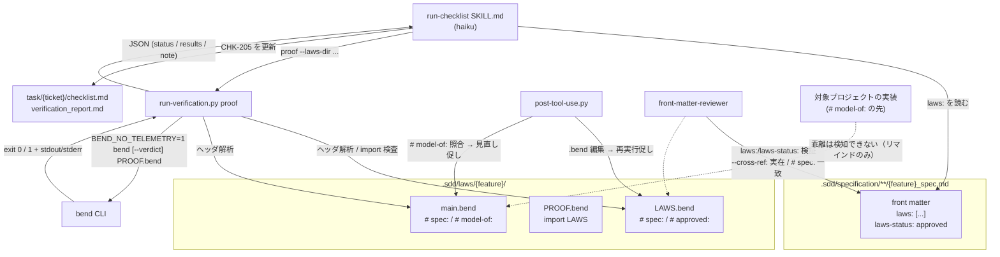
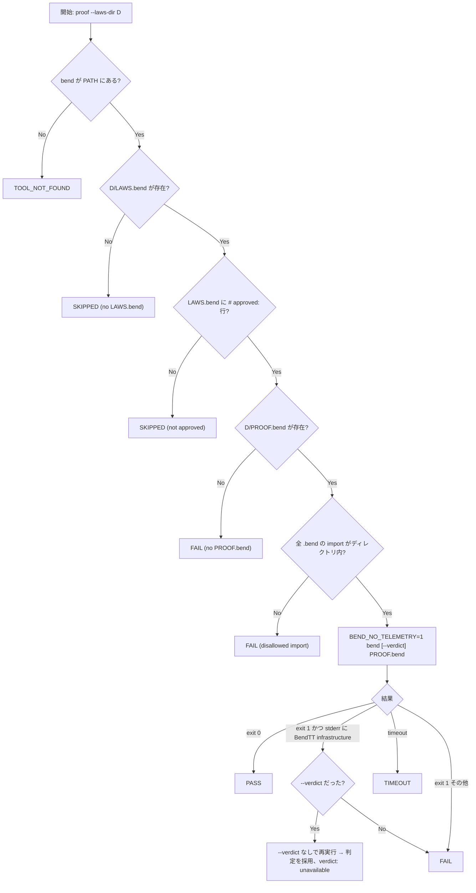

# Bend 証明ゲート（run-checklist の proof カテゴリ）の技術設計 `<MUST>`

**関連 Spec:** [proof-gate_spec.md](../../specification/task-implementation/proof-gate_spec.md),
[run-checklist_spec.md](../../specification/task-implementation/run-checklist_spec.md),
[front-matter-validation_spec.md](../../specification/quality-guardrails/front-matter-validation_spec.md),
[stale-doc-detection_spec.md](../../specification/quality-guardrails/stale-doc-detection_spec.md)
**関連 PRD:** [proof-gate.md](../../requirement/task-implementation/proof-gate.md)（GitHub issue #149。調査: #148, #5）
**準拠する原則:** [CONSTITUTION.md](../../CONSTITUTION.md)（参照した版: v2.0.0）の A-002（フックとスクリプトの責務分離）, B-001（Vibe Coding 防止）, B-002（多言語対応の一貫性）, D-001（Specification-Driven）, D-002（ファイル命名規則の厳守）, T-002（plugin.json 登録の徹底）

---

# 1. 実装ステータス `<MUST>`

**ステータス:** 🔴 未実装（本チケットは設計のみ。実装は別セッション・別 PR）

## 1.1. 実装進捗

| モジュール/機能                                                    | ステータス | 備考                                                       |
|------------------------------------------------------------|-------|----------------------------------------------------------|
| `run-verification.py` の `proof` カテゴリ                       | 🔴    | §4.2 / §5.1 / §9.1 D-01〜D-08                              |
| `hook_common.py` / `session-start.py` の `directories.laws`    | 🔴    | `SddPaths.laws_dir` と `SDD_LAWS_DIR` / `SDD_LAWS_PATH`      |
| `fm_parser.py` の `LIST_KEYS` に `laws`                        | 🔴    | 1 行変更 + テスト                                              |
| `post-tool-use.py` の `.bend` / `# model-of:` リマインド           | 🔴    | stale-doc-detection_spec FR-007 / FR-008                 |
| `front-matter-reviewer.md` / `front_matter_reference.md` の拡張 | 🔴    | front-matter-validation_spec FR-009                      |
| checklist テンプレート `CHK-205`（en/ja）                          | 🔴    | run-checklist テンプレートの proof 結果ブロックも                     |
| `run-checklist/SKILL.md` / `verification_commands.md`         | 🔴    | 判定表・PASS の意味の注記                                         |
| README / CHANGELOG / 原則文書の構成図                               | 🔴    | `laws/` の説明とモデル作成ガイド（§7）                                 |
| 第 2 弾: 法則案生成スキル                                            | ⏸️    | 本設計では境界のみ（§4.4）。別チケット                                   |

---

# 2. 設計目標 `<MUST>`

1. **既存の検証契約に乗せる**: `run-verification.py` に `proof` を 5 番目のカテゴリとして追加し、スキル側は既存の
   JSON 契約（`status` / `reason`）を読むだけで済む形にする。新しいスキル・エージェント・ベアな Bash 権限は追加しない
2. **不在時は無害**: `bend` が無い・法則ファイルが無い・Windows である、のいずれでも TOOL_NOT_FOUND / SKIPPED で
   素通りし、他カテゴリの検証と CI（bend 非導入）に影響を与えない
3. **自己採点を構造的に防ぐ**: 人の `# approved:` 行が無い限り PASS を返さない。AI は承認行を書かない
4. **外部通信ゼロ**: `BEND_NO_TELEMETRY=1` を常に付与し、法則ディレクトリ外を指す import は検査器を起動する前に FAIL にする
5. **spec を正典に保つ**: spec → `laws:` → 法則ファイルの一方向参照だけを持ち、`depends-on`・PRD・spec 本文を法則から変更しない
6. **PASS の意味を誤読させない**: 判定 JSON・結果ブロック・SKILL.md・README のすべてに「参照モデルが法則を満たす保証であり、
   実装の正しさではない」を載せる

---

# 3. 実装方式 `<MUST>`

| 領域                              | 採用方式                                                                                              | 選定理由                                                                                                               |
|---------------------------------|---------------------------------------------------------------------------------------------------|--------------------------------------------------------------------------------------------------------------------|
| 証明検査の実行                        | `run-verification.py` に `proof` カテゴリを追加（Python。`subprocess.run` で `bend` を起動）                      | スキルの `allowed-tools` が事前承認しているのはこのスクリプト 1 本だけ（Check 5.4 のスコープ付き Bash）。bend を直接呼ぶ経路を作らない（PRD DC_003、A-002）        |
| 法則ディレクトリの指定                    | CLI 引数 `--laws-dir`（複数可）。省略時は `SDD_LAWS_PATH` 配下を全走査                                              | spec の `laws:` を読むのはスキル（LLM）の仕事、ディレクトリを検査するのはスクリプトの仕事に分ける。既存の `Bash(... run-verification.py *)` パターンは追加引数を許す |
| 判定                              | 純粋関数 `precheck()` / `judge_run()`（ファイル有無・承認行・import 検査 / 終了コード・stderr → status）                                   | 判定ロジックを `subprocess` から切り離してユニットテストできるようにする                                                                        |
| import の静的検査                    | 先頭コメント・空行を読み飛ばした後の `import` 行を正規表現で抽出し、ローカル相対パスのみ許可する allowlist                                     | Bend Hub の import 構文を網羅的に deny するより、「法則ディレクトリ内のファイルだけ許す」allowlist のほうが構文変更に強い                                     |
| 先頭コメント規約の解析                    | `laws_header.py`（新規共有モジュール）で `# key: value` 行を dict に読む。`run-verification.py` / `post-tool-use.py` / 第 2 弾スキルで共用 | 規約の定義を 1 箇所に置く（naming.py / fm_parser.py と同じ「single source of truth」の流儀）                                           |
| `.sdd-config.json` の拡張           | `directories.laws`（既定 `laws`）、`proof.timeout_seconds`（既定 300）、`proof.verdict`（既定 false）             | 既存の `directories` の流儀に合わせる。`SddPaths` にフィールド追加、session-start が `SDD_LAWS_DIR` / `SDD_LAWS_PATH` をエクスポート            |
| spec front matter                | `fm_parser.LIST_KEYS` に `laws` を追加。`laws-status` はスカラー                                              | インデックス・recommend-front-matter・reviewer がリストとして扱える                                                                   |
| front matter の検証                | `front-matter-reviewer.md` の Spec 種別チェックに行追加、`--cross-ref` に `laws:` ディレクトリ実在・`# spec:` 一致・実態整合を追加 | 既存の「ルール基盤の軽量検証（haiku）」の範囲内。ファイル存在と先頭数行の照合だけで済む                                                                    |
| フックのリマインド                       | `post-tool-use.py` に 2 分岐を追加（`.bend` 編集 → 再実行促し、ソース編集 → `main.bend` の `# model-of:` 照合）                | 非ブロッキング `additionalContext`（stale-doc-detection の既定方針）。ソース編集時の照合は `laws/**/main.bend` の先頭 20 行だけ読む                 |
| チェックリスト項目                      | `checklist_template.md`（en/ja）の仕様レビューに `CHK-205 [P2]` を固定項目として追加。`laws:` が無い spec では生成しない旨を checklist SKILL.md に記載 | 既存 ID 体系（`CHK-{category}{nn}`、カテゴリ 1〜9）を崩さない（親 PRD IR_002）                                                             |
| Windows                         | 分岐を設けない。`bend` が PATH に無ければ TOOL_NOT_FOUND                                                        | PRD DC_004。WSL 内では Linux として動く                                                                                       |

---

# 4. アーキテクチャ `<MUST>`

## 4.1. システム構成図



## 4.2. モジュール分割

| モジュール名                                              | 責務                                                                                     | 依存関係                                        | 配置場所                                                   |
|-----------------------------------------------------|----------------------------------------------------------------------------------------|---------------------------------------------|--------------------------------------------------------|
| `run-verification.py`（拡張）                           | `proof` カテゴリ: 引数解析、法則ディレクトリ探索、承認行・ファイル有無・import の事前検査、`bend` 実行、判定、JSON 出力             | `laws_header.py`, `hook_common.read_sdd_config_json` | `skills/run-checklist/scripts/`                        |
| `laws_header.py`（新規）                                | 法則ファイル先頭のコメント規約（`# spec:` / `# approved:` / `# model-of:`）の解析と、import 行の抽出               | なし（stdlib のみ）                                | `scripts/`（共有モジュール。sdd_index 等と同じ流儀）                   |
| `hook_common.py`（拡張）                                | `SddPaths.laws_dir` / `laws_prefix`、`load_proof_config()`（timeout / verdict）              | -                                           | `scripts/`                                             |
| `session-start.py`（拡張）                              | `SDD_LAWS_DIR` / `SDD_LAWS_PATH` のエクスポート                                                 | `env_export.py`                             | `scripts/`                                             |
| `fm_parser.py`（拡張）                                  | `LIST_KEYS = {"depends-on", "tags", "laws"}`                                             | -                                           | `scripts/`                                             |
| `post-tool-use.py`（拡張）                              | `.bend` 編集時の再実行促し、ソース編集時の `# model-of:` 照合                                            | `laws_header.py`, `hook_common`             | `scripts/`                                             |
| `front-matter-reviewer.md` / `front_matter_reference.md`（拡張） | Spec 種別チェック（`laws:` / `laws-status`）、`--cross-ref` の実在・一致・実態整合                           | -                                           | `agents/` / `shared/references/`                       |
| `checklist_template.md`（en/ja、拡張）                   | `CHK-205 [P2] 法則証明（proof ゲート）`                                                          | -                                           | `skills/checklist/templates/{en,ja}/`                  |
| `result_format.md` / `report_format.md`（en/ja、拡張）    | proof の自動検証結果ブロック例と PASS の意味の注記                                                        | -                                           | `skills/run-checklist/templates/{en,ja}/`              |
| `SKILL.md`（run-checklist / checklist、拡張）            | `proof` の呼び出し手順・判定表・`laws:` 無しなら生成しない規則                                                | -                                           | `skills/run-checklist/`, `skills/checklist/`           |
| `verification_commands.md`（拡張）                      | `proof` の呼び出し例・判定対応表                                                                    | -                                           | `skills/run-checklist/references/`                     |

## 4.3. 判定フロー（`proof` カテゴリ）



複数ディレクトリの集約順位は FAIL > TIMEOUT > TOOL_NOT_FOUND > SKIPPED > PASS（最も悪い判定を全体の `status` にする）。

## 4.4. 第 2 弾（spec → LAWS 案生成）との境界

本設計は生成スキルを実装しないが、ゲート側が前提とする境界を固定する。

| 項目        | 内容                                                                                                                                       |
|:----------|:-----------------------------------------------------------------------------------------------------------------------------------------|
| 入力        | 対象 spec のパス。読み取るのは「§8 制約事項」と「§3.1 機能要件」表（事後条件・不変条件として読める行）に限定する                                                                 |
| 出力        | `${SDD_LAWS_PATH}/{feature}/LAWS.bend` の案（`# spec: <spec id>` を先頭に置き、**`# approved:` は書かない**）。spec front matter に `laws:` を追加し `laws-status: drafted` にする |
| 人の承認      | レビューのうえ `# approved: YYYY-MM-DD <承認者>` を追記し `laws-status: approved` にする。承認は PR で確認する運用                                                     |
| 後続        | 承認後、AI が `main.bend`（`# spec:` / `# model-of:`）と `PROOF.bend` を書き、`/run-checklist --category proof` で PASS を確認。`proven` への遷移は人が行う          |
| 禁止        | 法則・検査結果から spec・PRD を書き換えること（矛盾は報告する）。承認行を AI が書くこと                                                                                  |
| 実装の置き場所   | 新規スキル（名称は実装チケットで決定。`skills/` 配下、`plugin.json` 登録不要 — T-002）。`allowed-tools` は `Read, Glob, Grep, Edit(.sdd/**)` と、本スクリプトのスコープ付き Bash に限る        |

---

# 5. データ構造 `<OPTIONAL>`

## 5.1. `run-verification.py proof` の出力 JSON

```json
{
  "category": "proof",
  "project_type": "python",
  "status": "FAIL",
  "verdict": "checked",
  "timeout_seconds": 300,
  "results": [
    {
      "laws_dir": ".sdd/laws/task-implementation/proof-gate",
      "spec": "spec-task-implementation-proof-gate",
      "approved": "2026-10-17 @reviewer",
      "model_of": ["plugins/sdd-workflow/skills/run-checklist/scripts/run-verification.py"],
      "status": "FAIL",
      "reason": "bend reported SOME PROOFS FAIL",
      "command": "bend --verdict PROOF.bend",
      "exit_code": 1,
      "stdout": "",
      "stderr": "SOME PROOFS FAIL\nError: ..."
    },
    {
      "laws_dir": ".sdd/laws/auth/user-login",
      "spec": "spec-auth-user-login",
      "approved": null,
      "model_of": [],
      "status": "SKIPPED",
      "reason": "LAWS.bend has no '# approved:' line; unapproved laws are never reported as PASS"
    }
  ],
  "note": "PASS means the reference model (main.bend) satisfies the approved laws. It does not prove the project's implementation."
}
```

- `verdict` は `"checked"`（`--verdict` で再検査済み）/ `"unavailable"`（要求されたが Lean 基盤不備でフォールバック）/
  `"not-requested"` の 3 値
- 既存カテゴリとの互換のため、トップレベルの `status` / `reason`（集約後の 1 件）と `category` は従来どおり置く
- `stdout` / `stderr` は既存どおり末尾 8000 / 4000 文字に切り詰める

## 5.2. `.sdd-config.json`

```json
{
  "root": ".sdd",
  "directories": {
    "requirement": "requirement",
    "specification": "specification",
    "adr": "adr",
    "task": "task",
    "laws": "laws"
  },
  "proof": {
    "timeout_seconds": 300,
    "verdict": false
  }
}
```

`directories.laws` → `SddPaths.laws_dir`（既定 `"laws"`）、`laws_prefix` = `{root}/{laws_dir}`。session-start は
`SDD_LAWS_DIR` / `SDD_LAWS_PATH` をエクスポートする（`sdd-init` の `init-structure.py` が書く `.sdd-config.json`
の既定に `laws` を**含めない**: ディレクトリは opt-in 時に初めて作る）。

## 5.3. spec front matter

```yaml
---
id: "spec-task-implementation-proof-gate"
type: "spec"
sdd-phase: "specify"
depends-on: ["prd-task-implementation-proof-gate"]        # laws は含めない（下流）
laws: [".sdd/laws/task-implementation/proof-gate"]        # ${SDD_ROOT} 相対ディレクトリ。LIST_KEYS
laws-status: "approved"                                   # none | drafted | approved | proven
---
```

## 5.4. 法則ファイルの先頭コメント規約（`laws_header.py` が解析する範囲）

```
# spec: spec-task-implementation-proof-gate
# approved: 2026-10-17 @reviewer
# model-of: plugins/sdd-workflow/skills/run-checklist/scripts/run-verification.py
# model-of: plugins/sdd-workflow/scripts/laws_header.py

import ./main
```

- 解析するのは**先頭から連続する**コメント行（`#` 始まり）と空行のみ。最初の非コメント・非空行で打ち切る
  （Bend の `book_load` が import より前に読み飛ばす範囲と一致させる）
- キーは `spec` / `approved` / `model-of` の 3 つ。`model-of` は複数行可。未知のキーは無視する
- `approved` の値は `^\d{4}-\d{2}-\d{2}\b.*` に一致すること（日付が無い行は承認行とみなさない）
- import の allowlist: `^import\s+\.?/?([A-Za-z0-9_\-]+/)*[A-Za-z0-9_\-]+(\.bend)?\s*$` に一致し、解決先が法則ディレクトリ内に収まるもの。
  それ以外（`@` 始まりの Hub 名前空間、`http(s)://`、`..` を含むパス、絶対パス）は 1 行でも FAIL
  （Bend 側の正確な import 構文は実装時に `guide/GUIDE.md` で再確認し、allowlist の正規表現だけを調整する）

## 5.5. `run-verification.py` の `proof` 判定（pseudocode。verbatim で動く完全性を保つ）

```python
#!/usr/bin/env python3
"""proof category for run-verification.py (design pseudocode).

Decides PASS / FAIL / SKIPPED / TOOL_NOT_FOUND / TIMEOUT for one laws directory.
`precheck()` and `judge_run()` are pure functions so the decision table (spec
FR-002) can be unit-tested without spawning bend. `run_proof_dir()` does the
I/O around them.
"""

import os
import re
import shutil
import subprocess
from pathlib import Path
from typing import Dict, List, Optional

LAWS_FILE = "LAWS.bend"
PROOF_FILE = "PROOF.bend"
MODEL_FILE = "main.bend"
BENDTT_INFRA_MARKER = "BendTT infrastructure"
APPROVED_RE = re.compile(r"^\d{4}-\d{2}-\d{2}\b")
HEADER_RE = re.compile(r"^#\s*([A-Za-z][\w-]*):\s*(.*)$")
IMPORT_RE = re.compile(r"^\s*import\s+(?P<target>\S+)\s*$")
LOCAL_IMPORT_RE = re.compile(r"^\.?/?([A-Za-z0-9_\-]+/)*[A-Za-z0-9_\-]+(\.bend)?$")
SEVERITY = {"FAIL": 4, "TIMEOUT": 3, "TOOL_NOT_FOUND": 2, "SKIPPED": 1, "PASS": 0}
PASS_NOTE = ("PASS means the reference model (main.bend) satisfies the approved laws. "
             "It does not prove the project's implementation.")


def read_header(path: Path) -> Dict[str, List[str]]:
    """Parse leading `# key: value` comment lines; stop at the first code line."""
    header: Dict[str, List[str]] = {}
    for raw in path.read_text(encoding="utf-8", errors="replace").splitlines():
        line = raw.strip()
        if not line:
            continue
        if not line.startswith("#"):
            break
        m = HEADER_RE.match(line)
        if m:
            header.setdefault(m.group(1), []).append(m.group(2).strip())
    return header


def disallowed_imports(laws_dir: Path) -> List[str]:
    """Return import lines that point outside laws_dir (hub namespace, URL, parent dirs)."""
    root = laws_dir.resolve()
    bad: List[str] = []
    for bend_file in sorted(laws_dir.glob("*.bend")):
        for raw in bend_file.read_text(encoding="utf-8", errors="replace").splitlines():
            m = IMPORT_RE.match(raw)
            if not m:
                continue
            target = m.group("target")
            if not LOCAL_IMPORT_RE.match(target):
                bad.append(f"{bend_file.name}: {raw.strip()}")
                continue
            resolved = (laws_dir / target.lstrip("./")).resolve()
            if root != resolved and root not in resolved.parents:
                bad.append(f"{bend_file.name}: {raw.strip()}")
    return bad


def precheck(bend_found: bool, has_laws: bool, approved: Optional[str],
             has_proof: bool, bad_imports: List[str]) -> Optional[Dict[str, str]]:
    """Decision rows that need no bend run. None means "go run bend"."""
    if not bend_found:
        return {"status": "TOOL_NOT_FOUND", "reason": "bend is not installed (not on PATH)"}
    if not has_laws:
        return {"status": "SKIPPED", "reason": f"no {LAWS_FILE} in this laws directory"}
    if approved is None:
        return {"status": "SKIPPED",
                "reason": f"{LAWS_FILE} has no '# approved:' line; "
                          "unapproved laws are never reported as PASS"}
    if not has_proof:
        return {"status": "FAIL", "reason": f"{LAWS_FILE} is approved but {PROOF_FILE} is missing"}
    if bad_imports:
        return {"status": "FAIL",
                "reason": "disallowed import (only files inside the laws directory may be "
                          "imported): " + "; ".join(bad_imports)}
    return None


def judge_run(exit_code: Optional[int], stderr: str, timed_out: bool,
              verdict_requested: bool) -> Dict[str, str]:
    """Decision rows for a finished bend run."""
    if timed_out:
        return {"status": "TIMEOUT", "reason": "bend exceeded the time limit"}
    if exit_code == 0:
        return {"status": "PASS", "reason": "bend reported ALL PROOFS CHECK",
                "verdict": "checked" if verdict_requested else "not-requested"}
    if verdict_requested and BENDTT_INFRA_MARKER in stderr:
        return {"status": "TOOL_NOT_FOUND", "reason": "Lean kernel for --verdict is not available",
                "verdict": "unavailable"}
    return {"status": "FAIL", "reason": "bend reported SOME PROOFS FAIL (or a syntax error)",
            "verdict": "checked" if verdict_requested else "not-requested"}


def run_bend(laws_dir: Path, verdict: bool, timeout: int) -> Dict[str, object]:
    args = ["bend"] + (["--verdict"] if verdict else []) + [PROOF_FILE]
    env = dict(os.environ, BEND_NO_TELEMETRY="1")
    try:
        r = subprocess.run(args, cwd=laws_dir, env=env, capture_output=True, text=True,
                           timeout=timeout, encoding="utf-8", errors="replace")
        return {"command": " ".join(args), "exit_code": r.returncode,
                "stdout": r.stdout[-8000:], "stderr": r.stderr[-4000:], "timed_out": False}
    except subprocess.TimeoutExpired:
        return {"command": " ".join(args), "exit_code": None, "stdout": "", "stderr": "",
                "timed_out": True}


def run_proof_dir(laws_dir: Path, verdict: bool, timeout: int) -> Dict[str, object]:
    laws = laws_dir / LAWS_FILE
    header = read_header(laws) if laws.is_file() else {}
    approved_values = [v for v in header.get("approved", []) if APPROVED_RE.match(v)]
    approved = approved_values[0] if approved_values else None
    model = laws_dir / MODEL_FILE
    model_header = read_header(model) if model.is_file() else {}
    base: Dict[str, object] = {
        "laws_dir": str(laws_dir),
        "spec": (header.get("spec") or [None])[0],
        "approved": approved,
        "model_of": model_header.get("model-of", []),
    }
    early = precheck(
        bend_found=shutil.which("bend") is not None,
        has_laws=laws.is_file(),
        approved=approved,
        has_proof=(laws_dir / PROOF_FILE).is_file(),
        bad_imports=disallowed_imports(laws_dir) if laws.is_file() else [],
    )
    if early is not None:
        return {**base, **early}

    run = run_bend(laws_dir, verdict, timeout)
    outcome = judge_run(run["exit_code"], str(run["stderr"]), bool(run["timed_out"]), verdict)
    if outcome.get("verdict") == "unavailable":
        # Spec FR-006: fall back to the plain check and keep the primary verdict.
        run = run_bend(laws_dir, False, timeout)
        outcome = judge_run(run["exit_code"], str(run["stderr"]), bool(run["timed_out"]), False)
        outcome["verdict"] = "unavailable"
    return {**base, **outcome,
            **{k: run[k] for k in ("command", "exit_code", "stdout", "stderr")}}


def aggregate(results: List[Dict[str, object]]) -> str:
    """Worst status wins: FAIL > TIMEOUT > TOOL_NOT_FOUND > SKIPPED > PASS."""
    return max((str(r["status"]) for r in results),
               key=lambda status: SEVERITY[status], default="SKIPPED")
```

実装時に関数の切り方は変えてよいが、**判定表 `precheck` / `judge_run` の入出力**（spec FR-002）はテストで固定する。`main()` 側は `argparse` で `proof` のとき `--laws-dir`（`action="append"`）/ `--verdict` /
`--timeout` を受け、既存カテゴリは従来どおり単一位置引数で動かす（後方互換）。`project_type` 検出は `proof` では
不要なので、`None` でも SKIPPED に落とさない。

---

# 6. ファイル構成 `<OPTIONAL>`

```
plugins/sdd-workflow/
├── scripts/
│   ├── laws_header.py                       # 新規: 先頭コメント規約・import 行の解析（共有）
│   ├── hook_common.py                       # SddPaths.laws_dir / laws_prefix, load_proof_config()
│   ├── session-start.py                     # SDD_LAWS_DIR / SDD_LAWS_PATH のエクスポート
│   ├── fm_parser.py                         # LIST_KEYS に "laws"
│   └── post-tool-use.py                     # .bend 編集 / # model-of: 照合のリマインド
├── agents/front-matter-reviewer.md          # Spec: laws / laws-status、--cross-ref: 実在・# spec: 一致・実態整合
├── shared/references/front_matter_reference.md   # spec フィールド表に laws / laws-status、状態遷移
├── skills/run-checklist/
│   ├── SKILL.md                             # proof カテゴリの手順・判定表・PASS の意味
│   ├── scripts/run-verification.py          # proof カテゴリ（§5.5）
│   ├── references/verification_commands.md  # proof の呼び出し例
│   └── templates/{en,ja}/result_format.md   # proof 結果ブロック例
├── skills/checklist/
│   ├── SKILL.md                             # laws: 無しなら CHK-205 を生成しない
│   └── templates/{en,ja}/checklist_template.md   # CHK-205 [P2] 法則証明（proof ゲート）
├── AI-SDD-PRINCIPLES.source.md              # 構成図に laws/ を追記（任意ディレクトリとして）
├── README.md / README.ja.md                 # 「Bend 証明ゲート（opt-in）」節: PASS の意味、モデル作成ガイド（§7）
└── CHANGELOG.md / CHANGELOG.ja.md           # [Unreleased] に追加

tests/
├── test_run_verification_proof.py           # precheck / judge_run の判定表、import allowlist、集約順位、JSON 形状
├── test_laws_header.py                      # 先頭コメント解析（連続コメントで打ち切り、approved の日付検証、model-of 複数）
├── test_hook_common.py（拡張）                 # directories.laws / proof.* の既定値
├── test_fm_parser.py（拡張）                   # laws のインライン / ブロックリスト
├── test_post_tool_use.py（拡張）               # .bend 編集 / # model-of: 一致 / 法則ディレクトリ無し（無出力）
└── fixtures/laws/                           # LAWS.bend / PROOF.bend / main.bend の最小 fixture（bend 不要: 判定表は純粋関数）

.sdd/
└── laws/                                    # 本リポジトリでは本チケットでは作らない（実装チケットで dogfooding 用に 1 件作るかは別途判断）
```

`.bend` ファイルを `plugins/sdd-workflow/` 配下に置かない（`plugin-lint.sh` Check 2 のサポートファイル拡張子規則に
抵触するため。例はすべて Markdown のコードブロックとして `references/` / README に置く）。

---

# 7. 非機能要件実現方針 `<OPTIONAL>`

| 要件                              | 実現方針                                                                                                                                          |
|---------------------------------|-----------------------------------------------------------------------------------------------------------------------------------------------|
| NFR-001 任意依存                    | `shutil.which("bend")` を最初に見る。`TOOL_NOT_FOUND` / `SKIPPED` は run-checklist の判定表で「失敗ではない」。CI（`ci.yml`）には bend を入れず、テストは判定表の純粋関数と fixture で完結させる |
| NFR-002 応答性（300 秒）              | `subprocess.run(timeout=...)`。bend 単体は 0.04〜0.25 秒、`--verdict` の Lean は遅くなりうるので既定 300 秒を据え置き、`proof.timeout_seconds` / `--timeout` で変更可          |
| NFR-003 再現性                     | `BEND_NO_TELEMETRY=1` を `env` に常に付与。import allowlist で外部参照を排除                                                                                 |
| NFR-004 移植性                     | `pathlib` のみ。Windows 固有分岐なし（bend 不在 → TOOL_NOT_FOUND）                                                                                       |
| NFR-005 多言語                     | `CHK-205`・結果ブロック・レポートの文言を `templates/{en,ja}/` に揃える。スクリプトの JSON は英語固定（既存カテゴリと同じ。文言はテンプレートで切り替える）                                        |
| NFR-006 権限最小化                   | `allowed-tools` は現状の `Bash(python3 "${CLAUDE_PLUGIN_ROOT}/skills/run-checklist/scripts/run-verification.py" *)` のまま（引数 `*` で `proof --laws-dir ...` を許す）。bend を直接呼ぶ権限は与えない |
| フックの軽量性（stale-doc 親 NFR_001: 500ms） | ソース編集時の `# model-of:` 照合は `laws_prefix` が存在するときだけ `laws/**/main.bend` を glob し、各ファイルの先頭 20 行だけ読む。法則ディレクトリが無いプロジェクトでは追加コスト 1 回の `is_dir()` のみ        |

## 7.1. モデル作成ガイド（README に載せる要点）

- **PASS の意味**: PASS は `main.bend`（参照モデル）が承認済み法則を満たすことの保証であって、`# model-of:` の先にある
  実装の正しさではない。実装を変えたら参照モデルも見直す（post-tool-use がリマインドする）
- **law と def の相互再帰に注意**: 法則 `X` の証明は `PROOF.bend` の同名 `def X` で与える。参照モデル（`main.bend`）の
  `def` が法則の名前を呼んではならず、証明 `def` が自分の証明する法則を経由して自分自身を呼んでもならない
  （循環すると検査が意味を持たない）。モデルの関数名と法則名は衝突させない（例: 関数 `sort`、法則 `sort_preserves_length`）
- **参照モデルは小さく**: 証明対象は spec の制約・不変条件・事後条件だけ。IO・外部境界・性能はモデルにしない
- **承認行は人が書く**: `# approved:` は PR レビューで追記する。AI が書かないことを法則案生成スキルの指示に明記する
- **LAWS.bend を改訂したら承認し直す**: 承認行の日付を更新し、`laws-status` を `approved` に戻してから再検査する

---

# 8. テスト戦略 `<OPTIONAL>`

| テストレベル | 対象                                                               | カバレッジ目標                                                                                                                           |
|--------|------------------------------------------------------------------|-----------------------------------------------------------------------------------------------------------------------------------|
| ユニット   | `precheck()` / `judge_run()`                                     | 判定表の全行（bend 不在 / LAWS 不在 / 未承認 / PROOF 不在 / import 違反 / exit 0 / exit 1 + BendTT marker（verdict あり・なし）/ exit 1 / timeout）              |
| ユニット   | `disallowed_imports()` / `read_header()`                         | ローカル import 許可、Hub 名前空間・URL・`..`・絶対パスの拒否、先頭コメントで打ち切り、`approved` の日付必須、`model-of` 複数行                                              |
| ユニット   | `aggregate()`                                                    | FAIL > TIMEOUT > TOOL_NOT_FOUND > SKIPPED > PASS                                                                                   |
| ユニット   | `run-verification.py` CLI                                        | `proof --laws-dir` 複数、省略時の `SDD_LAWS_PATH` 走査、既存 4 カテゴリの後方互換（位置引数のみで動く）、bend 不在環境での JSON 形状                                           |
| ユニット   | `fm_parser` / `hook_common` / `session-start`                    | `laws` のリスト解析、`directories.laws` と `proof.*` の既定値、`SDD_LAWS_*` のエクスポート（`test-session-start.sh` のゴールデンは `laws` 無し設定で不変であることを確認）         |
| 回帰     | `post-tool-use.py`（`scripts/test-hook-scripts.sh` / pytest）     | `.bend` 編集で再実行促し、`# model-of:` 一致で見直し促し、法則ディレクトリ無しで無出力、spec 同期の促しと両立                                                               |
| Lint   | `plugin-lint.sh` / `plugin_lint.py`                              | `allowed-tools` 不変、`.bend` をプラグイン内に置かない、テンプレートの en/ja 対称性                                                                           |
| 手動     | bend 導入環境                                                        | `demos/proof_insertion_sort` 相当の最小 laws で PASS / 未承認 SKIPPED / 証明削除で FAIL / `--verdict`（Lean 無し）で `verdict: unavailable` を確認。CI には入れない |

---

# 9. 設計判断 `<MUST>`

## 9.1. 決定事項

issue #149「設計時に決める事項」の 4 点（D-01〜D-04）と、設計中に確定した事項（D-05〜D-10）。

| ID   | 決定事項                                                | 選択肢                                                                                                            | 決定内容                                                                                                               | 理由                                                                                                                                                                                                                                      |
|------|-----------------------------------------------------|----------------------------------------------------------------------------------------------------------------|--------------------------------------------------------------------------------------------------------------------|-----------------------------------------------------------------------------------------------------------------------------------------------------------------------------------------------------------------------------------------|
| D-01 | hub import（ネットワーク経由の import）をゲートで禁止するか              | (A) 一律 FAIL（import 行の静的 allowlist）<br>(B) `.sdd-config.json` で許可可能にする<br>(C) 禁止せず bend に任せる                     | **(A)** 法則ディレクトリ内のファイルを指す import だけ許可し、それ以外は検査器を起動する前に FAIL                                                       | 判定の再現性（オフライン）・テレメトリ停止方針・サプライチェーン面の安全性を揃える。allowlist なら Hub の構文変更に強い。(B) は「許可した途端に PASS がネットワーク状態に依存する」ため、必要になった時点で別途議論する。(C) は bend が解決に行ってしまう（PRD NFR_002）                                                  |
| D-02 | `laws/` 配下の命名検証を `naming.py` の対象にするか                 | (A) `naming.py` を `.bend` に拡張し pre-tool-use で deny<br>(B) 対象にせず、固定ファイル名の不備はゲート実行時の SKIPPED / FAIL の理由で報告        | **(B)**                                                                                                              | `naming.py` は「requirement/ と specification/ を名前だけで区別する」ための書き込み時 deny で、opt-in 機能のために `.md` 前提（naming.py:62 / doc_walker / sdd_index）を崩す価値がない。`main.bend` が import する補助 `.bend` を置く余地も残る。front-matter-reviewer の `--cross-ref` と post-tool-use が不備を可視化する |
| D-03 | `laws-status: proven` を run-checklist が自動で立てるか、人が立てるか | (A) run-checklist が PASS 時に spec の front matter を書き換える<br>(B) 人が立て、run-checklist はレポートで遷移を推奨するのみ               | **(B)**                                                                                                              | PASS は実行環境（bend の版、Lean の有無）に依存し、AI の自己昇格を許す経路になる。run-checklist の書き込みは `task/{ticket}/` に閉じている（spec 本文・front matter への書き込み経路を増やさない）。`impl-status` のように機械更新する前例はあるが、`proven` は「人が承認した法則が証明された」という承認連鎖の終端なので人の手に置く。front-matter-reviewer が `proven` の前提（承認行・PROOF.bend）を warning で検証する |
| D-04 | 対応するチェックリスト ID と優先度                                 | (A) `CHK-205 [P2]`（仕様レビューの固定項目、`laws:` がある spec のみ生成）<br>(B) `CHK-205 [P1]`<br>(C) 新カテゴリ 10（`CHK-10xx`）     | **(A)**                                                                                                              | Bend は必須依存ではないため P1（マージ前必須）にするとマージが環境依存になる（PRD DC_001）。カテゴリ 1〜9 は親 PRD IR_002 で固定され、2xx 既存項目（CHK-204 制約の実装）の隣が意味的にも自然。`laws:` の無い spec に項目を出すと常に SKIPPED のノイズになる                                                              |
| D-05 | `# spec:` の値                                        | (A) spec の `id`<br>(B) `${SDD_ROOT}` 相対パス                                                                      | **(A)** id（統括 / ユーザーの回答で変わりうる。回答があれば本行と spec §4.1 を更新）                                                           | ファイル移動・リネームに強い。front-matter-reviewer の `--cross-ref` が持つ id レジストリで spec `laws:` ↔ LAWS `# spec:` の双方向整合を検証できる。パスは index 無しでも直接検証できる利点があるが、`.cache/index.md` の Metadata で id → path 解決が可能                                                 |
| D-06 | `--verdict` 時に Lean 基盤が無い場合の扱い                       | (A) TOOL_NOT_FOUND で終える<br>(B) 通常検査にフォールバックし判定を返し、`verdict: "unavailable"` を併記                                | **(B)**（統括 / ユーザーの回答で変わりうる）                                                                                        | ゲートの主判定（法則が満たされるか）を Lean の有無で失わない。失敗ケースは `--verdict` の有無で出力・終了コードとも同一と実測されているので、フォールバックで判定が揺れない。`verdict` の 3 値で再検査の有無を機械可読に残す                                                                                              |
| D-07 | 法則ディレクトリの指定方法                                       | (A) スクリプトが spec の front matter を読む<br>(B) スキルが `laws:` を読み `--laws-dir` で渡す（省略時は `SDD_LAWS_PATH` 全走査）           | **(B)**                                                                                                              | A-002: spec の解釈（LLM）とディレクトリ検査（スクリプト）を分ける。スクリプトに fm_parser 依存を持ち込まず、`--laws-dir` 無しでも全走査できるので手動実行にも使える                                                                                                                              |
| D-08 | 複数法則ディレクトリの集約                                       | (A) 最悪判定を全体 `status` にする<br>(B) 個別判定のみ                                                                        | **(A)** + `results` に個別判定                                                                                           | run-checklist は 1 項目（CHK-205）に 1 判定を記録する。FAIL > TIMEOUT > TOOL_NOT_FOUND > SKIPPED > PASS の順で「見逃し」を作らない                                                                                                                                  |
| D-09 | `main.bend` の要否                                      | (A) 必須<br>(B) 任意                                                                                               | **(B)** 任意                                                                                                           | 法則が自己完結する（モデル関数を参照しない）場合もある。`# model-of:` は `main.bend` にのみ置くので、無ければ見直し促し（FR-009）の対象が無いだけで判定には影響しない                                                                                                                                 |
| D-10 | 階層 spec の法則ディレクトリ                                   | (A) `laws/{parent}/{child}/`<br>(B) `laws/{parent}-{child}/`                                                     | **(A)**（統括 / ユーザーの回答で変わりうる）                                                                                        | spec / requirement / adr と同じ階層規則（AI-SDD の階層構造）に揃え、識別子をディレクトリ名に置く方針と整合する。`laws:` はパスのリストなので (B) でも動作はするが、既定を揃えておく                                                                                                                      |

## 9.2. 未解決の課題

| 課題                                                           | 影響度 | 対応方針                                                                                                                                            |
|--------------------------------------------------------------|-----|-------------------------------------------------------------------------------------------------------------------------------------------------|
| clarify Q1〜Q6（D-01 / D-03 / D-04 / D-05 / D-06 / D-10）のユーザー回答    | 中   | 統括セッション経由で回答待ち。既定値で記述済み。回答で変わる場合は spec §4.1 / 本書 §9.1 / front-matter-validation_spec FR-009 を同時に更新する                                            |
| Bend Hub の import 構文の正確な形                                    | 低   | allowlist 方式なので構文が確定しなくても FAIL 側に倒れる。実装時に `guide/GUIDE.md` で確認し `LOCAL_IMPORT_RE` だけ調整                                                         |
| `sdd_index.py` に `laws` / `laws_status` 列を持たせるか                 | 低   | 本チケットでは持たせない（スキーマ bump が必要）。doc-consistency-checker で「`drafted` のまま放置された spec」を列挙したくなった時点で別チケット                                                 |
| 承認行の真正性（AI が `# approved:` を書いてしまう事故）                        | 中   | ゲートは有無しか見られない。PR レビューで承認行の追加を確認する運用 + 法則案生成スキルの指示で禁止。pre-tool-use での deny は「`.bend` への書き込み主体を判別できない」ため採らない                                      |
| 本リポジトリ自身の dogfooding 用 `.sdd/laws/` を実装チケットで作るか                | 低   | 実装チケットで判断。作る場合は `proof-gate_spec.md` の FR-002 判定表を法則化する候補                                                                                      |

---

# 10. 原則準拠チェックリスト `<MUST>`

| 原則ID  | 原則名                    | 準拠状況 | 備考                                                                                                    |
|-------|--------------------------|------|-------------------------------------------------------------------------------------------------------|
| B-001 | Vibe Coding 防止          | ✅    | 承認済み法則の証明という客観的根拠で判定。未承認は PASS にしない（D-03 と合わせて自己採点を排除）                                                   |
| B-002 | 多言語対応（EN/JA）の一貫性 | ✅    | `CHK-205` / 結果ブロック / レポートを `templates/{en,ja}/` に対で追加                                                        |
| A-001 | Skills-First              | ✅    | 新規コマンドなし。第 2 弾も `skills/` で実装する                                                                              |
| A-002 | フックとスクリプトの責務分離   | ✅    | 探索・import 検査・bend 実行・判定はスクリプト、spec の `laws:` 解釈と記録はスキル、促しはフック                                                 |
| D-001 | Specification-Driven      | ✅    | spec を正典に残す一方向派生。法則から spec / PRD を書き換えない                                                                   |
| D-002 | ファイル命名規則の厳守      | ✅    | `.md` の命名規則に変更なし。法則ファイルは固定名、識別子はディレクトリ名（D-02）                                                                 |
| D-003 | ドキュメント永続性ルール     | ✅    | 本ドラフトは `task/149/` に置き、実装完了後に §9.1 を `adr/task-implementation/proof-gate.md` へ統合して削除する                           |
| T-001 | JSON/Markdown 構文の正当性 | ✅    | `.sdd-config.json` の拡張は任意キーの追加のみ。相対リンクは整合チェックで確認                                                               |
| T-002 | plugin.json 登録の徹底      | ✅    | エージェント追加なし（front-matter-reviewer の拡張のみ）。`skills` / `hooks` は宣言しない                                                 |
| T-003 | 日本語出力の文字化け防止    | ✅    | フック出力は既存どおり `ensure_ascii=False`                                                                                 |
