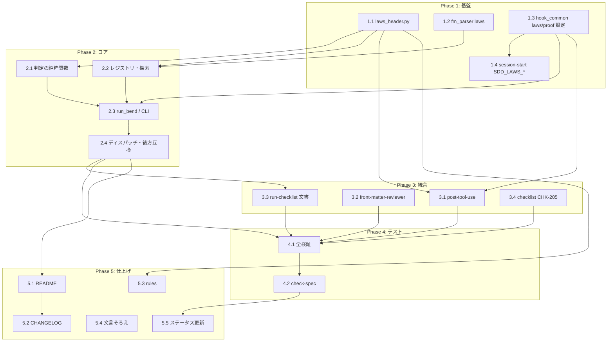

# Bend 証明ゲート（run-checklist の proof カテゴリ） タスク分解

設計の正典は [design-draft.md](design-draft.md)（§3 実装方式・§4.3 判定フロー・§5.5 擬似コード・§8 テスト戦略）。
各タスクは TDD（RED → GREEN → REFACTOR）で進め、完了条件の pytest がすべて通ることを完了とする。

## タスク一覧

### Phase 1: 基盤（共有モジュール・設定）

| #   | タスク                                   | 説明                                                                                                                                                       | 完了条件                                                                                                              | 依存  |
|:----|:--------------------------------------|:---------------------------------------------------------------------------------------------------------------------------------------------------------|:------------------------------------------------------------------------------------------------------------------|:----|
| 1.1 | `scripts/laws_header.py` 新規作成            | 先頭コメント規約（`# spec:` / `# approved:` / `# model-of:`）の解析、法則本文の内容ハッシュ（先頭コメント部除外・sha256 先頭 12 桁）、承認行の有効性（形式・暦日・ハッシュ一致）、`law` 宣言、`PROOF.bend` の LAWS import、import allowlist（`import Base` + ディレクトリ内に実在する `.bend` への相対 import） | `tests/test_laws_header.py` が緑（design §8 の laws_header 行を網羅）                                                      | -   |
| 1.2 | `fm_parser.LIST_KEYS` に `laws` を追加      | spec front matter の `laws:` をインライン / ブロック形式のリストとして解析する                                                                                                     | `tests/test_fm_parser.py` に `laws` のインライン・ブロック・単一スカラーのテストが追加され緑                                                     | -   |
| 1.3 | `hook_common.SddPaths` に `laws_dir` / `laws_prefix`、`load_proof_config()` | `.sdd-config.json` の `directories.laws`（既定 `laws`）と `proof.timeout_seconds`（既定 300、正の int 以外は既定）/ `proof.verdict`（既定 false）の読込                           | `tests/test_hook_common.py` に既定値・上書き・不正値のテストが追加され緑                                                              | -   |
| 1.4 | `session-start.py` の `SDD_LAWS_DIR` / `SDD_LAWS_PATH` エクスポート | `SddConfig.laws_dir` を追加し `write_env_vars` で 2 変数を書き出す。`init-structure.py` の既定 config には `laws` を**含めない**                                                     | `tests/test_session_start.py` と `tests/fixtures/*/expected_env.txt`（golden）が更新され `bash scripts/test-session-start.sh` が緑 | 1.3 |

### Phase 2: コア実装（`proof` カテゴリ）

| #   | タスク                                          | 説明                                                                                                                                                                   | 完了条件                                                                                                                  | 依存       |
|:----|:---------------------------------------------|:---------------------------------------------------------------------------------------------------------------------------------------------------------------------|:----------------------------------------------------------------------------------------------------------------------|:---------|
| 2.1 | 判定の純粋関数（`precheck` / `orphan_reason` / `needs_plain_fallback` / `judge_run` / `aggregate`） | spec 3.1.1 判定表 12 行を `subprocess` から切り離した純粋関数として `run-verification.py` に追加。集約順位 FAIL > TIMEOUT > TOOL_NOT_FOUND > SKIPPED > PASS、`verdict` の 3 値集約                       | `tests/test_run_verification_proof.py` の判定表テスト（全 12 行 + 集約 + verdict 3 値）が緑                                            | 1.1      |
| 2.2 | spec レジストリと法則ディレクトリ探索（`build_spec_registry` / `discover_laws_dirs`） | `doc_walker.iter_specification_docs` + `fm_parser` で id → (path, laws) を 1 回構築。`SDD_LAWS_PATH` 配下で `LAWS.bend` / `PROOF.bend` を直接含むディレクトリのみ列挙（中間ディレクトリを数えない）           | レジストリ（スカラー/リスト/不在、front matter なし無視、末尾 `/` 正規化）と探索（中間ディレクトリ除外・空集合）のテストが緑                                                 | 1.1, 1.2 |
| 2.3 | `run_bend` / `run_proof_dir` と `main_proof`（CLI）  | `BEND_NO_TELEMETRY=1` の常時付与、タイムアウト、起動失敗 → TOOL_NOT_FOUND、`--verdict` フォールバック、`--laws-dir`（複数）/ `--verdict` / `--timeout` / `--print-laws-hash`、CLI > 設定の優先順位、spec §4.1 の JSON 契約 | fake-bend fixture（`tests/fixtures/laws/fake-bend/bend`）で PASS / FAIL / 基盤不備フォールバック / TIMEOUT / `BEND_NO_TELEMETRY` 付与の subprocess テストが緑 | 2.1, 2.2, 1.3 |
| 2.4 | 既存 `main()` へのディスパッチと後方互換                     | `sys.argv[1] == "proof"` なら `main_proof(sys.argv[2:])`、それ以外は従来の単一位置引数経路。`VALID_CATEGORIES` に `proof` を追加（usage のみ）                                                 | 既存 4 カテゴリが位置引数のみで従来どおり動く回帰テスト、bend 不在環境での `proof` の JSON 形状テストが緑                                                       | 2.3      |

### Phase 3: 統合（フック・エージェント・スキル文書）

| #   | タスク                                            | 説明                                                                                                                                                                 | 完了条件                                                                                                    | 依存       |
|:----|:----------------------------------------------|:-------------------------------------------------------------------------------------------------------------------------------------------------------------------|:--------------------------------------------------------------------------------------------------------|:---------|
| 3.1 | `post-tool-use.py` の `.bend` / `# model-of:` リマインド | `${SDD_LAWS_PATH}` 配下の `.bend` 編集 → `# spec:` を示して proof 再実行（`LAWS.bend` なら再承認）を促す。ソース編集 → `laws/**/main.bend` の `# model-of:` が一致すれば見直しを促す（spec 同期の促しと両方注入しうる）。`SOURCE_EXTENSIONS` に `.bend` は追加しない | `tests/test_post_tool_use.py`（4 分岐）と `scripts/test-hook-scripts.sh` の追加ケースが緑。laws ディレクトリ無しで無出力                 | 1.1, 1.3 |
| 3.2 | `front-matter-reviewer.md` / `front_matter_reference.md` の拡張 | Spec 種別チェックに `laws:` / `laws-status:`（front-matter-validation_spec FR-009）、`--cross-ref` に実在・`# spec:` 一致・承認実態・孤児 laws 逆方向検査（Read/Glob/Grep のみ、ハッシュ計算なし）。reference に状態遷移を追記 | `bash scripts/plugin-lint.sh` 緑。両ファイルに `laws` / `laws-status` の定義・検査行がある                                       | -        |
| 3.3 | run-checklist SKILL.md / `verification_commands.md` / `templates/{en,ja}/result_format.md`, `report_format.md` | `proof` の呼び出し手順（`laws:` → `${SDD_ROOT}/` 前置 → `--laws-dir` を 1 回）、判定対応表、`--category proof` 別名、結果ブロック例・レポート節、PASS の意味の注記（en/ja 対）                                    | `plugin-lint.sh` / `plugin_lint.py` 緑。en/ja で同じ節構成                                                      | 2.4      |
| 3.4 | checklist SKILL.md / `templates/{en,ja}/checklist_template.md` の `CHK-205 [P2]` | 仕様レビューに固定項目「法則証明（proof ゲート）」を追加。`laws:` を持たない spec では生成しない旨を SKILL.md に記載                                                                                           | `plugin-lint.sh` 緑。en/ja 両テンプレートに `CHK-205 [P2]`                                                        | -        |

### Phase 4: テスト（回帰・Lint）

| #   | タスク                      | 説明                                                                                                                                    | 完了条件                                                                                                                                                     | 依存          |
|:----|:-------------------------|:--------------------------------------------------------------------------------------------------------------------------------------|:---------------------------------------------------------------------------------------------------------------------------------------------------------|:------------|
| 4.1 | 全検証コマンドの通し               | `python3 -m pytest tests/ -v` / `bash scripts/plugin-lint.sh` / `python3 .claude/skills/plugin-lint/scripts/plugin_lint.py` / `jq` / `bash scripts/test-skill-scripts.sh` / `bash scripts/test-e2e-sdd-init.sh` / `bash scripts/test-session-start.sh` / `bash scripts/test-hook-scripts.sh` / shellcheck | すべて exit 0                                                                                                                                              | 2.4, 3.1〜3.4 |
| 4.2 | `/check-spec` による整合確認    | proof-gate_spec と実装の整合（FR-001〜FR-009、3.1.1 判定表、§4.1 出力契約）                                                                                | 不整合なし、または不整合が本 tasks.md の未対応事項として記録される                                                                                                                 | 4.1         |

### Phase 5: 仕上げ（文書）

| #   | タスク                                         | 説明                                                                                                                                                                      | 完了条件                                            | 依存  |
|:----|:--------------------------------------------|:------------------------------------------------------------------------------------------------------------------------------------------------------------------------|:------------------------------------------------|:----|
| 5.1 | README.md / README.ja.md「Bend 証明ゲート（opt-in）」節 | PASS の意味、法則ディレクトリの作り方、承認行の書き方（`--print-laws-hash`）、モデル作成ガイド（design §7.1）、環境変数表に `SDD_LAWS_DIR` / `SDD_LAWS_PATH`、設定表に `directories.laws` / `proof.*`、プラグイン構成に `laws_header.py` | 両 README に節があり相対リンクが有効                           | 2.4 |
| 5.2 | CHANGELOG.md / CHANGELOG.ja.md `[Unreleased]`   | Added に proof カテゴリ・`laws:` / `laws-status:`・`CHK-205`・フックリマインド・`SDD_LAWS_*` を記載                                                                                           | 両 CHANGELOG に記載                                 | 5.1 |
| 5.3 | `.claude/rules/repository-structure.md`       | scripts 一覧に `laws_header.py`、`tests/fixtures/laws/` を追記                                                                                                                 | 記載あり                                            | 1.1 |
| 5.4 | 設計成果物の文言そろえ（PR #152 レビュー R-1 / R-2 / N-1） | R-1: spec 3.1.1 #4 の孤児条件に「`# spec:` 行が無い」を明記し PRD FR_002・用語集・front-matter-validation FR-009 (a) も追随 / R-2: FR-009 の「ID レジストリ」を FR-006 の走査で得る id → ファイル対応として定義 / N-1: spec #4 補足に「ゲートは spec 側を全走査、reviewer は laws 側を走査して照合」 | 4 文書が更新され `updated` が当日                          | -   |
| 5.5 | spec / design の実装ステータス更新                    | `proof-gate_spec.md` の `impl-status` を `implemented`、design-draft §1 の進捗表を 🟢 に更新（第 2 弾は ⏸️ のまま）                                                                        | front matter と §1 が実装と一致                        | 4.2 |

## 依存関係図

## 実装の注意事項

- `plugins/sdd-workflow/` 配下に `.bend` ファイルを置かない（`plugin-lint.sh` Check 2 の拡張子規則）。fixture は `tests/fixtures/laws/` に置く
- CI に本物の `bend` は入れない。subprocess 経路はダミー `bend` シェルスクリプトを PATH 先頭に置いて検証する
- `plugin.json` は変更しない（新規エージェント・スキルなし。CONSTITUTION T-002）
- run-checklist の `allowed-tools` は変更しない（既存の `run-verification.py *` パターンが `proof --laws-dir ...` を許す）
- 既存 4 カテゴリ（test / lint / typecheck / security）は位置引数 1 つで従来どおり動くこと（後方互換）
- `.sdd/AI-SDD-PRINCIPLES.md` / `.claude/rules/ai-sdd-instructions.md` / `AI-SDD-PRINCIPLES.source.md` は本タスクで触らない
- 判定 JSON・結果ブロック・SKILL.md・README のすべてに「PASS は参照モデルが法則を満たす保証であり実装の正しさではない」を載せる

## 参照ドキュメント

- PRD: `${SDD_REQUIREMENT_PATH}/task-implementation/proof-gate.md`
- 抽象仕様書: `${SDD_SPECIFICATION_PATH}/task-implementation/proof-gate_spec.md`
- 技術設計ドラフト: `${SDD_TASK_PATH}/149/design-draft.md`
- 関連 spec: `run-checklist_spec.md`, `checklist-generation_spec.md`, `quality-guardrails/front-matter-validation_spec.md`, `quality-guardrails/stale-doc-detection_spec.md`

## 要求カバレッジ

| 要求 ID（spec）              | 内容                                       | 対応タスク            |
|:-------------------------|:-----------------------------------------|:-----------------|
| FR-001                   | `proof` カテゴリ、複数ディレクトリの個別 + 集約判定           | 2.1, 2.3, 2.4    |
| FR-002 / 3.1.1           | 判定表 12 行の順序評価                             | 2.1, 2.3         |
| FR-003                   | `${SDD_LAWS_PATH}` の解決と固定ファイル名             | 1.3, 1.4, 2.2    |
| FR-004                   | 先頭コメント規約・内容ハッシュ・承認行・孤児 laws（#4）            | 1.1, 2.1, 2.2    |
| FR-005                   | `BEND_NO_TELEMETRY=1`・import allowlist     | 1.1, 2.3         |
| FR-006                   | `--verdict` とフォールバック（`verdict: unavailable`） | 2.1, 2.3         |
| FR-007                   | `CHK-205 [P2]`・PASS の意味・`--category proof` 別名 | 3.3, 3.4         |
| FR-008                   | `laws:` / `laws-status:` の定義と検証            | 1.2, 3.2         |
| FR-009                   | `.bend` 編集・`# model-of:` 編集後の促し            | 3.1              |
| FR-010                   | 第 2 弾の境界（spec に定義済み、実装は別チケット）              | 対象外（⏸️）          |
| NFR-001 / DC_001         | 任意依存（TOOL_NOT_FOUND / SKIPPED で素通り、CI に bend なし） | 2.1, 2.3, 4.1    |
| NFR-002                  | タイムアウト（既定 300 秒、設定 / CLI で変更）               | 1.3, 2.3         |
| NFR-003                  | オフライン再現性                                  | 1.1, 2.3         |
| NFR-004                  | 移植性（Windows 分岐なし）                          | 2.3              |
| NFR-005                  | en/ja テンプレート対称                             | 3.3, 3.4, 5.1    |
| NFR-006                  | 権限最小化（`allowed-tools` 不変）                  | 3.3              |
| NFR-007                  | 版の前提の明記                                   | 5.1              |
